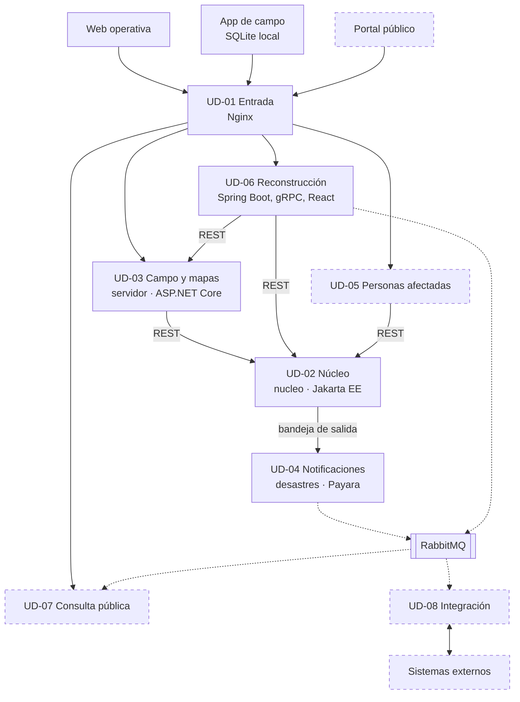

# Plataforma para la Gestión de Desastres y Reconstrucción

Proyecto del curso de Arquitectura de Software, Pontificia Universidad Javeriana (2026-30).

La plataforma permite que varios organismos coordinen la atención de un desastre y su reconstrucción: registran el desastre, evalúan los daños en campo aun sin conexión, solicitan recursos, avisan a los sistemas suscritos y llevan los proyectos de reconstrucción hasta su cierre.

Este repositorio contiene la documentación de arquitectura (SRS, SAD y ATAM) y la implementación de la parte ya construida.

## Documentación

| Documento | Qué contiene |
| --- | --- |
| [SRS](documentacion/SRS_v1.0_Plataforma_Gestion_Desastres.pdf) | Requisitos funcionales, escenarios de calidad, restricciones y análisis de una solución existente |
| [SAD](documentacion/SAD_v1.0_Plataforma_Gestion_Desastres.pdf) | Arquitectura: vistas, diseño de las seis capacidades, integración, seguridad, resiliencia y 22 decisiones |
| [ATAM](documentacion/ATAM_v1.0_Plataforma_Gestion_Desastres.pdf) | Evaluación de la arquitectura: análisis, riesgos, compromisos y plan de verificación |
| [Matriz de cobertura](documentacion/MATRIZ_COBERTURA_ENUNCIADO.pdf) | Dónde responde la arquitectura a cada exigencia del enunciado |

Las fuentes editables del SAD y del ATAM son `documentacion/SAD_fuente.md` y `documentacion/ATAM_fuente.md`. La versión vigente es la referencia CA-2026-11-12d; su manifiesto con huellas está en la misma carpeta.

Quien retome el proyecto debe leer primero [`CONTEXTO_PARA_CONTINUAR.md`](CONTEXTO_PARA_CONTINUAR.md).

## Arquitectura

Servicios de grano grueso: doce componentes lógicos en ocho unidades de despliegue, cada una con su base de datos. Las unidades se llaman entre sí por REST y usan colas solo para los avisos.



Línea continua: llamada directa. Línea punteada: aviso por cola. Las cajas con borde punteado están diseñadas en el SAD y todavía no tienen código.

Decisiones principales:

- **Sesión:** token de 8 horas validado contra el núcleo en cada solicitud. Tres roles por organismo: coordinador, evaluador y consulta.
- **Cambios confiables:** cada unidad guarda el cambio, su historial, su auditoría y su aviso en una sola transacción local.
- **Trabajo de campo:** la app captura sin conexión y sincroniza por lotes; un conflicto de versión se muestra y no se sobrescribe.
- **Ciclo del desastre:** Registro, Caracterización, Reconstrucción y Cierre, con el núcleo como dueño. Llegó con la integración de Reconstrucción y falta reflejarlo en el SAD.
- **Despliegue diseñado:** tres centros de datos, PostgreSQL con réplicas síncronas y RabbitMQ en tres nodos. El ambiente de este repositorio es Docker Compose en una máquina.

## Estado de la implementación

| Unidad | Carpeta | Estado |
| --- | --- | --- |
| UD-01 Entrada | `servidor/nginx.conf` | Funciona |
| UD-02 Núcleo: identidad, desastres, solicitudes de recursos, auditoría | `nucleo/` | Funciona |
| UD-03 Campo y mapas: evaluaciones, fotografías, mapas | `servidor/` | Funciona |
| UD-04 Notificaciones: colas por suscriptor y correo | `desastres/` | Funciona |
| App de campo Android | `campo/` | Funciona |
| UD-06 Reconstrucción | `reconstruccion/` | Funciona por separado. Su integración con la plataforma está escrita y **aún no se ha compilado ni probado** |
| UD-05 Personas afectadas, UD-07 Consulta pública, UD-08 Integración | — | Diseñadas en el SAD, sin código |

Lo que funciona se probó en un equipo local y con poca carga. La disponibilidad, la escalabilidad y los tiempos bajo carga están razonados en el SAD y el ATAM, y no están demostrados.

## Estructura del repositorio

```
documentacion/     SRS, SAD, ATAM, matriz de cobertura y manifiesto
nucleo/            Java 21, Jakarta EE (EJB, JPA, JTA), WildFly, PostgreSQL
servidor/          ASP.NET Core 10, PostgreSQL, web operativa, Nginx de entrada y Docker Compose
desastres/         Java 17, Payara, RabbitMQ y correo
campo/             .NET MAUI para Android, con SQLite
reconstruccion/    Spring Boot 3.3, gRPC, PostgreSQL y React
interop/           prueba del inicio de sesión por EJB remoto
evidencias/        registros y capturas de las pruebas
docs/              notas técnicas de operación
```

## Cómo ejecutarla

Requiere Docker Desktop y Python 3.

```sh
./iniciar.sh
```

| Qué | Dirección |
| --- | --- |
| Web operativa | http://127.0.0.1:18085 |
| Reconstrucción | http://127.0.0.1:18085/reconstruccion/ |
| Buzón de correo de prueba | http://127.0.0.1:18026 |
| API del núcleo (solo local) | http://127.0.0.1:18092 |

El usuario y la clave de laboratorio están en `.env.ejemplo`. Es un ambiente de demostración local, no un despliegue de producción.

Para detener sin perder datos: `docker compose -f servidor/compose.yaml stop`.

## Cómo verificarla

```sh
./verificar.sh                                        # API, mapas y sincronización de campo
python3 servidor/scripts/verificar_solicitudes.py     # solicitudes de recursos
python3 servidor/scripts/verificar_evolucion.py       # cambios de gravedad y versiones de evaluación
python3 servidor/scripts/verificar_reconstruccion.py  # Reconstrucción de punta a punta
```

Las pruebas crean datos sintéticos y algunas reinician servicios: no deben correrse durante una demostración. La de Reconstrucción todavía no se ha ejecutado.

El detalle de rutas, permisos, migración de datos de laboratorio y pruebas en Android está en [`docs/NOTAS_TECNICAS_DE_OPERACION.md`](docs/NOTAS_TECNICAS_DE_OPERACION.md). Cada carpeta de componente tiene además su propio README.

## Qué falta

1. Compilar y probar la integración de Reconstrucción.
2. Actualizar SRS, SAD y ATAM para reflejar Reconstrucción ya construida.
3. Mejorar los diagramas de contenedores y de despliegue del SAD.
4. Verificar el análisis de la solución existente contra sus fuentes.
5. Preparar las diapositivas de la sustentación.

El orden y el detalle de cada punto están en [`CONTEXTO_PARA_CONTINUAR.md`](CONTEXTO_PARA_CONTINUAR.md).

## Origen del código

Varios componentes nacieron como ejercicios del curso sobre partes de este mismo proyecto y después se unieron en una sola plataforma. Por eso algunos nombres internos, como paquetes y scripts, conservan referencias a esos ejercicios.
