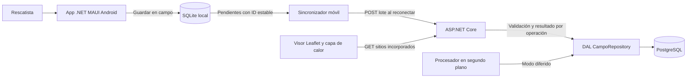

# Arqui Campo · Diseño de la entrega

El rescatista puede perder Internet justo al llegar a un sitio afectado. Guardar confirma primero en el teléfono. La sincronización se ejecuta aparte cuando el servidor vuelve a responder. La web muestra únicamente sitios incorporados. El enunciado establece latitud, longitud y nivel entero de afectación de 1 a 5. La foto y la descripción siguen disponibles como evidencia opcional. Se usa un identificador de desastre para consultar cada conjunto de sitios.

## Componentes y flujo

1. El móvil registra coordenadas del dispositivo o digitadas, nivel, desastre y fecha UTC. El guardado confirma una fila con identificadores UUID, estado local y foto opcional en la misma escritura SQLite. El registro aparece al volver a abrir la app.
2. Desde la pantalla principal se intenta sincronizar cada ocho segundos y con el botón **Sincronizar ahora**. Solo se intenta si hay registros elegibles. Un error de red deja los datos para reintentar. El móvil envía hasta 20 operaciones por lote. Cuando hay foto, se envía en su propia petición con un máximo de 5 MiB.
3. `POST /api/campo/lotes` devuelve un resultado por operación. Valida rangos de coordenadas, nivel, fecha, tamaño y hash de evidencia. PostgreSQL impone unicidad por operación y evaluación. Repetir el mismo contenido devuelve el estado durable del registro. Reutilizar una identidad con otro contenido genera conflicto y la captura permanece en el teléfono. La entrega maneja altas de sitios. Una captura del prototipo anterior queda disponible para asignar manualmente un nivel antes de enviarla.
4. `GET /api/campo/sitios?eventoId=DEMO-01` devuelve los puntos incorporados. La web actualiza mapa y tabla cada diez segundos. La capa dibuja una influencia radial por sitio y pondera cada punto por `nivel / 5`. La acumulación de sitios cercanos produce colores más cálidos. Los colores dependen de la escala de zoom y de los reportes, así que indican concentración observada. Si falla el mapa base, se conserva la tabla.

## Alternativas solicitadas por el profesor

| | A · Incorporación inmediata | B · Bandeja durable y lote en segundo plano |
|---|---|---|
| Acuse | HTTP 200 tras confirmar cada operación | HTTP 202 tras guardar las operaciones pendientes |
| Lectura | Aparece en la siguiente consulta | El trabajador incorpora hasta 100 pendientes por ciclo de dos segundos |
| Recuperación | Un reintento con los mismos UUID consulta el resultado persistido | Las pendientes sobreviven a reinicios. El trabajador incorpora con un solo cambio atómico y bloqueo por fila |
| Costo | Menor demora y menos estados durante la demo | Separación entre recepción y publicación con espera adicional |

Las dos opciones usan el mismo contrato y el mismo DAL. El móvil vuelve a enviar con los mismos UUID para recuperar el resultado final. Se entrega **A como configuración por defecto** por la confirmación inmediata y se puede activar B con `CAMPO_DIFERIDA=true`. La prueba funcional compara el comportamiento de ambas bajo el mismo lote mixto. Una decisión de producción requiere una comparación de carga representativa.

## Límites y trazabilidad

- RF-ED-12 se concreta en captura y persistencia Android. RF-ED-13 se concreta en reconciliación idempotente para altas. RF-ED-14 se concreta en consulta y mapa de calor. RF-ED-11, precarga autorizada, queda en el diseño de la plataforma general.
- El recorrido se configura para una demostración local con datos ficticios. El servicio del Taller 4 se publica en la interfaz local. La conexión HTTP del móvil se permite para loopback y el emulador. Para destinos remotos se exige HTTPS. La política de usuarios, roles y autorización del sistema completo corresponde a otra fase.
- Para esta entrega académica la foto viaja junto al registro, con hash y límite. El canal de carga de evidencias separado, las ediciones con versión base y la resolución de conflictos de ediciones pertenecen al diseño general.

## Verificación del servidor

En una ejecución local contra PostgreSQL 17, ambos modos pasaron la validación de lote mixto, los conflictos de identidad, la foto y su hash, el reenvío concurrente sin duplicados y el filtro por desastre. En ese lote de cinco operaciones, con dos altas válidas, el modo inmediato dio acuse en 25 ms y ambas altas quedaron visibles en 33 ms. El modo diferido dio acuse en 27 ms y ambas altas quedaron visibles en 1,32 s. El script consulta cada 250 ms y el trabajador se activa cada dos segundos. Son observaciones de una prueba funcional local.

El APK Release se compiló con 0 errores y 0 advertencias. La firma de prueba se verificó con apksigner y el paquete incluye ARM64 y x86-64. El 5 de noviembre de 2026 se instaló en una tablet Samsung Galaxy Tab S9 FE (SM-X510). En modo avión, con Wi‑Fi apagado y el túnel USB retirado, se guardó una evaluación de nivel 5 con foto. Tras forzar el cierre, el detalle conservó las coordenadas y la foto. Al restablecer el acceso por USB, la app mostró «Sincronizada · con foto» y la consulta del visor devolvió un único sitio para el evento de prueba.
