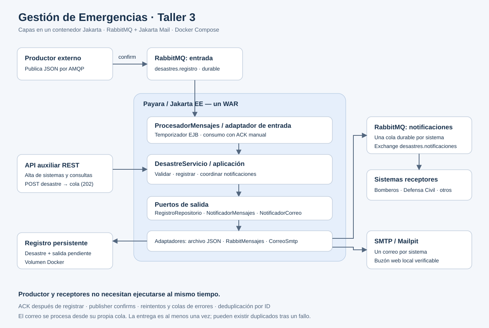
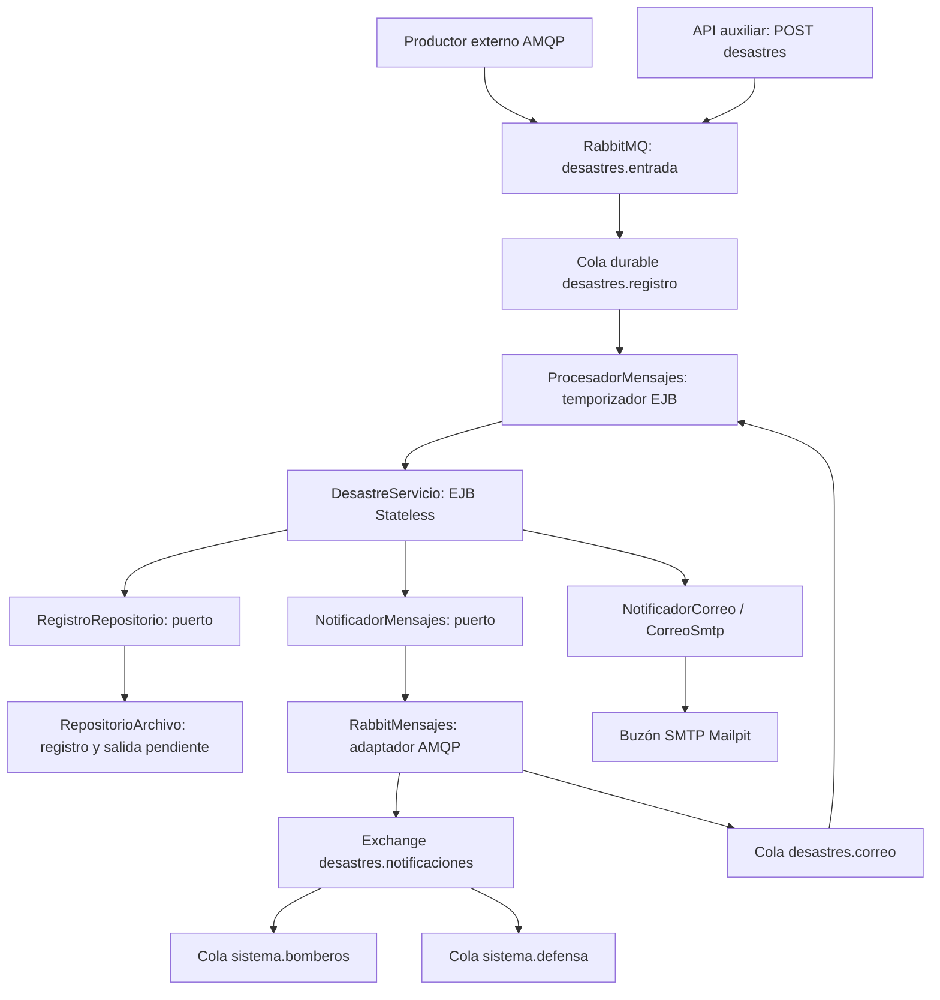

# Diseño de arquitectura — Taller 3

## Requisitos y decisiones

El tablero pide recibir de forma asincrónica información de un desastre, registrarla y notificar a los sistemas conectados o registrados mediante mensajería y correo o SMS. Los entregables son código y diseño de arquitectura.

Se conserva la arquitectura por capas del proyecto y el contenedor Jakarta que el tablero relaciona con tiers. Se seleccionan RabbitMQ y correo mediante Jakarta Mail (nombre actual de JavaMail). No se seleccionan Kafka ni SMS. Se emplea el cliente AMQP de RabbitMQ con un temporizador EJB; no se utiliza un MDB/JMS. Esta es la opción RabbitMQ, no una integración JMS adicional. Thomas confirmó que las tecnologías del tablero son opciones.

## Diagramas editables PlantUML

Las vistas de componentes, despliegue, secuencia y topología están en [docs/plantuml](plantuml/README.md), con sus fuentes `.puml` e imágenes `.svg`.

## Vista lógica

## Componentes y desacoplamiento

| Capa | Componentes | Responsabilidad |
|---|---|---|
| Dominio | Desastre, Sistema, Registro | Datos y validación de los contratos |
| Aplicación | DesastreServicio | Registro idempotente, registro de sistemas, despacho y envío a destinatarios |
| Puertos | RegistroRepositorio, NotificadorMensajes, NotificadorCorreo | Contratos de persistencia y notificación |
| Entrada | DesastreResource, ProcesadorMensajes | Recibir HTTP auxiliar y consumir mensajes |
| Salida | RabbitMensajes, CorreoSmtp, RepositorioArchivo | Adaptar AMQP, SMTP y almacenamiento |
| Contenedor | Payara | Ciclo de vida EJB, temporizadores, inyección y exclusión del escritor |

El servicio depende de interfaces; no conoce archivos, canales AMQP ni detalles SMTP. Los adaptadores encapsulan estas tecnologías. Se mantiene la organización de dominio, aplicación e infraestructura del proyecto anterior, reemplazando el caso de uso de solicitudes de recursos por el del tablero.

## Contratos de mensajería

| Elemento | Nombre / regla |
|---|---|
| Exchange de entrada | `desastres.entrada`, topic, durable |
| Routing key de entrada | `desastre.reportado` |
| Cola consumida por Jakarta | `desastres.registro`, durable |
| Exchange de notificaciones | `desastres.notificaciones`, topic, durable |
| Cola de cada sistema | `sistema.<id>`, durable, binding exacto del mismo nombre |
| Cola de correo | `desastres.correo`, durable |
| Reintentos | `<cola>.reintento`, TTL de 5 segundos, retorno a la cola original |
| Errores | `<cola>.errores` |
| Mensajes | JSON UTF-8; delivery_mode 2; message_id igual al ID del desastre |

El intercambio de salida usa una clave por sistema para respetar la lista de destinatarios tomada al registrar el evento. Cada sistema registrado recibe su copia; dos consumidores sobre la misma cola se reparten el trabajo. Un sistema nuevo comienza con eventos registrados después de su alta.

## Secuencia de procesamiento

1. El productor publica el JSON en el exchange de entrada y espera la confirmación del broker. Puede finalizar sin esperar al registro ni a los destinatarios.
2. RabbitMQ conserva el mensaje en la cola. El temporizador Jakarta consulta una entrega por segundo con ACK manual.
3. Se valida el contrato. El servicio registra una sola vez cada ID junto con su salida pendiente y una copia de los sistemas registrados en ese momento.
4. El archivo se escribe mediante reemplazo atómico antes de enviar el ACK de entrada. Si el proceso cae antes del ACK, el broker reentrega; el ID evita otro registro.
5. El despachador publica una notificación persistente por sistema y un mensaje de correo. Espera publisher confirms antes de marcar la salida como publicada.
6. Cada sistema procesa su cola de manera independiente y confirma con ACK. Puede conectarse después de haberse publicado el evento.
7. El consumidor de correo envía por Jakarta Mail a cada destinatario y registra su confirmación SMTP. Los correos confirmados no se repiten ante reentregas normales.
8. Un mensaje inválido se aísla; un fallo transitorio se reintenta. Al agotarse los intentos, queda en una cola de errores para revisión y reenvío manual.

No se espera a que todos los consumidores estén conectados. RabbitMQ elimina cada entrega de una cola cuando su consumidor la confirma. La confirmación del productor acredita recepción en el broker, no procesamiento por todos los sistemas.

## Registro persistente y consistencia

El almacenamiento es un archivo JSON en volumen Docker y tiene un solo escritor: un EJB Singleton con bloqueo de escritura predeterminado. Las lecturas devuelven copias para evitar modificaciones externas. Se fuerza el archivo temporal a disco y se reemplaza el archivo anterior de forma atómica. Un fallo de escritura no cambia el estado publicado en memoria.

Registro y salida pendiente se escriben juntos (patrón outbox sencillo). AMQP y archivo no forman una transacción distribuida: la estrategia prioriza reintentar antes que perder notificaciones. La garantía es al menos una vez. Un consumidor real debe deduplicar el ID. SMTP no permite garantizar exactamente un correo en la ventana entre envío y confirmación local.

## Vista de despliegue

Docker Compose crea tres contenedores permanentes en la misma red:

- Payara: WAR Jakarta con las capas del sistema; volumen `registro`.
- RabbitMQ: broker y consola; volumen `mensajes`.
- Mailpit: recepción SMTP y buzón web local; volumen `correos`.

El perfil opcional `demo` ejecuta el productor y los consumidores AMQP; no añade servicios de negocio. Todo el negocio está en un WAR Jakarta. No es una arquitectura de microservicios y no requiere Kubernetes.

## Atributos de calidad y costos

| Atributo | Mecanismo | Límite / costo |
|---|---|---|
| Desacoplamiento temporal | Colas durables por sistema | Requiere broker y espacio para mensajes pendientes |
| Recuperación | ACK manual, confirmaciones, reintentos, salida persistida | Puede haber duplicados |
| Modificabilidad | Puertos para persistencia, mensajes y correo | Más interfaces y adaptadores |
| Trazabilidad | ID común en JSON, message_id, registro y correo | No hay plataforma de monitoreo distribuido |
| Simplicidad | Un WAR, archivo JSON, Compose | Capacidad limitada; una sola instancia de negocio |

## Referencias técnicas

- [Cliente Java de RabbitMQ](https://www.rabbitmq.com/client-libraries/java-api-guide)
- [ACK de consumidores y confirmaciones de productores](https://www.rabbitmq.com/docs/confirms)
- [Topic exchanges](https://www.rabbitmq.com/tutorials/tutorial-five-java)
- [Mailpit en Docker](https://mailpit.axllent.org/docs/install/docker/)
