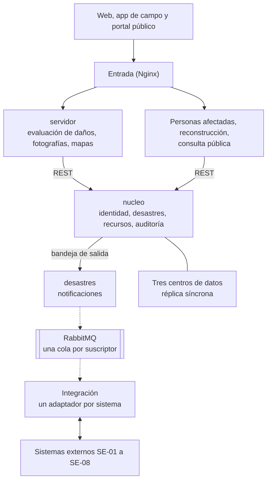

# ATAM v1.0 · Plataforma para la Gestión de Desastres y Reconstrucción

Evaluación de la arquitectura descrita en el SAD v1.0 frente a los atributos de calidad del SRS v1.0, con el método ATAM. Reemplaza la evaluación entregada el 19 de septiembre de 2026.

## 1. Método, alcance y participantes

La evaluación sigue los pasos del método ATAM (Architecture Tradeoff Analysis Method) y analiza los diez grupos de escenarios de mayor prioridad. Combina dos fuentes: el razonamiento con cálculos y presupuestos de tiempo sobre la arquitectura documentada, y las pruebas ya ejecutadas sobre el código de la segunda entrega. Cada análisis separa lo probado de lo que sigue siendo cálculo. No hay pruebas de carga ni simulacros de disponibilidad.

| Paso del método | Dónde se desarrolla |
| --- | --- |
| 1. Presentar el método | Esta sección |
| 2. Presentar los drivers de negocio | §2 |
| 3. Presentar la arquitectura | §3.1, con referencia al SAD |
| 4. Identificar los enfoques arquitectónicos | §3.2 |
| 5. Generar el árbol de utilidad | §4 |
| 6. Analizar los enfoques arquitectónicos | §5 |
| 7. Lluvia de ideas y priorización de escenarios | §4.2 |
| 8. Analizar de nuevo con los escenarios agregados | §5, análisis AN-08 a AN-10 |
| 9. Presentar resultados | §6, §7 y §8 |

| Rol | Quién | Responsabilidad |
| --- | --- | --- |
| Interesado principal | Profesor del curso, en representación de la organización gubernamental | Define los objetivos y valida las prioridades |
| Arquitectos | Los cuatro integrantes del equipo | Presentan la arquitectura y responden por las decisiones |
| Evaluadores | Los mismos integrantes, rotando por escenario: quien diseñó una decisión no evalúa el escenario que la pone a prueba | Cuestionan cada decisión y registran riesgos |

Entradas: SRS v1.0 (requisitos, 21 escenarios de calidad y cinco escenarios operacionales) y SAD v1.0 (vistas, estrategias y 22 decisiones) y los registros de prueba del código.

## 2. Drivers de negocio

Una organización gubernamental necesita coordinar a varios organismos durante un desastre, usando información que hoy está repartida en ocho tipos de sistemas independientes que no va a reemplazar.

| Objetivo de la organización | Qué significa para la arquitectura | Atributo |
| --- | --- | --- |
| Que la plataforma funcione justo cuando ocurre el desastre | Las funciones críticas disponibles el 99,95 % del mes y recuperables en 15 minutos | Disponibilidad |
| Atender el pico de consultas y reportes tras el evento | De 1.000 a 10.000 usuarios y 500 equipos de campo sin rediseñar | Escalabilidad |
| Que los organismos actúen a tiempo | Consultas en 2 s, registros en 3 s, alertas en 5 s | Rendimiento |
| No depender de que todos los sistemas externos estén arriba | Una falla externa o interna no se vuelve general | Resiliencia |
| Integrar sin reemplazar | Intercambio con sistemas de tecnologías distintas, y sumar otros después | Interoperabilidad, extensibilidad |
| Proteger a las personas afectadas | Acceso restringido por organismo y rol | Seguridad |
| Rendir cuentas por recursos y presupuestos | Quién hizo qué, cuándo, sobre qué y con qué resultado | Trazabilidad |
| Servir para desastres y organismos que hoy no se conocen | Nuevos tipos de desastre y organismos sin cambiar código | Modificabilidad |
| Confiar en lo que reportan los equipos de campo | Nada se pierde ni se sobrescribe al sincronizar | Confiabilidad |

Restricciones principales: no se reemplazan los sistemas existentes, los sistemas externos pueden fallar, las aplicaciones móviles trabajan parcialmente sin conexión y la implementación usa las tecnologías de los talleres del curso.

## 3. Arquitectura evaluada y enfoques arquitectónicos

### 3.1 Resumen de la arquitectura

Ocho unidades de despliegue de grano grueso, separadas por consistencia transaccional y por perfil de carga. Se llaman por REST cuando necesitan la respuesta y se avisan por colas cuando no, y se despliegan en tres centros de datos. Cuatro unidades y la app de campo ya están construidas. Los diagramas completos están en el SAD §3 (contenedores) y §6 (despliegue).

### 3.2 Enfoques arquitectónicos por atributo

| Atributo | Enfoque (táctica o patrón) | Decisión del SAD |
| --- | --- | --- |
| Disponibilidad | Redundancia activa en tres centros; réplica síncrona; conmutación automática; copia aislada | ADR-09, ADR-12 |
| Disponibilidad | Unidades críticas separadas de las degradables, con reserva de capacidad; el desastre se confirma antes de notificar | ADR-01, ADR-11 |
| Escalabilidad | Unidades sin estado que crecen por separado; copia pública en caché; límite de tasa en la entrada; incorporación diferida de lotes | ADR-01, ADR-03, ADR-14, ADR-18 |
| Rendimiento | Copias de lectura, caché, paginación; presupuesto de tiempo por tramo; fotografías después de los datos | ADR-03, ADR-13 |
| Resiliencia | Tiempo de espera, reintento con identificador único, bandeja de salida, colas de reintento y de errores, corte de circuito en los adaptadores; operaciones externas con confirmación explícita | ADR-02, ADR-07, ADR-15, ADR-16, ADR-21 |
| Interoperabilidad y extensibilidad | Adaptador por sistema con traductor a un modelo común; una cola por suscriptor; accesos REST, SOAP y EJB remoto | ADR-07, ADR-17 |
| Seguridad | Negar por defecto; sesión validada en el núcleo en cada solicitud; rol y organismo tomados de la sesión; ámbitos de organismo, evento y caso | ADR-10, ADR-19 |
| Trazabilidad | Auditoría e historial en la misma transacción del cambio, en cada unidad, con consulta consolidada; historia con dos fechas | ADR-06, ADR-20 |
| Modificabilidad | Configuración en lugar de código; capas con dependencias hacia el dominio | ADR-08 |
| Confiabilidad | Operaciones con identificador y versión base; conflictos explícitos; transacción local por unidad; consolidación reversible | ADR-01, ADR-04, ADR-05 |

## 4. Árbol de utilidad

Cinco escenarios tienen importancia alta y dificultad alta, y son los que más arriesgan la arquitectura. Cada hoja del árbol es un escenario del SRS calificado con (importancia para la organización, dificultad técnica): A alta, M media, B baja.

### 4.1 Árbol

| Atributo | Refinamiento | Escenario | (Importancia, dificultad) |
| --- | --- | --- | --- |
| Disponibilidad | Servicio continuo de lo crítico | QA-DIS-01: 99,95 % mensual en funciones críticas | (A, A) |
| Disponibilidad | Recuperación | QA-DIS-02: se pierde un centro de datos; lo crítico vuelve en 15 min con 0 pérdida | (A, A) |
| Disponibilidad | Datos de campo | QA-DIS-03: nada capturado sin conexión se pierde por una falla central | (M, M) |
| Escalabilidad | Usuarios | QA-ESC-01: de 1.000 a 10.000 en 10 min, creciendo solo lo saturado | (A, A) |
| Escalabilidad | Ingesta | QA-ESC-02: 500 equipos sin subir más de 10 % el tiempo de coordinación | (A, A) |
| Rendimiento | Consulta | QA-REN-01: estado del evento en menos de 2 s con 10.000 usuarios | (A, M) |
| Rendimiento | Registro | QA-REN-02: registro de un evento confirmado en menos de 3 s | (A, M) |
| Rendimiento | Alerta | QA-REN-03: alerta aceptada en menos de 5 s | (A, M) |
| Resiliencia | Falla externa | QA-RES-01: cae el sistema hospitalario; 0 funciones críticas afectadas; resincroniza en 5 min | (A, M) |
| Resiliencia | Falla interna | QA-RES-02: falla detectada en 10 s y aislada | (A, M) |
| Interoperabilidad | Intercambio | QA-INT-01: 100 % de mensajes válidos procesados e inválidos rechazados | (A, M) |
| Interoperabilidad | Cambio de contrato | QA-INT-02: 0 capacidades ajenas cambian | (M, M) |
| Extensibilidad | Nuevo sistema | QA-EXT-01: un adaptador nuevo, 0 cambios en lo existente, 5 días-persona | (M, M) |
| Seguridad | Confidencialidad | QA-SEG-01: 100 % de accesos no autorizados rechazados | (A, M) |
| Seguridad | Separación entre organismos | QA-SEG-02: 0 accesos fuera del ámbito | (A, M) |
| Trazabilidad | Operaciones críticas | QA-TRZ-01: quién, qué, cuándo, sobre qué y resultado en el 100 % | (A, B) |
| Trazabilidad | Evolución del evento | QA-TRZ-02: estado a las 10:00 y a las 14:00 | (M, M) |
| Modificabilidad | Tipo de desastre | QA-MOD-01: por configuración en 1 hora | (M, B) |
| Modificabilidad | Organismo | QA-MOD-02: alta por configuración en 1 hora | (M, B) |
| Confiabilidad | Reconciliación | QA-CNF-01: 0 sobrescrituras silenciosas | (A, A) |
| Confiabilidad | Consolidación | QA-CNF-02: 100 % con procedencia y reversibles | (M, M) |

### 4.2 Priorización y escenarios agregados

El análisis empezó por los escenarios (A, A) y (A, M) ligados a los cinco escenarios operacionales del enunciado, que dieron los análisis AN-01 a AN-07. En la segunda ronda se revisó qué atributos prioritarios del enunciado quedaban sin evaluar, y se agregaron seguridad, trazabilidad, modificabilidad y extensibilidad como AN-08 a AN-10.

| Análisis | Escenarios que cubre | Escenario operacional |
| --- | --- | --- |
| AN-01 | QA-DIS-01 | B |
| AN-02 | QA-DIS-02 | — |
| AN-03 | QA-ESC-01, QA-REN-01, QA-REN-02, QA-RES-02 | B |
| AN-04 | QA-ESC-02 | D |
| AN-05 | QA-REN-03 | A |
| AN-06 | QA-CNF-01, QA-CNF-02, QA-DIS-03 | D |
| AN-07 | QA-RES-01, QA-INT-01 | C |
| AN-08 | QA-SEG-01, QA-SEG-02 | — |
| AN-09 | QA-TRZ-01, QA-TRZ-02 | E |
| AN-10 | QA-EXT-01, QA-INT-02, QA-MOD-01, QA-MOD-02 | — |

Los 21 escenarios del SRS quedan cubiertos por algún análisis.

## 5. Análisis de los escenarios

De los diez análisis, uno queda verificado en el alcance probado, cuatro sustentados en diseño bajo condiciones y cinco parciales. AN-06 se reporta por escenario, porque la reconciliación está verificada y la consolidación de reportes no tiene código. Cada ficha razona cómo la arquitectura produce la respuesta, indica qué parte tiene evidencia en el código y registra puntos de sensibilidad (PS), trade-offs (TO), riesgos (R) y no-riesgos (NR), consolidados en §6.

Cada resultado usa uno de tres estados, para que una prueba no se lea como garantía general:

| Estado | Significado |
| --- | --- |
| Verificado en el alcance probado | Hay pruebas ejecutadas que lo muestran, en una máquina, con poca carga y datos sintéticos |
| Sustentado en diseño bajo condiciones | El razonamiento lo sostiene si se cumplen las condiciones indicadas; no hay prueba |
| Parcial o pendiente | Una parte está verificada y otra falta por construir o por medir |

La evidencia tiene dos orígenes. El primero son los registros del equipo en la carpeta `evidencias`, producidos por los scripts de `servidor/scripts`; incluyen la prueba instrumentada de la app Android, el inicio de sesión por EJB remoto, la caída y recuperación de RabbitMQ y la separación entre dos organismos. El segundo son 46 comprobaciones ejecutadas el 11 de noviembre de 2026 contra la API en ejecución, todas correctas. Todo se hizo con datos sintéticos en el ambiente de una sola máquina (SAD §6.4), que no aporta evidencia de disponibilidad ni de carga.

### AN-01 — Disponibilidad de las funciones críticas

| Campo | Contenido |
| --- | --- |
| Escenario | QA-DIS-01: las funciones críticas están disponibles el 99,95 % del mes (máximo 21,6 min de caída) |
| Prioridad | (A, A) |
| Decisiones evaluadas | ADR-12 tres centros con réplica síncrona; ADR-11 unidades críticas separadas de las degradables; ADR-10 sesión validada en el núcleo |
| Razonamiento | Con centros disponibles el 99,5 % e independientes, al menos dos de tres están arriba el 99,9925 % del tiempo. Como todas las unidades dependen de los mismos tres centros, eso equivale a unos 3 min de caída al mes por fallas de centro. Es un cálculo ilustrativo: no incluye fallas de software, de red, de operación ni el tiempo de cada conmutación, que deben caber en los 18 min restantes. Una falla en reconstrucción o en la consulta pública no cuenta, porque lo crítico no las llama. En cambio toda operación protegida depende del núcleo, que por eso corre con dos instancias en cada centro |
| Evidencia en el código | Los datos sobreviven al reinicio del núcleo y de `servidor`. La caída de notificaciones o de RabbitMQ no impide registrar desastres. No hay evidencia de disponibilidad: el ambiente tiene una instancia de cada unidad |
| Puntos de sensibilidad | PS-01: la disponibilidad depende de que los centros fallen de forma independiente. PS-11: toda operación protegida depende del tiempo de respuesta del núcleo |
| Trade-offs | TO-01: confirmar en otro centro da durabilidad y cuesta tiempo de registro. TO-02: reunir identidad, desastres y recursos en el núcleo da integridad y hace que fallen juntos |
| Riesgos | R-01: una dependencia común (energía, red) tumba dos centros a la vez. R-10: operar ocho unidades de dos plataformas en tres centros supera la capacidad del equipo de operación. R-13: el núcleo es una dependencia común de todas las unidades. R-15: mientras el registro de notificaciones sea un archivo, solo una instancia puede estar activa. R-18: la promoción del primario no está implementada |
| No-riesgos | Ninguno: la pérdida de un centro queda como riesgo (R-18) mientras la conmutación no esté implementada |
| Resultado | Sustentado en diseño bajo condiciones: independencia entre centros, redundancia del núcleo y mecanismos de conmutación, que están diseñados y sin implementar. Sin verificación |

### AN-02 — Recuperación tras perder un centro de datos

| Campo | Contenido |
| --- | --- |
| Escenario | QA-DIS-02: se pierde un centro de datos; funciones críticas en 15 min y 0 operaciones confirmadas perdidas |
| Prioridad | (A, A) |
| Decisiones evaluadas | ADR-09 recuperación automática; ADR-12 réplica síncrona; ADR-16 monitoreo |
| Razonamiento | Todo cambio confirmado está en el primario y en una réplica de otro centro, así que al perder uno siempre queda una copia. No se pierde nada si se promueve la réplica más adelantada, que es la que tiene lo último confirmado. La conmutación suma 30 s de detección, 30 s de retiro del tráfico, 1 min para que una réplica asuma como primario, 2 min de crecimiento y 1 min de margen: 5 min, un tercio de la meta. Las solicitudes en curso se reintentan con el mismo identificador y no se duplican. Como la sesión vive en la base del núcleo, los usuarios no tienen que volver a iniciar sesión. La promoción de la réplica y el bloqueo del primario anterior están diseñados (SAD §10.4) y sin implementar |
| Evidencia en el código | Repetir una operación con el mismo identificador no duplica. Sin evidencia de conmutación |
| Puntos de sensibilidad | PS-01. PS-03: el tiempo de conmutación depende de cuánto tardan en arrancar las instancias nuevas |
| Trade-offs | TO-07: con un solo centro vivo, seguir aceptando operaciones protege la respuesta y reduce la durabilidad |
| Riesgos | R-11: si se pierden dos centros puede perderse lo confirmado solo en ellos, y la recuperación exige decisión humana (15 min) |
| No-riesgos | Ninguno, por la misma razón que en AN-01 |
| Resultado | Sustentado en diseño bajo condiciones para la pérdida de un centro: depende de implementar la promoción y el bloqueo del primario (R-18). La pérdida de dos centros queda como riesgo aceptado |

### AN-03 — Aumento repentino de usuarios

| Campo | Contenido |
| --- | --- |
| Escenario | QA-ESC-01, QA-REN-01, QA-REN-02, QA-RES-02: de 1.000 a 10.000 usuarios en 10 min; consulta en menos de 2 s; registro de un evento en menos de 3 s; solo crece lo saturado |
| Prioridad | (A, A) |
| Decisiones evaluadas | ADR-01 unidades separadas; ADR-03 copia pública; ADR-14 límite de tasa en la entrada; ADR-16 monitoreo |
| Razonamiento | De los 10.000, unos 8.000 son ciudadanos: 267 consultas por segundo que atiende la consulta pública, casi todas desde caché de 30 s. Ninguna llega al núcleo. Los 2.000 funcionarios generan 200 operaciones por segundo sobre `servidor` y unas 273 sobre el núcleo. Con el supuesto de 100 operaciones por segundo por instancia, el despliegue mínimo de seis instancias queda al 35 % y al 46 % en el pico, y al 53 % y al 68 % con un centro perdido (SAD §11.3). Cada operación suma una validación de sesión, una lectura por clave que se atiende en el primario. La consulta pública, con cuatro instancias, queda al 13 %; crece solo si los ciudadanos pasan de 10.000. El presupuesto de la consulta es 0,5 s de red, 0,1 s de entrada, 0,2 s de validación de sesión, 0,5 s de `servidor`, 0,4 s de respuesta y 0,3 s de margen. El registro de un desastre gasta 0,5 s de red, 0,1 s de entrada, 0,2 s de validación de sesión, 0,9 s para guardar con réplica, 0,4 s de respuesta y deja 0,9 s de margen |
| Evidencia en el código | Con poca carga y el cliente en la misma máquina, las consultas respondieron entre 5 y 30 ms y el registro de un desastre en 22 ms. Esas cifras no incluyen red real ni réplica en otro centro. Ninguna prueba de carga. La consulta pública no está construida |
| Puntos de sensibilidad | PS-03: el uso en el pico depende de la capacidad real de cada instancia, que es un supuesto. PS-04: la carga sobre la consulta pública depende de la vigencia de la caché. PS-11 |
| Trade-offs | TO-03: la caché y la copia pública dan capacidad y cuestan frescura (hasta 30 s). TO-04: validar la sesión en cada solicitud da seguridad y cuesta 0,2 s de cada operación |
| Riesgos | R-03: la capacidad real por instancia es menor que la supuesta y el despliegue mínimo no alcanza. R-13 |
| No-riesgos | NR-02: la carga ciudadana no alcanza las bases críticas |
| Resultado | Sustentado en diseño bajo condiciones: una prueba de carga debe confirmar el tiempo de crecimiento y el costo de validar sesiones, y la consulta pública debe construirse |

### AN-04 — Ingesta masiva desde campo

| Campo | Contenido |
| --- | --- |
| Escenario | QA-ESC-02: 500 equipos, un reporte por minuto con su fotografía; la plataforma los recibe todos; cada evaluación se confirma completa dentro de la meta provisional de 10 minutos; coordinación no sube más de 10 % |
| Prioridad | (A, A) |
| Decisiones evaluadas | ADR-01 evaluación separada del registro de desastres; ADR-13 la fotografía viaja con su evaluación; ADR-18 incorporación inmediata o diferida; ADR-12 réplica síncrona |
| Razonamiento | Se evalúa en tres partes. Capacidad de recepción: los registros son 8 por segundo, carga baja para una unidad con seis instancias; si se supera, el modo diferido recibe y aplica después. Transferencia de fotografías: cada evaluación con foto viaja completa; con 1 MB en promedio son 8 MB por segundo sobre `servidor`, y el tiempo de cada una depende de su tamaño y de la conexión (unos 8 s para 1 MB a 1 Mbps, unos 40 s para 5 MB); si la transferencia falla se reenvía todo el paquete. Efecto sobre la coordinación: la evaluación y el registro de desastres no comparten proceso ni base; lo común es la entrada y la validación de sesión en el núcleo |
| Evidencia en el código | Capacidad: los lotes se incorporan en modo inmediato y en modo diferido; sin prueba con 500 equipos. Transferencia: la única medición (12 ms) usó una imagen de un píxel con el cliente en la misma máquina, así que no dice nada del rendimiento móvil. Coordinación: sin medición |
| Puntos de sensibilidad | PS-02: el tiempo de confirmación depende de la latencia entre centros. PS-12: la capacidad de ingesta y el tiempo de transferencia dependen del tamaño de la fotografía y de la conexión |
| Trade-offs | TO-01. TO-09: enviar la foto con la evaluación da integridad y hace que las fotos compitan con el registro. TO-11 |
| Riesgos | R-02: si la latencia entre centros supera lo supuesto, la confirmación se alarga. R-12: con fotos cercanas al máximo de 5 MB la carga se multiplica por cinco. R-19: una evaluación con fotografía no se confirma hasta que sube la foto |
| No-riesgos | NR-04: no existe una evaluación sincronizada sin su fotografía |
| Resultado | Parcial, pendiente de pruebas representativas. Capacidad de recepción: sustentada en diseño. Transferencia de fotografías: sin medición válida. Efecto sobre la coordinación: sustentado en diseño |

### AN-05 — Alerta crítica

| Campo | Contenido |
| --- | --- |
| Escenario | QA-REN-03: al menos el 95 % de las alertas aceptadas por los canales de notificación en menos de 5 s, con hasta 10 alertas críticas simultáneas (carga de diseño). El tiempo va desde que la plataforma recibe el estímulo hasta que el aviso queda publicado en la cola de cada suscriptor y el servidor de correo lo acepta |
| Prioridad | (A, M) |
| Decisiones evaluadas | ADR-02 bandeja de salida y colas; ADR-15 dos canales; ADR-11 el desastre se confirma antes de notificar |
| Razonamiento | El camino tiene cuatro tramos: guardar el evento y su aviso con réplica 0,8 s, espera en la bandeja de salida hasta 1,0 s, entrega a notificaciones y publicación 0,4 s, y consumo con entrega a cada cola y envío del correo 1,5 s. Suman 3,7 s y dejan 1,3 s de margen. La alerta no espera al GIS. Cada suscriptor tiene su cola: uno lento o caído no retrasa a los demás. Si RabbitMQ o notificaciones fallan, el aviso sigue en la bandeja de salida y se entrega al volver |
| Evidencia en el código | Al registrar un desastre y al cambiar su nivel, el aviso quedó publicado y el correo confirmado en 2,7 s y 3,2 s, con poca carga y el ciclo anterior de 5 s. Según los registros del equipo, con RabbitMQ detenido el desastre se registra y los avisos se entregan al volver. Los reintentos no duplican. Sin prueba bajo ráfagas |
| Puntos de sensibilidad | PS-05: el tiempo de alerta depende del ciclo de la bandeja de salida y del ciclo del consumidor |
| Trade-offs | TO-08: entregar por bandeja de salida garantiza que ningún aviso se pierde y agrega hasta un ciclo de espera |
| Riesgos | R-05: la cola de un sistema y el correo fallan a la vez porque el desastre afectó la misma red. R-16: el publicador trabaja en serie y el consumidor toma un mensaje por segundo, así que con 10 alertas simultáneas la última tarda más de 10 s |
| No-riesgos | NR-10: un aviso no se pierde aunque RabbitMQ o notificaciones caigan |
| Resultado | Parcial: verificado con avisos aislados. Con la carga de diseño de 10 alertas simultáneas el código actual no cumple (R-16); el diseño exige consumo continuo de las colas (SAD §8.6) y ese cambio está pendiente. La meta de 5 s se mantiene |

### AN-06 — Trabajo sin conexión y reconciliación

| Campo | Contenido |
| --- | --- |
| Escenario | QA-CNF-01, QA-CNF-02, QA-DIS-03: 0 sobrescrituras silenciosas; consolidación con procedencia; nada capturado se pierde |
| Prioridad | (A, A) |
| Decisiones evaluadas | ADR-04 operaciones sobre versión base; ADR-05 consolidación gobernada; ADR-13 el dispositivo conserva hasta confirmar |
| Razonamiento | Cada operación llega con su identificador y la versión sobre la que se hizo. Si la versión vigente coincide, se aplica; si no, el servidor responde conflicto y no cambia nada. No existe un camino en que el servidor aplique un cambio sobre una versión distinta, así que la sobrescritura silenciosa es imposible por construcción. Reenviar un lote no duplica, por el identificador. El dispositivo conserva la captura hasta recibir confirmación, de modo que una falla central no pierde capturas. Ante un conflicto, el evaluador ve su propuesta y el dato del servidor y elige |
| Evidencia en el código | Reintentos concurrentes sin duplicados; una versión base obsoleta devuelve 409 sin sobrescribir. Según los registros del equipo, en la prueba instrumentada de la app el conflicto se resuelve sin forzar y la captura persiste tras un cierre forzado sin conexión. La consolidación de reportes no está construida |
| Puntos de sensibilidad | PS-06: el número de conflictos depende de cuánto tiempo trabajan los equipos sin conexión y de cuánto se solapan sus zonas |
| Trade-offs | TO-06: no fusionar en automático protege la integridad y carga a las personas que resuelven. TO-05: capturar sin conexión con una sesión de 8 horas da continuidad y expone más el dispositivo |
| Riesgos | R-04: en una emergencia grande los conflictos y los candidatos a consolidar superan la capacidad de quienes los resuelven |
| No-riesgos | NR-06: un conflicto nunca se sobrescribe. NR-09: un reintento no duplica |
| Resultado | QA-CNF-01 y QA-DIS-03: verificado en el alcance probado. QA-CNF-02: pendiente. La consolidación está diseñada con alias entre eventos, sin mover los registros de su unidad y con reglas que impiden ciclos y cadenas (SAD §3.6, ADR-05), y no tiene código |

### AN-07 — Falla de un sistema externo

| Campo | Contenido |
| --- | --- |
| Escenario | QA-RES-01, QA-INT-01: cae el sistema hospitalario; 0 funciones críticas afectadas; pendientes sincronizados en 5 min al volver |
| Prioridad | (A, M) |
| Decisiones evaluadas | ADR-07 adaptador por sistema con protección; ADR-02 colas para avisar; ADR-21 operaciones externas con confirmación explícita |
| Razonamiento | El adaptador hospitalario corre en la unidad de integración, con sus propias conexiones. Tras tres fallas deja de llamar: a lo sumo 15 s de espera acumulada, que solo afectan a ese adaptador. Ninguna unidad crítica llama al sistema hospitalario; personas afectadas recibe sus datos por su cola y los marca como desactualizados. Lo saliente se guarda en la cola del adaptador. Una sonda cada 30 s detecta el regreso; el envío de pendientes en orden y la consulta de lo ocurrido completan la resincronización. Una remisión o una asignación enviada a un sistema externo queda Por confirmar y termina en Aceptada o Rechazada solo por respuesta del sistema externo. Si no responde en el plazo queda En conciliación: no se libera ni se revierte nada, porque el sistema pudo haberla aplicado, y el adaptador consulta el resultado por el identificador. Lo apartado se libera solo con un resultado definitivo: rechazo, cancelación confirmada o garantía del sistema externo de que ya no la ejecutará; una respuesta de "no encontrada" no lo es |
| Evidencia en el código | El mecanismo de cola por suscriptor, cola de reintento y cola de errores funciona para los sistemas suscritos. Los adaptadores a SE-02 a SE-07 no están construidos |
| Puntos de sensibilidad | PS-07: la contención depende del umbral del corte de circuito; muy alto demora la detección, muy bajo corta por fallas pasajeras |
| Trade-offs | TO-02 |
| Riesgos | R-06: tras una caída de horas, el volumen pendiente puede hacer que la resincronización tarde más de 5 min. R-20: una operación En conciliación mantiene apartada una cantidad o un presupuesto mientras el sistema externo no dé un resultado definitivo |
| No-riesgos | NR-03: la falla de un sistema externo no detiene funciones críticas |
| Resultado | Sustentado en diseño bajo condiciones: los adaptadores no están construidos y las caídas largas dependen del volumen acumulado (R-06). Verificado solo el mecanismo de colas con reintento |

### AN-08 — Acceso no autorizado y separación entre organismos

| Campo | Contenido |
| --- | --- |
| Escenario | QA-SEG-01, QA-SEG-02: 100 % de accesos no autorizados rechazados; 0 accesos fuera del ámbito del organismo |
| Prioridad | (A, M) |
| Decisiones evaluadas | ADR-10 sesión validada en el núcleo; ADR-14 entrada única; ADR-03 datos por unidad; ADR-19 ámbitos de organismo, evento y caso |
| Razonamiento | Toda solicitud entra por Nginx y la unidad que la recibe valida el token contra el núcleo. De esa respuesta salen el usuario, el rol y el organismo: lo que el cliente diga de sí mismo se ignora. Consultas y escrituras se filtran por ese organismo. Una sesión cerrada o revocada deja de servir en la siguiente solicitud. Los datos personales viven en una sola unidad y sus avisos no llevan datos personales. El acceso tiene tres ámbitos: lo propio del organismo, lo del evento para los organismos con participación vigente, y los datos de una persona solo para el organismo que la registró o que la atiende |
| Evidencia en el código | Tres roles; organismo y evaluador tomados de la sesión aunque el cliente envíe otros; fotografías protegidas; un token cerrado deja de servir en la siguiente solicitud. Según los registros del equipo, también el aislamiento entre dos organismos y la revocación por SOAP y EJB remoto. El código aplica hoy solo el ámbito de organismo; los ámbitos de evento y de caso no están construidos |
| Puntos de sensibilidad | PS-08: la exposición ante un token o un dispositivo comprometido depende de la vigencia de la sesión (8 horas) |
| Trade-offs | TO-04: validar la sesión en el núcleo da revocación inmediata y hace del núcleo una dependencia de cada operación; para que su caída no detenga mapas ni capturas, `servidor` acepta por 15 minutos la última validación, y en ese lapso una revocación reciente no surte efecto en esas consultas. TO-13: compartir por participación en el evento mejora la coordinación y amplía quién ve la información |
| Riesgos | R-07: un dispositivo robado con sesión vigente permite ver lo descargado hasta que se revoca o vence. R-21: un organismo asociado por error a un evento ve su información hasta que se retira |
| No-riesgos | NR-08: una sesión revocada no sigue operando |
| Resultado | Parcial: verificado en el alcance probado para sesión, roles y separación por organismo; los ámbitos de evento y de caso y la protección de datos personales están diseñados y sin código |

### AN-09 — Trazabilidad

| Campo | Contenido |
| --- | --- |
| Escenario | QA-TRZ-01, QA-TRZ-02: quién, qué, cuándo, sobre qué y resultado en el 100 % de operaciones críticas; estado del evento a las 10:00 y a las 14:00 |
| Prioridad | (A, B) y (M, M) |
| Decisiones evaluadas | ADR-20 auditoría local por unidad con consulta consolidada; ADR-01 transacción local por unidad; ADR-06 historia con dos fechas |
| Razonamiento | Cada cambio se guarda en una transacción con su historial, su auditoría y su aviso pendiente, por lo que no puede existir un cambio sin su registro. El historial no se modifica ni se borra. Para la evolución, cada versión de la delimitación guarda desde cuándo aplica y cuándo se registró: la consulta de lo vigente a las 10:00 devuelve 3 barrios y a las 14:00 devuelve 7, y un segundo instante opcional limita la respuesta a lo que ya se sabía entonces. Como cada unidad tiene su base, la auditoría se guarda en la unidad dueña del dato y una copia viaja a la consulta consolidada, que puede ir segundos atrás |
| Evidencia en el código | El cambio de nivel guarda historial, versión y aviso en una transacción. Solicitudes y evaluaciones tienen historial con autor y motivo. Solo se auditan la creación de desastres y las solicitudes; nada impide todavía modificar esas tablas. Falta la delimitación con dos fechas |
| Puntos de sensibilidad | PS-09: el tiempo de la consulta histórica depende del número de versiones acumuladas |
| Trade-offs | TO-12: guardar la auditoría en cada unidad garantiza que existe con el cambio y hace que la consulta consolidada vaya unos segundos atrás. La historia completa da reconstrucción fiel y encarece las consultas |
| Riesgos | R-08: en un evento de meses, la historia acumulada lleva la consulta por encima de 2 s |
| No-riesgos | NR-07: en el cambio de nivel no existe un cambio sin su registro |
| Resultado | Parcial: verificado el historial en nivel, solicitudes y evaluaciones; pendientes la auditoría de todas las operaciones, la protección del registro contra modificación y la historia con dos fechas |

### AN-10 — Cambio y extensión

| Campo | Contenido |
| --- | --- |
| Escenario | QA-EXT-01, QA-INT-02, QA-MOD-01, QA-MOD-02: nuevo sistema externo con un adaptador; cambio de contrato localizado; nuevo tipo de desastre y nuevo organismo por configuración |
| Prioridad | (M, M) y (M, B) |
| Decisiones evaluadas | ADR-07 adaptadores; ADR-08 configuración; ADR-17 tecnologías; capas del SAD §4 |
| Razonamiento | Un sistema que solo necesita recibir avisos se suscribe y obtiene su propia cola, sin código nuevo. Uno que intercambia datos se integra con un adaptador de conector, traductor y validador, que se despliega solo; las unidades solo conocen el modelo común. Un cambio de contrato toca el traductor de ese adaptador. Tipos de desastre y organismos son datos de catálogo |
| Evidencia en el código | Un sistema se suscribe por la API y empieza a recibir avisos. El inicio de sesión funciona por REST y el servicio SOAP responde; según los registros del equipo, también por EJB remoto con las mismas cuentas. Los catálogos de tipos y activos todavía son fijos |
| Puntos de sensibilidad | PS-10: el esfuerzo de integrar depende de que el modelo común ya tenga los conceptos del sistema nuevo |
| Trade-offs | El modelo común da independencia y cuesta mantenerlo. TO-10: usar la plataforma que mejor se ajusta a cada unidad cuesta operar dos |
| Riesgos | R-09: un sistema nuevo trae conceptos que el modelo común no tiene y obliga a cambiar unidades. R-14: mientras los catálogos sean fijos, un tipo de desastre nuevo exige cambiar código |
| No-riesgos | NR-05: un suscriptor nuevo no requiere código |
| Resultado | Parcial: verificados la suscripción y los accesos; pendientes los catálogos configurables (R-14) y los adaptadores |

## 6. Consolidado

Los análisis produjeron 12 puntos de sensibilidad, 13 trade-offs, 21 riesgos y 9 no-riesgos.

### 6.1 Puntos de sensibilidad

Un punto de sensibilidad es un parámetro de una decisión del que depende de forma marcada la medida de un atributo.

| ID | La medida de | Es sensible a | Decisión | Análisis |
| --- | --- | --- | --- | --- |
| PS-01 | Disponibilidad de lo crítico | La independencia real de fallas entre los tres centros | ADR-12 | AN-01, AN-02 |
| PS-02 | Tiempo de registro | La latencia de confirmación en la réplica de otro centro (supuesta en 0,8 s) | ADR-12 | AN-04 |
| PS-03 | Uso en el pico, tiempo de crecimiento y de conmutación | La capacidad real de cada instancia (supuesta en 100 operaciones por segundo) y su tiempo de arranque | ADR-16 | AN-02, AN-03 |
| PS-04 | Carga sobre la consulta pública | La vigencia de la caché (30 s) | ADR-03 | AN-03 |
| PS-05 | Tiempo de alerta | El ciclo de la bandeja de salida (1 s) y el del consumidor (1 s) | ADR-02 | AN-05 |
| PS-06 | Número de conflictos por resolver | El tiempo sin conexión y el solapamiento de zonas entre equipos | ADR-04 | AN-06 |
| PS-07 | Contención de una falla externa | El umbral del corte de circuito | ADR-07 | AN-07 |
| PS-08 | Exposición ante un token o dispositivo comprometido | La vigencia de la sesión (8 horas) | ADR-10 | AN-08 |
| PS-09 | Tiempo de la consulta histórica | El número de versiones acumuladas del evento | ADR-06 | AN-09 |
| PS-10 | Esfuerzo de integrar un sistema nuevo | La cobertura del modelo común | ADR-07 | AN-10 |
| PS-11 | Tiempo y disponibilidad de toda operación protegida | El tiempo de respuesta del núcleo al validar la sesión y el tiempo de espera de 5 s | ADR-10 | AN-01, AN-03 |
| PS-12 | Capacidad de ingesta de campo | El tamaño promedio de la fotografía | ADR-13 | AN-04 |

### 6.2 Trade-offs

Un trade-off es una decisión que mejora un atributo y empeora otro.

| ID | Decisión | Mejora | Empeora | Análisis |
| --- | --- | --- | --- | --- |
| TO-01 | Confirmar cada cambio crítico en una réplica de otro centro | Disponibilidad y durabilidad | Rendimiento del registro (0,8 de 3 s) | AN-01, AN-04 |
| TO-02 | Reunir identidad, desastres, recursos y auditoría en el núcleo | Integridad de los cambios y simplicidad de operación | Escalabilidad por partes y contención de fallas | AN-01, AN-07 |
| TO-03 | Copia pública derivada con caché | Escalabilidad y protección de lo crítico | Frescura de la información pública (hasta 30 s) | AN-03 |
| TO-04 | Validar la sesión en el núcleo en cada solicitud, con modo degradado en `servidor` si el núcleo cae | Seguridad: revocación inmediata y organismo no falsificable mientras el núcleo responde. Disponibilidad de mapas y capturas durante su caída | Rendimiento (0,2 s por operación). Seguridad durante la caída: hasta 15 minutos de lectura con una autorización sin volver a comprobar | AN-03, AN-08 |
| TO-05 | Captura sin conexión con sesión de 8 horas | Continuidad del trabajo de campo | Seguridad del dispositivo | AN-06 |
| TO-06 | No fusionar conflictos ni reportes dudosos en automático | Confiabilidad de la información | Carga de trabajo de quienes resuelven | AN-06 |
| TO-07 | Seguir aceptando operaciones con un solo centro vivo | Disponibilidad durante la falla | Durabilidad de lo confirmado en ese lapso | AN-02 |
| TO-08 | Entregar los avisos por bandeja de salida | Confiabilidad: ningún aviso se pierde | Rendimiento de la alerta (hasta un ciclo de espera) | AN-05 |
| TO-09 | Enviar la fotografía con su evaluación | Integridad: llegan o fallan juntas | Escalabilidad de la ingesta | AN-04 |
| TO-10 | Una plataforma por unidad: Jakarta EE y .NET | Ajuste a cada necesidad e interoperabilidad demostrada | Simplicidad de operación | AN-10 |
| TO-11 | Incorporar los lotes de inmediato por defecto | Certeza del evaluador sobre el resultado | Capacidad ante picos de carga de campo | AN-04 |
| TO-12 | Auditoría en cada unidad con consulta consolidada | Trazabilidad: no existe un cambio sin su registro | La consulta consolidada va segundos atrás | AN-09 |
| TO-13 | Compartir por participación en el evento | Coordinación entre organismos | Seguridad: más organismos ven la información del evento | AN-08 |

### 6.3 Riesgos

| ID | Riesgo | Consecuencia | Acción propuesta | Análisis |
| --- | --- | --- | --- | --- |
| R-01 | Los centros comparten energía o red | Caen dos a la vez y se pierde el 99,95 % | Inventario de dependencias compartidas antes de elegir infraestructura | AN-01 |
| R-02 | La latencia entre centros es mayor a la supuesta | El registro de un evento supera los 3 s y la confirmación de evaluaciones se alarga | Medir la latencia real; fijar distancia máxima entre centros | AN-03, AN-04 |
| R-03 | La capacidad real por instancia es menor que la supuesta, o las instancias nuevas tardan más de 5 min | El despliegue mínimo no alcanza en el pico | Prueba de carga de 1.000 a 10.000 en 10 min para reemplazar el supuesto | AN-03 |
| R-04 | Los conflictos y candidatos superan a quienes los resuelven | Información fragmentada durante la emergencia | Priorizar por severidad; dimensionar por número de equipos | AN-06 |
| R-05 | La cola de un sistema y el correo fallan juntos | La alerta no llega en 5 s | Exigir que los dos canales usen redes distintas | AN-05 |
| R-06 | Un sistema externo cae por horas | La resincronización tarda más de 5 min | Resincronizar por lotes con lo más reciente primero | AN-07 |
| R-07 | Dispositivo robado con sesión vigente | Exposición de lo descargado | Descargar lo mínimo; revocar la sesión; revisar las 8 horas | AN-08 |
| R-08 | La historia de un evento largo crece mucho | Consulta histórica por encima de 2 s | Consultas históricas sobre réplicas y resúmenes por periodo | AN-09 |
| R-09 | Un sistema nuevo no cabe en el modelo común | Cambios en unidades, contra QA-EXT-01 | Revisar el modelo común con cada integración; versionarlo | AN-10 |
| R-10 | Operar ocho unidades de dos plataformas en tres centros excede al equipo de operación | Errores de operación y despliegue | Automatizar construcción y despliegue; un solo tablero de monitoreo | AN-01 |
| R-11 | Se pierden dos centros a la vez | Posible pérdida de lo confirmado solo en ellos | Aceptado; mitigado por la copia aislada y por lo que conservan los dispositivos | AN-02 |
| R-12 | Las fotografías se acercan al máximo de 5 MB | La ingesta se multiplica por cinco y compite con el registro de evaluaciones | Comprimir en la app; medir el tamaño real; usar el modo diferido en el pico | AN-04 |
| R-13 | El núcleo es una dependencia de todas las unidades | Si cae, no se registran desastres, no se solicitan recursos y nadie inicia sesión; `servidor` conserva solo las consultas y la recepción del modo degradado. Si se satura, todas las unidades se vuelven lentas | Dos instancias por centro; modo degradado de `servidor` (SAD §9.2); probar su caída | AN-01, AN-03 |
| R-14 | Los catálogos de tipos y activos son fijos | Un tipo de desastre nuevo exige cambiar código, contra QA-MOD-01 | Construir la administración de catálogos | AN-10 |
| R-15 | El registro de entregas de notificaciones es un archivo con un solo escritor | Solo una instancia de notificaciones puede estar activa; si cae, los avisos esperan en la bandeja de salida hasta que vuelva | Implementar ADR-22: registro en una base replicada | AN-01 |
| R-16 | El publicador de avisos trabaja en serie y el consumidor toma un mensaje por segundo | Con 10 alertas simultáneas, la carga de diseño, la última supera los 5 s | Consumir cada cola de forma continua y publicar primero lo crítico (SAD §8.6); medir con 10 simultáneas y con ráfagas | AN-05 |
| R-17 | El orden de los avisos no está garantizado: uno que falla se reintenta después de los siguientes, y varias instancias del núcleo publicarían sin coordinarse | Un destinatario puede recibir primero el cambio más nuevo, o el mismo aviso dos veces por la cola o por correo | Usar la versión que lleva cada aviso para descartar el más viejo; tomar los avisos con bloqueo por fila | AN-05 |
| R-18 | La promoción del primario de PostgreSQL y el bloqueo del anterior no están implementados | QA-DIS-02 no tiene sustento práctico todavía | Implementar el coordinador y hacer el simulacro de pérdida de un centro | AN-02 |
| R-19 | Una evaluación con fotografía no se confirma hasta que sube la foto | En una red móvil lenta la evaluación tarda en aparecer para los coordinadores | Medir el tiempo real; si no cabe en la meta, enviar los datos antes que la foto | AN-04 |
| R-20 | Un sistema externo no ofrece consulta, cancelación ni plazo de validez para una operación En conciliación | Cantidades o presupuestos apartados sin usar, o los dos lados con datos distintos | Exigir en cada contrato consulta y cancelación por identificador o un plazo de validez; tablero de operaciones En conciliación con aviso al responsable; decisión manual con auditoría pasado el plazo | AN-07 |
| R-21 | Un organismo queda asociado por error a un evento | Ve la información compartida del evento hasta que se retira | Solo el organismo que dirige asocia; auditoría de cada asociación | AN-08 |

### 6.4 No-riesgos

Un no-riesgo es una decisión que, analizada, resulta segura bajo los supuestos del diseño. NR-01, la pérdida de un centro de datos, se retiró de esta lista: depende de una conmutación que todavía no está implementada y pasó a R-18.

| ID | No-riesgo | Por qué | Análisis |
| --- | --- | --- | --- |
| NR-02 | La carga ciudadana sobre los datos críticos | El portal lee solo su copia derivada | AN-03 |
| NR-03 | La falla de un sistema externo sobre lo crítico | Ninguna unidad crítica lo llama; los avisos van por colas | AN-07 |
| NR-04 | Una evaluación sincronizada sin su fotografía | Llegan y se confirman juntas | AN-04 |
| NR-05 | Agregar un suscriptor de avisos | Recibe su propia cola sin código nuevo; probado | AN-10 |
| NR-06 | Sobrescritura de un cambio concurrente | El servidor solo aplica una operación sobre la versión en que se hizo; probado | AN-06 |
| NR-07 | Un cambio de nivel sin su registro | Cambio, historial y aviso en la misma transacción; probado | AN-09 |
| NR-08 | Una sesión revocada que sigue operando | Se valida en el núcleo en cada solicitud; probado. Con el núcleo caído solo podría leer en `servidor`, por 15 minutos como máximo, y lo que envíe no se incorpora sin revalidar (TO-04) | AN-08 |
| NR-09 | Duplicar un registro al reintentar | El cliente genera el identificador; probado con reintentos concurrentes | AN-06 |
| NR-10 | Perder un aviso si RabbitMQ o notificaciones caen | El aviso se guarda con el cambio y se reintenta; probado por el equipo deteniendo RabbitMQ | AN-05 |

## 7. Temas de riesgo, resultados y acciones

La arquitectura da una respuesta razonada a los diez grupos de escenarios, pero solo la reconciliación sin conexión queda verificada, y en el alcance probado; el aislamiento por organismo está verificado, y los ámbitos compartidos de evento y de caso no. La disponibilidad, la escalabilidad y la alerta bajo ráfagas descansan en diseño o en mediciones que faltan.

### 7.1 Temas de riesgo

| Tema | Riesgos | Driver de negocio amenazado |
| --- | --- | --- |
| La disponibilidad depende de supuestos de infraestructura aún no verificados | R-01, R-02, R-03, R-11 | Que la plataforma funcione justo cuando ocurre el desastre |
| El núcleo concentra identidad, desastres y recursos | R-13, R-10 | Que la plataforma funcione justo cuando ocurre el desastre |
| El código actual no puede operar todavía con redundancia | R-15, R-17, R-18 | Que la plataforma funcione justo cuando ocurre el desastre |
| La capacidad humana es el límite en una emergencia grande | R-04 | Confiar en lo que reportan los equipos de campo |
| El camino de las alertas y las operaciones externas dependen de terceros y de un publicador en serie | R-05, R-06, R-09, R-16, R-20 | Que los organismos actúen a tiempo; integrar sin reemplazar |
| Los dispositivos de campo y los organismos asociados concentran información | R-07, R-12, R-19, R-21 | Proteger a las personas afectadas; atender el pico de reportes |
| El crecimiento de la historia y los catálogos fijos | R-08, R-14 | Rendir cuentas; servir para desastres que hoy no se conocen |

### 7.2 Resultado por análisis

| Análisis | Escenarios | Estado | Verificado | Condición o pendiente |
| --- | --- | --- | --- | --- |
| AN-01 | QA-DIS-01 | Sustentado en diseño bajo condiciones | Nada | Independencia entre centros (R-01); redundancia del núcleo (R-13); conmutación sin implementar (R-18) |
| AN-02 | QA-DIS-02 | Sustentado en diseño bajo condiciones | Nada | Promoción y bloqueo del primario (R-18); pérdida de dos centros aceptada (R-11) |
| AN-03 | QA-ESC-01, QA-REN-01, QA-REN-02, QA-RES-02 | Sustentado en diseño bajo condiciones | Tiempos de consulta y de registro de un desastre, en local y con poca carga | Prueba de carga con red real (R-03, R-13); consulta pública sin código |
| AN-04 | QA-ESC-02 | Parcial | Lotes inmediatos y diferidos | Volumen de 500 equipos; transferencia con fotos y conexiones reales; efecto sobre coordinación (R-02, R-12, R-19) |
| AN-05 | QA-REN-03 | Parcial | Alerta en 2,7 s y 3,2 s con poca carga; recuperación tras caída de RabbitMQ | Carga de diseño de 10 alertas simultáneas, que el código actual no cumple (R-16); varias instancias (R-17) |
| AN-06 | QA-CNF-01, QA-DIS-03 | Verificado en el alcance probado | Reconciliación sin sobrescribir; capturas que no se pierden | — |
| AN-06 | QA-CNF-02 | Parcial o pendiente | Nada | Consolidación de reportes sin código |
| AN-07 | QA-RES-01, QA-INT-01 | Sustentado en diseño bajo condiciones | Colas con reintento | Adaptadores sin código; caídas largas (R-06) |
| AN-08 | QA-SEG-01, QA-SEG-02 | Parcial | Sesión, roles y separación por organismo | Ámbitos de evento y de caso sin código (R-21); datos personales sin código |
| AN-09 | QA-TRZ-01, QA-TRZ-02 | Parcial | Historial en nivel, solicitudes y evaluaciones | Auditoría general, protección del registro e historia con dos fechas |
| AN-10 | QA-EXT-01, QA-INT-02, QA-MOD-01, QA-MOD-02 | Parcial | Suscripción de sistemas; accesos REST, SOAP y EJB remoto | Catálogos configurables (R-14); adaptadores |

### 7.3 Decisiones que cambiaron por la evaluación

La evaluación de la primera entrega no reabrió ninguna decisión. Esta sí llevó a cinco cambios, ya incorporados en el SAD v1.0:

| Hallazgo | Cambio |
| --- | --- |
| Un núcleo con las seis capacidades no permite crecer por partes ni aislar lo degradable de lo crítico | ADR-01: el núcleo conserva solo lo que comparte transacciones; campo, notificaciones, personas, reconstrucción y consulta pública van aparte |
| Medir la disponibilidad solo durante emergencias dejaba por fuera la recepción de la primera alerta | ADR-11: medición permanente |
| Toda recuperación pasaba por una decisión humana | ADR-09: conmutación automática al perder un centro |
| La alerta dependía de un único canal | ADR-15: cola por suscriptor y correo |
| Con un ciclo de 5 s en la bandeja de salida, el aviso podía tardar más de 5 s | El ciclo de la bandeja de salida se cambió a 1 s en el código (PS-05); falta compilarlo y verificarlo |

### 7.4 Acciones siguientes

- Validar con el profesor las condiciones propuestas para dar por cumplidos los tiempos del enunciado: percentil 95, topes, tasa de error y carga de diseño de 10 alertas simultáneas (PREM-06)
- Compilar y verificar el cambio del ciclo de avisos y cambiar el consumidor a consumo continuo; medir con 10 alertas simultáneas, con ráfagas y con caída y recuperación de RabbitMQ (R-16)
- Medir el registro de un desastre contra los 3 s con red real, y las evaluaciones con fotografías de distintos tamaños y conexiones (R-19); con eso decidir si la foto sigue viajando con la evaluación
- Inventario de dependencias compartidas entre los tres centros de datos (R-01)
- Medición de la latencia de confirmación entre centros (R-02)
- Prueba de carga de 1.000 a 10.000 usuarios en 10 minutos, midiendo el costo de validar sesiones (R-03, R-13)
- Construir el modo degradado de `servidor` y probar la caída del núcleo: qué sigue, qué se rechaza, el vencimiento de la gracia y la revalidación al volver (R-13)
- Prueba con 500 equipos de campo simulados, con fotografías de tamaño real y ráfagas de reconexión (R-04, R-12)
- Medición del tiempo de registro y de alerta en el ambiente actual, como línea base (QA-REN-02, QA-REN-03)
- Simulacro de pérdida de un centro de datos midiendo cada paso (QA-DIS-02)
- Prueba de caída de un sistema externo durante 4 horas y medición de la resincronización (R-06)
- Prueba de la app con su interfaz en un teléfono físico: inicio de sesión, catálogo, captura y sincronización

## 8. Plan de verificación

Cada atributo tiene definido qué se medirá, cómo, en qué condiciones y con qué resultado se dará por cumplido. El plan no está ejecutado: es el criterio con que se verificará la arquitectura cuando el código y el despliegue lo permitan. La columna final dice qué evidencia existe hoy.

| Escenario | Qué se mide | Cómo | Condiciones | Se acepta si | Evidencia hoy |
| --- | --- | --- | --- | --- | --- |
| QA-DIS-01 Disponibilidad | Porcentaje del mes en que cada función crítica responde | Sonda cada 10 s sobre registro, consulta y alerta, desde fuera de los centros. Cuenta como indisponible todo intervalo en que la sonda falla o supera el tiempo permitido para esa función | Despliegue en tres centros; medición permanente | 99,95 % o más en el mes: 21,6 minutos de indisponibilidad como máximo | Ninguna |
| QA-DIS-02 Recuperación | Tiempo hasta recuperar cada grupo de funciones; operaciones confirmadas perdidas | Simulacro: apagar el centro del primario mientras un cliente registra y anota cada confirmación | Tres centros; 200 operaciones por segundo | Críticas en 15 minutos o menos, esenciales en 1 hora y degradables en 4 horas; ninguna confirmada perdida; nunca dos primarios a la vez | Ninguna |
| QA-DIS-03 Capturas sin conexión | Capturas hechas frente a capturas incorporadas | Cortar la conexión y detener el servidor a mitad de una sincronización, en un teléfono real | 100 capturas, 20 con fotografía | Llegan las 100 y ninguna se duplica | Prueba del equipo en emulador |
| QA-ESC-01 Aumento de usuarios | Tiempo hasta tener capacidad adicional, uso por unidad, solicitudes críticas rechazadas y tiempos | Prueba de carga de 1.000 a 10.000 usuarios en 10 minutos, con la mezcla del SAD §11.1 | Red real entre los clientes y la entrada | Capacidad adicional en servicio en 5 minutos o menos; ninguna crítica rechazada; se cumplen QA-REN-01 y 02; solo crece lo saturado | 600 consultas en local |
| QA-ESC-02 Ingesta de campo | Reportes recibidos; tiempo de confirmación por tamaño de foto; tiempo de la coordinación | 500 clientes simulados con un reporte por minuto, fotos de 0,3, 1 y 5 MB y conexiones de 1 y 5 Mbps | Con ráfagas de reconexión | Ningún reporte rechazado; confirmación dentro de la meta provisional; coordinación sube 10 % o menos | Flujo probado con una imagen de un píxel |
| QA-REN-01 Consulta | Tiempo de cada consulta frecuente, desde que se envía hasta la respuesta, y errores | Durante la prueba de carga; se reportan red y carga | 10.000 usuarios | Al menos el 95 % en menos de 2 s; ninguna sobre 4 s; menos del 0,1 % con error | 5 a 30 ms en local |
| QA-REN-02 Registro de eventos | Tiempo desde que se envía la solicitud hasta la confirmación de guardado, y errores | Durante la prueba de carga; se reportan red y carga | 10.000 usuarios; réplica en otro centro | Al menos el 95 % en menos de 3 s; ninguno sobre 6 s; menos del 0,1 % con error | 22 ms en local |
| QA-REN-03 Alerta | Tiempo desde el estímulo hasta la publicación en la cola de cada suscriptor y la aceptación del correo; tiempo de reintento del canal que falla | Marca de tiempo en el aviso y en el registro de entregas; un aviso aislado, 10 simultáneas (carga de diseño) y ráfagas de 20 y de 100 | Con y sin caída de RabbitMQ | Al menos el 95 % en menos de 5 s con hasta 10 simultáneas y ninguna sobre 10 s con los canales disponibles; reintento en 10 s o menos. Las ráfagas mayores se reportan aparte y no cuentan como cumplimiento | 2,7 s y 3,2 s, aislado y en local. Con 10 simultáneas el código actual no cumple (R-16) |
| QA-RES-01 Falla externa | Funciones críticas afectadas; operaciones fallidas mostradas como exitosas; tiempo de resincronización | Apagar el simulador del sistema hospitalario 10 minutos y 4 horas, con remisiones en curso; dejar una sin respuesta | Con registros en curso | Ninguna crítica afectada; ninguna operación fallida ni sin respuesta mostrada como exitosa o como rechazada; una respuesta de "no encontrada" no libera lo apartado; todos los pendientes al día en 5 minutos tras volver, en las dos caídas. Si la de 4 horas no lo logra, cuenta como incumplimiento (R-06) | Solo las colas de reintento |
| QA-RES-02 Falla interna | Tiempo de detección, tiempo hasta volver al servicio y propagación de la falla | Detener una instancia y luego una unidad degradable | Bajo carga | Falla detectada en 10 s o menos; componente de nuevo en servicio en 2 minutos o menos; lo crítico sigue; se cumple el orden de degradación | El registro sigue con notificaciones caídas; sin medición de tiempos |
| QA-RES-02, QA-SEG-01 Caída del núcleo | Operaciones que siguen y que se rechazan; capturas incorporadas sin autorización | Detener el núcleo con sesiones abiertas: consultar, enviar capturas, intentar una corrección y entrar con una sesión nueva; revocar una sesión y usarla una vez antes de la caída, para que el núcleo la declare inválida; esperar 15 minutos; levantar el núcleo | Dos organismos | Siguen solo las consultas locales del propio organismo y la recepción de capturas; lo demás responde 503; la sesión declarada inválida antes de la caída no recupera el acceso; a los 15 minutos se rechaza todo; al volver se incorporan solo las capturas de sesiones que seguían vigentes y ninguna otra | Ninguna: hoy `servidor` rechaza el acceso sin el núcleo |
| QA-INT-01, 02; QA-EXT-01 Integración | Tiempo hasta ver un dato externo nuevo; mensajes traducidos bien; archivos tocados y esfuerzo al cambiar un contrato o agregar un sistema | Mensajes válidos e inválidos por adaptador; cambiar un campo de un contrato; agregar un suscriptor y un adaptador nuevo, anotando el esfuerzo | — | Dato externo visible en 60 s o menos; todo lo válido se acepta y lo inválido va a errores; el cambio toca solo el traductor; el suscriptor no requiere código; un adaptador nuevo cuesta 5 días-persona o menos y no cambia otras unidades | Suscripción de un sistema |
| QA-SEG-01, 02 Acceso | Accesos indebidos aceptados | Batería: sin token, token vencido o revocado, rol sin permiso, organismo ajeno, organismo sin participación en el evento, organismo sin atención abierta | Dos organismos y un tercero | Ninguno aceptado | Los cuatro primeros casos |
| QA-TRZ-01, 02 Trazabilidad | Cambios sin registro; exactitud y tiempo de la consulta histórica | Comparar cambios y registros tras una jornada de prueba; forzar una falla entre el cambio y su aviso; consultar lo vigente en dos instantes, y un dato registrado tarde con dos instantes de conocimiento | — | Ningún cambio sin registro; la consulta devuelve la versión vigente en cada instante y distingue lo que se sabía entonces; responde en menos de 2 s | Cambio de nivel, solicitudes y evaluaciones |
| QA-MOD-01, 02 Cambio por configuración | Despliegues necesarios y tiempo del cambio | Agregar un tipo de desastre y un organismo, midiendo desde que se pide hasta que se puede usar | — | Ningún despliegue; cada cambio queda en uso en 1 hora o menos; el tipo nuevo se usa en el registro y en la app tras actualizar el catálogo | Ninguna |
| QA-CNF-01, 02 Integridad | Sobrescrituras silenciosas; reportes y registros perdidos o cambiados de evento al consolidar | Dos dispositivos sobre la misma evaluación; consolidar dos eventos con evaluaciones en `servidor`, registrar algo después y revertir; intentar un ciclo, una cadena y dos consolidaciones simultáneas | — | Ninguna sobrescritura; consolidar no cambia el origen de ningún registro; revertir devuelve cada uno a su evento y conserva lo registrado después; el ciclo se rechaza, la cadena se reapunta y de las dos simultáneas una recibe 409 | Reconciliación probada; consolidación no |

Los criterios de aceptación de cada capacidad funcional están en el SAD §15.2.
