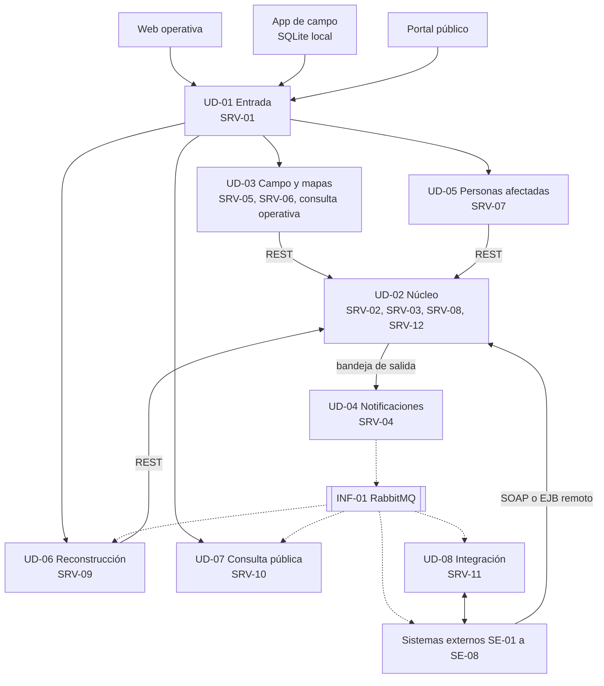
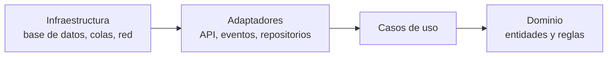
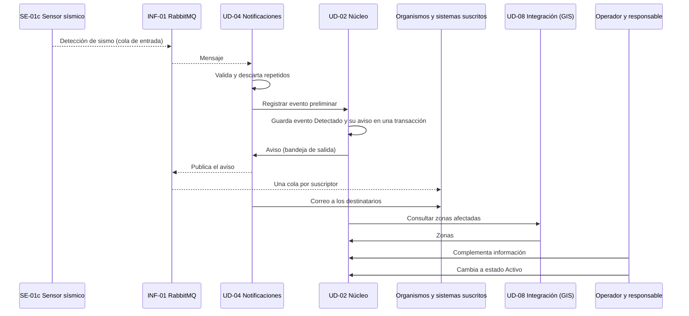
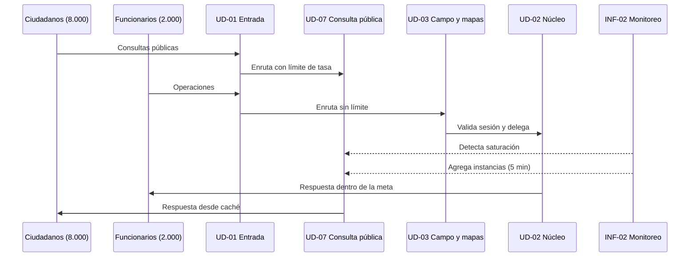
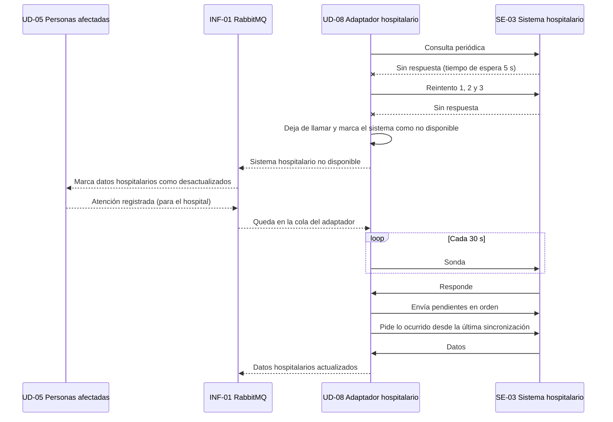
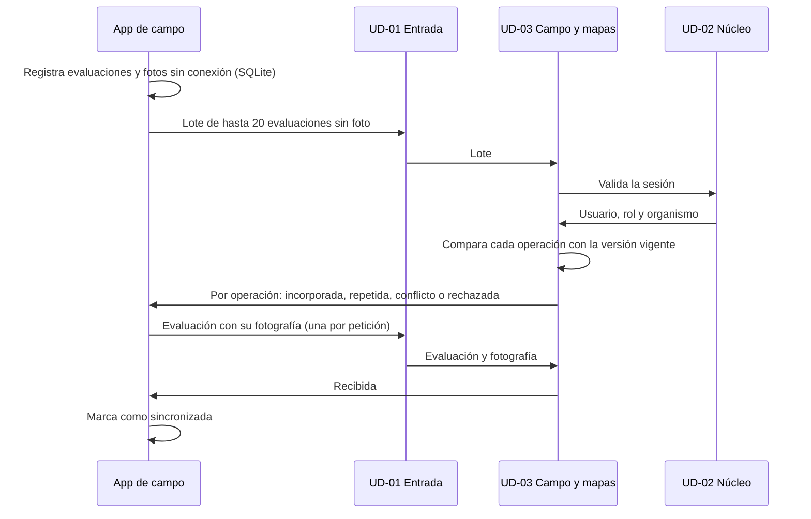
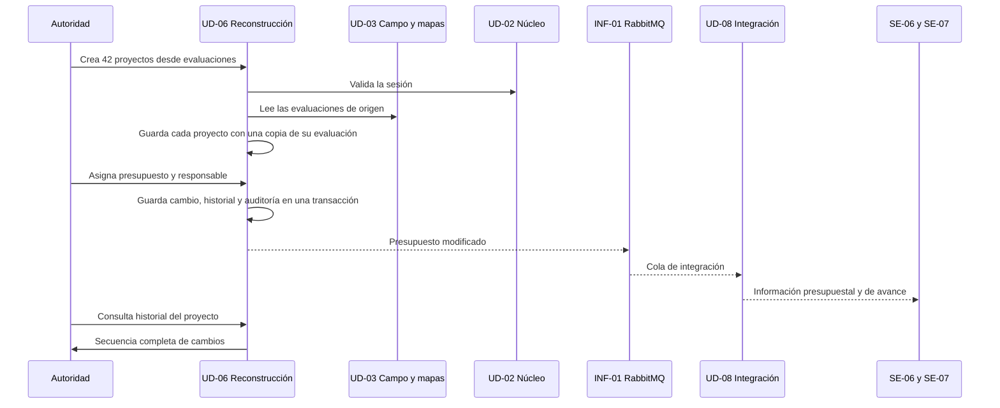
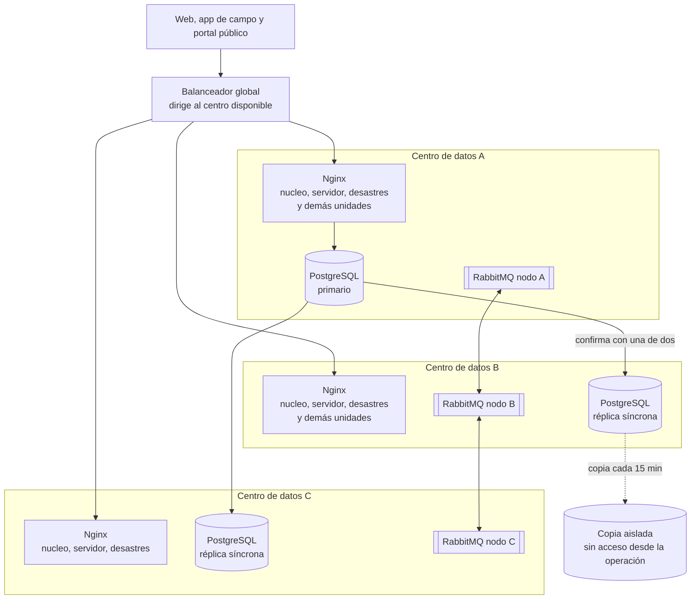
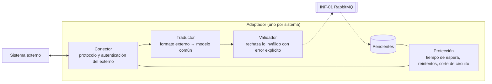

# SAD v1.0 · Plataforma para la Gestión de Desastres y Reconstrucción

Nov 10, 2026 · @Thomas Lopez Rojas

Documento de arquitectura de software, versión 1.0. Reemplaza el diseño inicial entregado el 19 de septiembre de 2026 y responde a los requisitos del SRS v1.0. Describe una sola arquitectura: la que implementa el código de la segunda entrega, extendida a las capacidades que todavía no tienen código.

## 1. Propósito, alcance y drivers

### 1.1 Propósito

Este documento describe la arquitectura de la Plataforma para la Gestión de Desastres y Reconstrucción y justifica cada decisión con los atributos de calidad del SRS v1.0. Presenta el estilo elegido frente a sus alternativas, las vistas del modelo 4+1, el modelo de integración, el diseño de APIs y eventos, las estrategias de seguridad, resiliencia, recuperación y escalabilidad, y el registro de decisiones.

### 1.2 Alcance

Cubre las seis capacidades del SRS, la integración con los sistemas externos SE-01 a SE-08 y la operación móvil sin conexión. Nombra las tecnologías de la implementación (CON-07) y señala qué unidades ya están construidas (§3.2 y §15).

### 1.3 Drivers arquitectónicos

Cinco escenarios del SRS tienen importancia alta y dificultad alta, y son los que más condicionan la forma de la arquitectura.

| Driver | Qué exige | Consecuencia para el diseño |
| --- | --- | --- |
| QA-DIS-01 | 99,95 % mensual en las funciones críticas | Redundancia de lo crítico y unidades aparte para lo degradable |
| QA-DIS-02 | Recuperar lo crítico en 15 minutos sin perder operaciones confirmadas | Datos confirmados en más de un centro de datos; conmutación automática |
| QA-ESC-01 | De 1.000 a 10.000 usuarios aumentando solo los componentes saturados | Unidades de despliegue separadas por perfil de carga |
| QA-ESC-02 | 500 equipos de campo sin afectar la coordinación | Recepción de evaluaciones en una unidad distinta de la que registra y coordina |
| QA-CNF-01 | Reconciliación sin sobrescrituras tras trabajar sin conexión | Operaciones con identidad propia y conflictos explícitos |

Los demás escenarios (rendimiento, resiliencia, interoperabilidad, seguridad, trazabilidad, modificabilidad y extensibilidad) se atienden con las tácticas de las secciones 7 a 11. La matriz de la sección 13 muestra dónde se resuelve cada uno.

### 1.4 Metas cuantitativas

| Meta | Valor | Origen |
| --- | --- | --- |
| Disponibilidad de funciones críticas | 99,95 % mensual (máximo 21,6 min de caída) | Enunciado |
| Usuarios concurrentes | De 1.000 a 10.000 en 10 minutos | Enunciado y SUP-02 |
| Consulta frecuente | Menos de 2 s | Enunciado |
| Registro | Menos de 3 s | Enunciado |
| Alerta crítica | Menos de 5 s | Enunciado |
| Cómo se dan por cumplidos esos tres tiempos | Al menos el 95 % de las operaciones dentro del tiempo, ninguna por encima del doble y menos del 0,1 % con error; las alertas, con hasta 10 simultáneas (§8.6) | Propuesta del equipo (PREM-06), por validar con el profesor: el enunciado no da percentil ni carga |
| Recuperación de funciones críticas | 15 minutos, 0 operaciones confirmadas perdidas | Propuesta del equipo |

### 1.5 Restricciones que condicionan la arquitectura

| Restricción | Efecto en el diseño |
| --- | --- |
| CON-01 a CON-03: no se reemplazan los sistemas existentes y cada uno tiene su propio mecanismo | Un adaptador por sistema externo; ningún sistema externo se obliga a cambiar |
| CON-04: los sistemas externos pueden no estar disponibles | Tiempo de espera, reintentos, corte de circuito y cola de pendientes en cada adaptador |
| CON-05 y CON-06: hay operaciones inmediatas y otras diferibles | Cada interacción declara si es inmediata o diferida (§7.2) |
| CON-07: tecnologías de los talleres del curso | Jakarta EE, .NET, PostgreSQL, RabbitMQ y Nginx, asignadas por unidad (ADR-17) |
| CON-08: móvil parcialmente sin conexión | Almacén local en el dispositivo y sincronización con reconciliación |
| CON-09: protección de datos personales | Unidad de personas afectadas aislada y reglas de §9.6 |

## 2. Estilo arquitectónico

La plataforma adopta una arquitectura basada en servicios de grano grueso: ocho unidades de despliegue, separadas por consistencia transaccional y por perfil de carga, que se llaman por REST cuando necesitan la respuesta y se avisan por colas cuando no. Gana porque guarda en una sola transacción lo que debe ser consistente y, a la vez, deja crecer por separado lo que recibe la carga.

### 2.1 Alternativas evaluadas

| Alternativa | Descripción |
| --- | --- |
| A. Monolito modular | Una sola unidad de despliegue con un módulo por capacidad y una base de datos |
| B. Núcleo con tres satélites | Un núcleo con las seis capacidades y tres elementos aparte: evidencias, consulta pública e integración. Fue el diseño de la primera entrega |
| C. Servicios por consistencia y perfil de carga | Ocho unidades de grano grueso. Un núcleo reúne solo lo que comparte transacciones (identidad, desastres, recursos y auditoría); la captura de campo, las notificaciones, las personas afectadas, la reconstrucción, la consulta pública y la integración van aparte |
| D. Un servicio por componente | Doce servicios pequeños, cada uno con sus datos, comunicados solo por eventos |

### 2.2 Comparación por atributo

Cada alternativa se califica de 1 (muy débil) a 5 (muy fuerte) frente a los atributos prioritarios.

| Atributo | A. Monolito modular | B. Núcleo y satélites | C. Servicios por consistencia y carga | D. Un servicio por componente |
| --- | --- | --- | --- | --- |
| Disponibilidad de lo crítico | 3 | 3 | 4 | 4 |
| Escalabilidad por partes | 2 | 3 | 4 | 5 |
| Rendimiento | 5 | 4 | 4 | 3 |
| Resiliencia | 2 | 3 | 3 | 5 |
| Interoperabilidad | 3 | 4 | 4 | 4 |
| Modificabilidad | 3 | 3 | 4 | 5 |
| Integridad de los cambios | 5 | 4 | 5 | 3 |
| Simplicidad de operación | 5 | 4 | 3 | 1 |
| **Total** | **28** | **28** | **31** | **30** |

### 2.3 Justificación de los puntajes

Cada puntaje tiene su razón. Son valoraciones del equipo, no mediciones.

| Atributo | A. Monolito modular | B. Núcleo y satélites | C. Servicios por consistencia y carga | D. Un servicio por componente |
| --- | --- | --- | --- | --- |
| Disponibilidad de lo crítico | 3: se puede duplicar entero, pero un despliegue o una falla de cualquier módulo afecta a todo | 3: lo mismo para las seis capacidades del núcleo | 4: lo degradable va aparte; pierde un punto porque el núcleo es dependencia común | 4: todo aislado, pero más piezas y cadenas de llamadas que pueden fallar |
| Escalabilidad por partes | 2: escala todo junto | 3: solo escalan los tres satélites | 4: escalan por separado campo, consulta pública y notificaciones, que reciben los picos; no los componentes del núcleo entre sí | 5: escala cada componente |
| Rendimiento | 5: sin saltos de red | 4: un salto hacia los satélites | 4: uno o dos saltos por operación | 3: varios saltos y lecturas que dependen de datos de otros servicios |
| Resiliencia | 2: una falla es total | 3: las fallas de los satélites quedan contenidas | 3: una falla del núcleo afecta identidad, desastres y recursos a la vez | 5: cada falla queda en su componente |
| Interoperabilidad | 3: la integración vive dentro del monolito; un cambio de contrato obliga a desplegar todo | 4: integración aparte | 4: adaptadores aparte y una cola por suscriptor | 4: adaptadores aparte. Ninguna recibe 5 porque el modelo común hay que mantenerlo |
| Modificabilidad | 3: módulos separados, un solo despliegue | 3: igual dentro del núcleo | 4: cada unidad se despliega sola; lo que vive en el núcleo se despliega junto | 5: cada componente se despliega solo |
| Integridad de los cambios | 5: todo cambio es una transacción local | 4: transacción en el núcleo, pero la evidencia queda fuera de la transacción de su evaluación | 5: lo que debe cambiar junto vive en la misma unidad | 3: un cambio con su historial, su auditoría y su aviso cruza varios servicios y exige compensaciones |
| Simplicidad de operación | 5: una pieza | 4: cuatro piezas | 3: ocho unidades y dos plataformas | 1: doce servicios con doce bases |

El Escenario B pide "incrementar la capacidad de los componentes necesarios sin tener que escalar obligatoriamente toda la plataforma"; por eso A y B quedan abajo en escalabilidad.

El resultado es sensible: C supera a D por un solo punto. Sin la fila de integridad ganaría D (27 a 26), y sin la de simplicidad de operación también (29 a 28). La elección de C depende entonces de que esos dos atributos pesen, y aquí pesan por dos razones. La trazabilidad es obligatoria en el enunciado: cada asignación de recursos, cada cambio de presupuesto y cada cambio de nivel debe quedar con quién, cuándo y con qué resultado, y eso es más seguro cuando el cambio y su registro son una sola transacción. Y la plataforma la opera una organización gubernamental, no un equipo dedicado a operar decenas de servicios. Lo que D hace mejor, escalar o modificar un componente aislado del núcleo, no lo exige ningún escenario del SRS.

### 2.4 Patrones que componen la solución

| Patrón | Dónde se usa | Qué atributo sirve |
| --- | --- | --- |
| Servicios de grano grueso con datos propios | Las ocho unidades de despliegue (§3) | Escalabilidad, disponibilidad |
| Transacción local por unidad | Cambio, historial, auditoría y aviso se guardan juntos | Confiabilidad, trazabilidad |
| Bandeja de salida (outbox) | Avisos que salen del núcleo hacia notificaciones | Confiabilidad |
| Publicar y suscribir con una cola por suscriptor | Notificación a organismos, a sistemas externos y a las demás unidades | Resiliencia, extensibilidad |
| Entrada única | Nginx delante de todas las unidades | Seguridad, protección de lo crítico |
| Fachada de API | `servidor` ofrece a la web y a la app una sola API y delega en el núcleo | Modificabilidad |
| Copia de lectura derivada | Consulta pública y catálogo de desastres en `servidor` | Escalabilidad, rendimiento |
| Adaptador por sistema externo | Unidad de integración | Interoperabilidad, extensibilidad |
| Tiempo de espera y reintento con identificador único | Toda llamada entre unidades y hacia afuera | Resiliencia |
| Capas con dependencias hacia el dominio | Estructura interna de cada unidad (§4) | Modificabilidad |


## 3. Vista lógica

La plataforma se compone de tres clientes, doce componentes lógicos y dos elementos de infraestructura. Las seis capacidades están diseñadas en §3.6, con las reglas comunes que valen entre ellas. Los doce componentes se empaquetan en ocho unidades de despliegue; cuatro de ellas ya están construidas y son el código de la segunda entrega.

### 3.1 Diagrama de contenedores

Línea continua: llamada inmediata. Línea punteada: mensaje en cola.



La web y la app solo hablan con `servidor`, que les ofrece una sola API y delega en el núcleo la sesión, los desastres y las solicitudes de recursos. Los cambios del núcleo salen por la bandeja de salida hacia notificaciones, que los publica en una cola por suscriptor: cada organismo, cada sistema externo y cada unidad interesada tiene la suya.

### 3.2 Unidades de despliegue

| ID | Unidad | Tecnología | Componentes que contiene | Datos propios | Criticidad | Construida |
| --- | --- | --- | --- | --- | --- | --- |
| UD-01 | Entrada | Nginx | SRV-01 | Ninguno | Crítica | Sí |
| UD-02 | Núcleo (`nucleo`) | Java 21, Jakarta EE (EJB, JPA, JTA) sobre WildFly; PostgreSQL | SRV-02, SRV-03, SRV-08, SRV-12 | Base `pgdrdb` | Crítica | Sí; faltan ciclo de vida, delimitación, consolidación y tareas |
| UD-03 | Campo y mapas (`servidor`) | ASP.NET Core; PostgreSQL | SRV-05, SRV-06, consulta operativa de SRV-03, fachada de API | Base `mapas` | Crítica | Sí; faltan validación y duplicados |
| UD-04 | Notificaciones (`desastres`) | Java 17, Jakarta EE sobre Payara; RabbitMQ; Jakarta Mail | SRV-04 y la entrada de alertas de SRV-11 | Registro de entregas | Crítica | Sí |
| UD-05 | Personas afectadas | Jakarta EE; PostgreSQL | SRV-07 | Base propia con datos personales | Esencial | No |
| UD-06 | Reconstrucción | Jakarta EE; PostgreSQL | SRV-09 | Base propia | Degradable | No |
| UD-07 | Consulta pública | ASP.NET Core; PostgreSQL | SRV-10 | Copia pública derivada | Degradable | No |
| UD-08 | Integración | Jakarta EE; RabbitMQ | SRV-11: un adaptador por sistema externo | Mensajes pendientes | Según adaptador | No |
| — | App de campo (`campo`) | .NET MAUI para Android; SQLite | Captura sin conexión y sincronización | Capturas pendientes, por organismo y usuario | Crítica | Sí |
| INF-01 | Cola de mensajes | RabbitMQ | — | Mensajes en tránsito | Crítica | Sí |
| INF-02 | Monitoreo | Sondas de salud y métricas | — | Métricas | Crítica | Solo la sonda de salud |

### 3.3 Responsabilidades de los componentes

| ID | Componente | Responsabilidad | Unidad | Requisitos |
| --- | --- | --- | --- | --- |
| SRV-01 | Entrada | Punto único de acceso: sirve la web, enruta por prefijo de ruta, limita el tamaño de las solicitudes y la tasa del portal público | UD-01 | FC-07 |
| SRV-02 | Identidad y acceso | Usuarios, organismos, roles y sesiones; inicio de sesión por REST, SOAP y EJB remoto sobre las mismas cuentas | UD-02 | FC-07, QA-SEG, QA-MOD-02 |
| SRV-03 | Gestión de desastres y coordinación | Registro único de desastres, nivel con historial, ciclo de vida, delimitación, consolidación de reportes, organismos, responsabilidades y tareas | UD-02; el mapa y el tablero en UD-03 | RF-GD, RF-CO; FC-01, 02, 05, 06 |
| SRV-04 | Alertas y notificaciones | Recibe cada aviso, lo publica en la cola de cada suscriptor, envía los correos y registra cada entrega | UD-04 | RF-GD-13, RF-CO-06; FC-03 |
| SRV-05 | Evaluación de daños | Recibe los lotes de campo, compara versiones, marca conflictos, guarda correcciones con historial y vincula cada evaluación con su desastre | UD-03 | RF-ED; FC-04 |
| SRV-06 | Evidencias | Guarda la fotografía de cada evaluación y la sirve con los mismos permisos de la evaluación | UD-03 | RF-ED-07 |
| SRV-07 | Personas afectadas | Personas, familias, necesidades, refugios, atención y solicitudes de ayuda | UD-05 | RF-PA |
| SRV-08 | Recursos | Solicitudes de recursos, también desde una evaluación; atención, disponibilidad, asignaciones y donaciones | UD-02 | RF-GR |
| SRV-09 | Reconstrucción | Proyectos, presupuesto, avance y vínculo con las evaluaciones | UD-06 | RF-RE |
| SRV-10 | Consulta pública | Sirve al ciudadano una copia de solo lectura con lo expresamente publicable | UD-07 | PREM-03 |
| SRV-11 | Integración | Un adaptador por sistema externo: traduce formatos, aplica tiempo de espera y reintento y guarda pendientes | UD-08; la entrada de alertas en UD-04 | QA-INT, QA-EXT-01, QA-RES-01 |
| SRV-12 | Auditoría | Consulta consolidada de quién hizo qué, cuándo, sobre qué y con qué resultado. Cada unidad guarda su registro en la transacción del cambio y envía una copia | UD-02; el registro, en cada unidad | QA-TRZ-01 |

### 3.4 Decisiones de agrupación

- **Identidad, desastres, recursos y auditoría van juntos en el núcleo.** Comparten transacciones: una solicitud de recursos se guarda con su historial y su auditoría, y un cambio de nivel con su historial y su aviso. Separarlos obligaría a coordinar varias bases para un solo cambio.
- **La evaluación de daños va aparte.** Recibe la carga de escritura de 500 equipos de campo (QA-ESC-02), que no debe competir con el registro de desastres. Guarda su propia copia del catálogo de desastres para vincular evaluaciones.
- **La fotografía va con la evaluación.** Llegan y se confirman juntas, de modo que no existe una evaluación sincronizada con su foto perdida (ADR-13).
- **Las notificaciones van aparte.** El desastre queda registrado antes de notificar; si RabbitMQ o el correo fallan, el registro no se detiene.
- **Personas afectadas va aparte.** Guarda datos personales; aislarla reduce quién y qué puede alcanzarlos (CON-09).
- **Reconstrucción va aparte.** Opera durante meses después de la emergencia y es degradable; no debe compartir despliegues ni fallas con lo crítico.
- **Cada unidad es dueña de sus datos.** Ninguna lee la base de otra. Lo que necesita de otra lo pide por REST o lo recibe por su cola, y guarda una copia mínima.

### 3.5 Componentes de las dos unidades más exigidas

| Unidad | Componente interno | Responsabilidad |
| --- | --- | --- |
| UD-02 Núcleo | Autenticación | Inicio y cierre de sesión, validación de cada sesión, usuarios y roles |
| UD-02 Núcleo | Registro de desastres | Crear sin duplicar, cambiar el nivel sobre una versión base, guardar el historial |
| UD-02 Núcleo | Solicitudes de recursos | Registrar, listar pendientes y atender una sola vez |
| UD-02 Núcleo | Auditoría | Entrada de auditoría en la misma transacción del cambio |
| UD-02 Núcleo | Bandeja de salida | Guarda cada aviso con su cambio y lo entrega a notificaciones hasta que lo acepta |
| UD-02 Núcleo | Accesos SOAP y EJB remoto | Inicio de sesión para sistemas que no usan REST |
| UD-03 Campo y mapas | Fachada de API | Valida la sesión contra el núcleo y delega desastres y solicitudes |
| UD-03 Campo y mapas | Recepción de lotes | Incorpora las operaciones de campo, de inmediato o en diferido (ADR-18) |
| UD-03 Campo y mapas | Evaluaciones versionadas | Compara cada corrección con la versión vigente; aplica o devuelve conflicto |
| UD-03 Campo y mapas | Mapas | Afectaciones, panorama, mapa de calor y GeoJSON |
| UD-03 Campo y mapas | Catálogo de desastres | Copia local para vincular evaluaciones aunque el núcleo no responda |


### 3.6 Diseño de las seis capacidades

Cada capacidad tiene aquí sus datos, estados, reglas, permisos y transacciones. Las partes que ya tienen código se indican como tales; lo demás es diseño.

#### Reglas comunes

Seis reglas valen para todas las capacidades y resuelven lo que ocurre entre ellas.

| Regla | Qué establece | Decisión |
| --- | --- | --- |
| Identificador del cliente | Quien crea un registro genera su identificador. Repetir la misma solicitud no duplica; el mismo identificador con otro contenido responde 409 | ADR-04 |
| Versión base | Todo cambio indica la versión sobre la que se hizo. Si ya no es la vigente responde 409 y no cambia nada | ADR-04 |
| Transacción local | El cambio, su historial, su auditoría y su aviso pendiente se guardan en una sola transacción, en la base de la unidad dueña del dato. No hay transacciones entre unidades | ADR-01, ADR-20 |
| Ámbito de acceso | Hay tres ámbitos. Organismo: cada organismo ve y cambia lo suyo. Evento: los organismos con participación vigente en un desastre ven el desastre y sus tareas, evaluaciones y solicitudes. Caso: los datos de una persona afectada solo los ve el rol de atención a afectados del organismo que la registró o que tiene una atención abierta para ella | ADR-19 |
| Operación externa | Lo que depende de un sistema externo no se confirma en la misma transacción. Queda Por confirmar, con lo reservado apartado, y solo termina en Aceptada o Rechazada cuando el sistema externo lo dice. Si pasa el plazo de ese sistema sin respuesta, queda En conciliación: no se libera ni se revierte nada, el adaptador consulta el resultado por el identificador de la operación y una respuesta tardía se aplica si corresponde a esa misma operación y versión. Lo reservado solo se libera con un resultado definitivo del sistema externo: un rechazo, una cancelación que ese sistema confirma, o su garantía contractual de que la operación ya no se ejecutará. Una consulta que responde "no encontrada" o "en proceso" no es un resultado definitivo, porque la operación puede estar en tránsito: sigue En conciliación. Si el sistema no ofrece consulta ni cancelación, o la conciliación supera el plazo configurado, decide una persona autorizada, con motivo y auditoría, después de confirmar el resultado con el operador de ese sistema | ADR-21 |
| Auditoría | Cada unidad guarda su auditoría en su propia base, en la transacción del cambio, y envía una copia por su bandeja de salida. SRV-12 reúne esas copias para la consulta consolidada; la copia puede ir segundos atrás y la fuente de verdad es la local | ADR-20 |

Al retirarse la participación de un organismo en un desastre, conserva la lectura de lo que él mismo registró y deja de ver lo demás.

#### Catálogos configurables

Los catálogos viven en el núcleo y se entregan con su versión por `/api/catalogos`; `servidor` y la app guardan una copia. Agregar o cambiar una entrada es una operación auditada de un coordinador y no despliega código. Hoy ese recurso devuelve listas fijas.

| Catálogo | Qué define cada entrada | Requisitos |
| --- | --- | --- |
| Tipo de desastre | Código, nombre, atributos adicionales (nombre, tipo de dato, obligatorio y orden), política de ciclo de vida y regla de clasificación | RF-GD-04, QA-MOD-01 |
| Política de ciclo de vida | Estados y transiciones permitidas de un tipo, con versión. Una política solo es válida si desde cada estado se puede llegar a Cerrado | RF-GD-05 |
| Tipo de activo | Código, nombre, unidad y costo de referencia | RF-ED-04 |
| Categoría de daño | Código, nombre, orden y factor de costo. El conjunto inicial tiene cinco: sin daño, leve, moderado, grave y destrucción total | RF-ED-05 |
| Criterio por tipo de activo | Para cada tipo de activo y categoría, la descripción de qué observar | RF-ED-06 |

Los atributos adicionales de un tipo se guardan con el evento y se validan contra la definición del tipo. La web y la app construyen los campos de esos atributos a partir de esa definición, en el orden que indica, sin código propio de cada tipo. Cada evento y cada evaluación guardan la versión del catálogo con que se crearon. Un cambio de política aplica a los eventos nuevos; uno existente conserva la suya salvo que un coordinador lo migre de forma expresa.

#### Gestión de desastres

SRV-03 en el núcleo. Requisitos RF-GD-01 a 17.

| Dato mínimo del evento | De dónde sale | En el código |
| --- | --- | --- |
| Identificador único | Lo genera el cliente | Sí |
| Tipo de desastre | Catálogo | Sí, con lista fija |
| Fecha y hora de inicio | Quien registra, o la fuente externa | Sí |
| Ubicación geográfica | Texto y punto de referencia | Sí, como texto |
| Área o zonas afectadas | Delimitación versionada | No |
| Nivel de severidad | Cuatro niveles | Sí |
| Descripción | Quien registra | Sí |
| Fuente de la información | Usuario, o sistema externo con su identificador de mensaje | No |
| Organismo que registra | La sesión | Sí |
| Responsable de la emergencia | Participación con la responsabilidad de dirigir | No |
| Estado actual | Ciclo de vida | No |
| Fecha y hora de actualización | La del último cambio | Sí, con la versión |

| Aspecto | Diseño |
| --- | --- |
| Estados | Detectado, Registrado, Activo, En evaluación, En atención, En recuperación, En reconstrucción y Cerrado. Las transiciones permitidas salen de la política del tipo |
| Transiciones iniciales | Detectado a Registrado: confirma tipo, ubicación y severidad; una falsa alarma pasa a Cerrado con ese motivo. Registrado a Activo: exige responsable. Activo, En evaluación y En atención: en cualquier sentido, con motivo. En atención a En recuperación a En reconstrucción: solo hacia adelante. Cualquiera a Cerrado: sin tareas abiertas ni solicitudes pendientes, o con motivo. Una transición que no está en la política responde 422 |
| Reclasificación y estado | Subir a crítico un evento Detectado o Registrado lo pasa a Activo en la misma transacción. Como Activo exige responsable, si el evento no lo tiene queda como responsable provisional quien reclasifica, y así se registra. En cualquier otro estado, reclasificar no cambia el estado. Toda reclasificación guarda nivel anterior y nuevo, motivo, autor y hora, y emite un aviso |
| Delimitación | Cada versión guarda la geometría (punto, polígono o varios polígonos) o referencias a municipios, barrios y zonas de riesgo; la hora desde la que aplica; la hora de registro; la fuente y el autor. Nunca se edita: se agrega una versión. Las referencias se resuelven a geometría con el GIS (SE-02) y se guarda la geometría resuelta junto con la versión del catálogo del GIS que la produjo. Si el GIS cambia después sus divisiones, las versiones guardadas no cambian: adoptar la división nueva exige agregar una versión de la delimitación. Si el GIS no responde, se guarda la referencia y la geometría queda pendiente |
| Evolución | La consulta histórica recibe dos instantes. «Vigente en» pide lo que aplicaba en ese momento. «Conocido en» limita la respuesta a lo que la plataforma ya había registrado en ese momento; si se omite, vale el momento actual. Devuelve la versión de estado, nivel y delimitación que cumple ambos. Así, vigente a las 10:00 responde 3 barrios y vigente a las 14:00 responde 7. Y un dato de las 9:50 registrado a las 13:00 aparece al pedir lo vigente a las 10:00 con lo conocido hoy, y no aparece con lo conocido a las 10:00 |
| Fuentes y reportes | Cada reporte guarda fuente, identificador de mensaje, tipo, ubicación, hora y contenido. Un reporte repetido de la misma fuente se descarta. Estados del reporte: Recibido, Asociado a un evento, Candidato a duplicado |
| Consolidación | Una regla configurable (mismo tipo, distancia y ventana de tiempo) propone candidatos y una persona confirma. Una regla certificada como inequívoca por dos personas (§9.8) puede consolidar sola. Al consolidar, un evento queda como canónico y los demás como alias suyos, en una tabla del núcleo con evento absorbido, evento canónico, desde, hasta, autor y motivo. Nada se mueve ni se reescribe: reportes, evaluaciones y solicitudes conservan el identificador de evento con que nacieron, en la base de su unidad, y las consultas resuelven el alias al canónico. El evento absorbido queda marcado como consolidado y no admite cambios de estado ni de nivel mientras lo esté; lo que llegue después contra él se acepta y se muestra bajo el canónico. El alias vigente es un dato del evento en el catálogo de desastres del núcleo, con su versión; `servidor` lo recibe al actualizar su copia de ese catálogo, por la lectura que ya hace, y hasta entonces sus evaluaciones siguen bajo el evento absorbido. Estados: Propuesta, Confirmada, Revertida |
| Integridad de los alias | Un evento no se consolida consigo mismo. El canónico debe estar abierto y no estar absorbido: un alias siempre apunta a un evento que no es alias de otro, así que no hay cadenas ni ciclos. Un evento tiene como máximo un alias vigente. Si se absorbe un canónico que ya tenía alias, esos alias se cierran y se abren de nuevo hacia el canónico nuevo en la misma transacción, y cada fila guarda la consolidación que la originó. Dos consolidaciones simultáneas que tocan un mismo evento se resuelven en la base del núcleo: la transacción bloquea los eventos en orden de identificador y comprueba su versión; la segunda recibe 409 y debe proponerse otra vez sobre el estado nuevo. Una propuesta que rompe estas reglas responde 422 |
| Reversión de una consolidación | Cierra, con su fecha, los alias vigentes que nacieron de esa consolidación. Si alguno fue reapuntado por una consolidación posterior, se revierte primero la posterior; la plataforma responde 409 mientras exista. Al revertir, los alias que esa consolidación había reapuntado vuelven al canónico que tenían. Cada registro vuelve a mostrarse bajo el evento con que nació, incluido lo registrado después de consolidar; lo creado directamente en el canónico se queda en él. Los cambios hechos al canónico mientras duró (nivel, estado, delimitación) no se deshacen ni se copian al absorbido, que vuelve con su último estado propio. La consulta histórica sigue mostrando que entre esas dos fechas estuvieron unidos |
| Una transacción guarda | El cambio, su historial, su auditoría y su aviso |
| Permisos | Coordinador: registra, cambia estado y nivel, delimita y consolida. Evaluador y Consulta: leen. Ámbito de evento |

#### Evaluación de daños

SRV-05 y SRV-06 en `servidor`, y la app de campo. Requisitos RF-ED-01 a 17. Ya tienen código la captura sin conexión, la sincronización, las correcciones con historial, la fotografía, el vínculo con el desastre y el mapa.

| Aspecto | Diseño |
| --- | --- |
| Datos | Evaluación: identificador, desastre o ninguno, fecha, evaluador y organismo (de la sesión), ubicación, tipo de activo y nombre, categoría de daño, descripción, evidencias, estado y versión. Evidencia: fotografía o documento, con tipo y huella; hoy solo fotografía. La operación original nunca se modifica |
| Estados | Preliminar (sin desastre), Registrada, Validada, Devuelta y Duplicada. Hoy existen las dos primeras |
| Reglas | Valida un coordinador distinto del evaluador. Una Devuelta lleva observación y vuelve a Registrada al corregirse. Corregir una Validada la devuelve a Registrada. Candidato a duplicado: mismo desastre, mismo tipo de activo y a menos de una distancia configurable; lo decide una persona, y la que no prevalece queda Duplicada, conservada y enlazada. Solo las Validadas alimentan estimaciones, prioridades y proyectos de reconstrucción |
| Estimación de impacto y costo | Por desastre y por zona: conteo de activos por tipo y categoría, y costo estimado como la suma del costo de referencia del tipo por el factor de la categoría. Se presenta como estimación |
| Prioridad | Las zonas se ordenan por número de activos en las dos categorías más graves |
| Evidencias | Fotografía: JPEG o PNG de hasta 5 MB; viaja con su evaluación y se captura sin conexión. Documento: PDF de hasta 5 MB; se sube aparte, uno por solicitud y con conexión, con su propio identificador para poder repetir el envío. Cada evaluación admite hasta 5 evidencias. Lo que excede el tamaño o el tipo responde 413 o 415 y no se guarda a medias. Cada evidencia guarda tipo, tamaño, huella, autor y hora, se lee con los permisos de su evaluación y no se modifica: se agrega otra. Hoy el código guarda una fotografía por evaluación |
| Una transacción guarda | La evaluación con su evidencia, su historial y su auditoría, en la base de `servidor`. El aviso sale por una bandeja de salida propia de `servidor`, que hoy no existe |
| Avisos | Evaluación validada, con desastre, tipo de activo, categoría y ubicación, hacia recursos y reconstrucción |
| Permisos | Evaluador: captura y corrige las suyas. Coordinador: valida y resuelve duplicados. Consulta: lee. Ámbito de evento |

#### Coordinación de organismos

SRV-03 en el núcleo. Requisitos RF-CO-01 a 07 y RF-GD-12.

| Aspecto | Diseño |
| --- | --- |
| Datos | Participación: desastre, organismo, responsabilidad, desde y hasta; una de ellas es la de dirigir la emergencia. Tarea: identificador del cliente, desastre, descripción, organismo responsable, persona responsable opcional, prioridad, estado, avance de 0 a 100 y versión. Actividad: historial del desastre |
| Estados de la tarea | Pendiente, Asignada, En curso y Terminada. Cancelada desde cualquiera menos Terminada |
| Quién hace qué | El coordinador del organismo que dirige asocia y retira organismos, crea tareas para cualquier participante y fija prioridades. El coordinador de un organismo participante crea tareas para su propio organismo. El avance lo registra el organismo responsable de la tarea |
| Reglas | Solo se asigna una tarea a un organismo con participación vigente. Terminada exige avance 100. Al retirar un organismo, sus tareas abiertas se reasignan o se cancelan en la misma operación |
| Una transacción guarda | La tarea o la participación, la actividad, la auditoría y el aviso |
| Avisos | Organismo asociado, tarea asignada y tarea actualizada, a la cola del organismo afectado |

#### Recursos

SRV-08 en el núcleo. Requisitos RF-GR-01 a 07. Ya tienen código la solicitud, también desde una evaluación, y su atención única con historial.

| Aspecto | Diseño |
| --- | --- |
| Clases de recurso | Consumible (alimentos, agua, medicamentos, donaciones): cantidad disponible y reservada. Reutilizable (vehículos, maquinaria, equipos de rescate, personal): unidades asignadas por un periodo, que vuelven a estar disponibles al liberarse. Capacidad (refugios): cupos ocupados sobre cupos totales |
| Identidad y autoridad | Un recurso propio lo crea un organismo en la plataforma, que es su autoridad. Un recurso de SE-04 se identifica por la fuente y su identificador externo, y su autoridad es SE-04: la plataforma solo guarda la última disponibilidad recibida, con su hora. Un mismo recurso nunca existe en las dos formas, así que la visión consolidada no lo cuenta dos veces |
| Solicitud | Cantidad solicitada, asignada y entregada. Estados: Pendiente, En atención (asignación parcial), Atendida, Entregada y Rechazada con motivo. Hoy existen Pendiente y Atendida |
| Asignación | Sobre un recurso propio queda Reservada en la misma transacción que descuenta la disponibilidad, con una comparación atómica que impide asignar más de lo que hay. Sobre un recurso de SE-04 queda Por confirmar |
| Resultado de una asignación externa | Aceptada: se registra y la solicitud suma lo asignado. Rechazada: se anula, la solicitud conserva lo pendiente y se avisa al solicitante. Sin respuesta en el plazo: queda En conciliación, la cantidad sigue apartada y el adaptador consulta a SE-04 por el identificador; si SE-04 la había aplicado, pasa a Aceptada; si responde con un rechazo o confirma una cancelación, pasa a Rechazada y se libera lo apartado; si responde que no la encuentra o que está en proceso, sigue En conciliación. Un reintento usa el mismo identificador de asignación para que SE-04 no la aplique dos veces |
| Entrega y liberación | Entregar descuenta de reservado. Liberar un reutilizable lo devuelve a disponible. Una donación suma a disponible |
| Una transacción guarda | La asignación, el movimiento de inventario, el historial de la solicitud, la auditoría y el aviso |
| Permisos | Coordinador: asigna, entrega, libera y registra donaciones. Evaluador: solicita. Consulta: lee. Ámbito de evento para solicitudes; ámbito de organismo para el inventario propio |

#### Personas afectadas

SRV-07 en UD-05. Requisitos RF-PA-01 a 07.

| Aspecto | Diseño |
| --- | --- |
| Datos | Persona: identificador, nombres, documento opcional, contacto y estado de identidad. Familia: jefe y miembros. Necesidad: persona o familia, tipo, prioridad y estado. Estadía: persona, refugio, desde y hasta. Atención: persona, organismo que la presta, tipo, desde, hasta y origen (propia, SE-03 o SE-05). Solicitud de ayuda: persona o familia y estado. Todo queda ligado a un desastre |
| Estados | Identidad: Por verificar, Verificada con SE-05 y Duplicada. Necesidad: Registrada, En atención y Cubierta. Solicitud de ayuda: Recibida, En trámite, Atendida o Rechazada |
| Acceso | Ámbito de caso. El organismo que registra a la persona accede siempre. Otro organismo accede mientras tenga una atención abierta para esa persona; la atención la abre el organismo que la registró al remitirla, o el que opera el refugio donde está, y el acceso termina al cerrarla |
| Reglas | Cada lectura de una ficha queda en auditoría. Los posibles duplicados se proponen y los decide una persona; al unir se conservan los registros originales. Los tableros y mapas solo reciben conteos. Los datos de personas no se descargan a la app de campo |
| Una transacción guarda | El cambio, su historial y su auditoría, en la base de UD-05. La lectura de una ficha guarda su propio registro |
| Permisos | Atención a afectados: lee y escribe dentro de su ámbito de caso. Coordinador: ve conteos. Los demás roles: sin acceso |
| Avisos | Persona modificada, solo con identificador y tipo de cambio, a integración (SE-03 y SE-05) |

#### Reconstrucción

SRV-09 en UD-06. Requisitos RF-RE-01 a 06.

| Aspecto | Diseño |
| --- | --- |
| Datos | Proyecto: identificador del cliente, desastre, evaluaciones de origen con su copia y versión, responsable, contratista, fuente de financiación, cronograma, estado y versión. Presupuesto: versión, monto, fuente, motivo, quién propone y quién autoriza. Avance: fecha, porcentaje, costo ejecutado y evidencia. Documento |
| Origen | Un proyecto nace de una o más evaluaciones en estado Validada. Guarda una copia de cada una y su versión, de modo que conserva su origen aunque la evaluación se corrija después; si eso ocurre, el proyecto muestra que su origen cambió |

| Transición del proyecto | Quién | Condición |
| --- | --- | --- |
| Propuesto a Aprobado | Coordinador | Presupuesto autorizado y responsable asignado |
| Aprobado a En ejecución | Gestor de proyectos | Contratista y cronograma registrados |
| En ejecución a Suspendido y de vuelta | Coordinador | Motivo |
| En ejecución a Terminado | Gestor de proyectos | Avance 100 |
| Terminado a Cerrado | Coordinador | Costo ejecutado registrado, compromiso financiero aceptado por SE-06 y documentos de cierre cargados |
| Propuesto o Aprobado a Cancelado | Coordinador | Motivo |

| Aspecto | Diseño |
| --- | --- |
| Presupuesto | Cada cambio es una versión propuesta, con motivo, que autoriza un coordinador distinto de quien la propone. El compromiso ante SE-06 es una operación externa atada a esa versión. La versión vigente es la última autorizada y aceptada por SE-06; una versión Por confirmar o En conciliación todavía no es vigente. Si SE-06 la rechaza, se anula solo esa versión, queda en el historial y las propuestas posteriores no se tocan. Si no responde en el plazo, queda En conciliación y no se anula: una aceptación tardía se aplica a esa versión, y pasa a vigente solo si no hay otra posterior ya aceptada |
| Una transacción guarda | El cambio, la versión anterior o el historial, la auditoría y el aviso, en la base de UD-06, con su propia bandeja de salida |
| Permisos | Gestor de proyectos: crea y registra avance. Coordinador: autoriza presupuesto y cambia el estado. Consulta: ve el seguimiento consolidado por desastre |
| Avisos | Presupuesto modificado y estado de proyecto cambiado, a integración (SE-06 y SE-07) |

#### Consulta pública

SRV-10 en UD-07. Un desastre se publica solo cuando un coordinador lo marca como publicable. La copia pública guarda, por desastre, nombre, tipo, ubicación general, severidad, estado y hora de la última actualización; se construye con los avisos que recibe por su cola y nunca contiene datos de personas ni de organismos. No exige sesión.

## 4. Vista de desarrollo

Todas las unidades comparten la misma estructura interna de cuatro capas, con dependencias que apuntan siempre hacia el dominio. Así, cambiar una tecnología o un sistema externo toca solo la capa exterior.

| Capa | Contiene | Depende de |
| --- | --- | --- |
| Dominio | Entidades y reglas de negocio: evento, evaluación, proyecto, sus estados y transiciones | Nada |
| Casos de uso | Una operación por intención de negocio: registrar evento, reclasificar, sincronizar lote | Dominio |
| Adaptadores | Controladores de API, consumidores y publicadores de eventos, repositorios | Casos de uso |
| Infraestructura | Base de datos, cola de mensajes, clientes de red, configuración | Adaptadores |



Reglas de organización del código:

- Una carpeta de código y un contenedor por unidad de despliegue: `nucleo`, `servidor`, `desastres` y `campo` en esta entrega.
- Los contratos de API y de eventos se versionan en un repositorio común; ninguna unidad importa código de otra.
- Cada adaptador de sistema externo es un módulo independiente de la unidad de integración y se despliega sin tocar los demás (QA-EXT-01, QA-INT-02).
- Dentro del núcleo, cada caso de uso es un EJB y su transacción la maneja el contenedor (JTA).
- Los tipos de desastre, activos, categorías de daño y organismos son datos de configuración, no código (QA-MOD-01, QA-MOD-02).

## 5. Vista de procesos

Los cinco escenarios operacionales del SRS se recorren sobre las unidades de la sección 3. Flecha continua: llamada inmediata. Flecha punteada: mensaje en cola o respuesta diferida.

### 5.1 Escenario A — Inicio de una emergencia



La alerta no espera al GIS: la consulta de zonas ocurre después de crear el evento. Si la misma detección llega dos veces, el identificador del mensaje evita crear un segundo evento. La alerta se cuenta desde que la plataforma recibe el estímulo hasta que el aviso queda publicado en la cola de cada suscriptor y el servidor de correo lo acepta. Que el destinatario lo lea no depende de la plataforma.

| Tramo | Presupuesto |
| --- | --- |
| Guardar el evento y su aviso, con confirmación en una réplica de otro centro | 0,8 s |
| Espera en la bandeja de salida (ciclo de 1 s) | 1,0 s |
| Entrega a notificaciones y publicación en RabbitMQ | 0,4 s |
| Consumo (ciclo de 1 s), cola de cada suscriptor y envío del correo | 1,5 s |
| Margen | 1,3 s |
| **Total (meta QA-REN-03)** | **5,0 s** |

Si notificaciones o RabbitMQ no responden, el aviso sigue en la bandeja de salida y se reintenta en cada ciclo; un aviso no entregado pasa a una cola de reintento y vuelve a los 5 s.

Estado: verificado con poca carga en el ambiente de §6.4, donde dos mediciones dieron 2,7 s y 3,2 s con el ciclo anterior de 5 s. Con la carga de diseño de 10 alertas simultáneas todavía no se cumple: la bandeja de salida entrega hasta 20 avisos por ciclo, uno tras otro, y el consumidor toma un mensaje por segundo de cada cola. El diseño exige consumo continuo (§8.6) y ese cambio de código está pendiente.

**Fallos y alternativas del escenario A**

| Situación | Qué hace la plataforma | Dónde se decide |
| --- | --- | --- |
| El mensaje de la fuente no cumple el formato | No crea evento; el mensaje va a la cola de errores, visible para un operador | §7.2, §8.5 |
| La misma fuente envía dos veces la misma detección | La segunda se descarta por fuente e identificador de mensaje | §3.6 |
| Dos fuentes distintas reportan el mismo sismo | Quedan dos reportes. Si una regla certificada los reconoce como el mismo sismo, se consolidan solos; si no, quedan como candidatos y una persona decide | ADR-05 |
| El núcleo no responde cuando notificaciones intenta registrar el evento | El mensaje vuelve a su cola de reintento cada 5 s; no se pierde | §8.5 |
| El GIS no responde | El evento se crea igual; la delimitación guarda la referencia y la geometría queda pendiente | §3.6 |
| Notificaciones o RabbitMQ no responden | El evento queda registrado y el aviso espera en la bandeja de salida | ADR-02 |
| Nadie complementa ni activa el evento | Sigue en Detectado y el tablero muestra hace cuánto está así | §3.6 |
| Se sube a crítico sin responsable asignado | Pasa a Activo y queda como responsable provisional quien reclasifica | §3.6 |

### 5.2 Escenario B — Aumento repentino de usuarios



Según el modelo de capacidad de §11.3, el despliegue mínimo alcanza para 10.000 usuarios; si la carga ciudadana sigue subiendo, solo crece la consulta pública. El núcleo y `servidor` crecen por separado y solo si sus propias métricas lo piden. La consulta pública lee su propia copia y nunca llama al núcleo. El modelo de carga y los umbrales están en §11.

**Fallos y alternativas del escenario B**

| Situación | Qué hace la plataforma | Dónde se decide |
| --- | --- | --- |
| Las consultas ciudadanas superan el límite de tasa | La entrada responde 429 a lo que excede; los funcionarios no se ven afectados porque usan otras rutas | ADR-14 |
| La consulta pública se satura | Sirve la última respuesta en caché con su hora y agrega instancias | §11.2 |
| El uso del núcleo o de `servidor` pasa de 60 % sostenido | Se agregan instancias de esa unidad | §11.3 |
| La carga sigue por encima de la capacidad | Se degrada en el orden de §10.2: primero las consultas históricas y las estimaciones; lo crítico no se degrada | §10.2 |
| Cae una instancia en pleno pico | El balanceador la retira y las demás absorben; las solicitudes en curso se reintentan con el mismo identificador | §10.3 |
| El núcleo no responde | Las operaciones protegidas se rechazan hasta que vuelve; la consulta pública sigue, porque no lo llama | ADR-10 |

### 5.3 Escenario C — Falla de un sistema externo



Mientras el sistema hospitalario no responde, el núcleo, `servidor`, notificaciones y los demás adaptadores no reciben ningún efecto: ninguno lo llama, y el adaptador es el único que espera.

**Fallos y alternativas del escenario C**

Con el sistema hospitalario se intercambian atenciones y remisiones (§7.6). Cada mensaje lleva su identificador. Una operación En conciliación ya fue enviada: no cuenta entre los pendientes que deben quedar al día en 5 minutos (QA-RES-01) y se cierra al conocer su resultado.

| Situación | Qué hace la plataforma | Dónde se decide |
| --- | --- | --- |
| El hospital no responde | El adaptador deja de llamar tras tres fallas y marca el sistema como no disponible; las demás unidades no se enteran más que por ese aviso | ADR-07 |
| Hay remisiones por enviar durante la caída | Quedan en la cola del adaptador y se envían en orden al volver, salvo tras una caída de horas (más abajo) | §7.4 |
| El hospital vuelve y recibe dos veces una remisión | El identificador del mensaje le permite descartar la repetida; si no lo hace, el adaptador no reenvía lo que ya fue confirmado | §8.6 |
| La caída duró horas | Los pendientes se envían por lotes, lo más reciente primero | ATAM R-06 |
| Los datos hospitalarios quedaron viejos | Se muestran con la hora de su última actualización y la marca de desactualizados | §7.4 |
| El hospital rechaza una remisión | Queda Rechazada con su motivo y se avisa a quien la creó | ADR-21 |
| El hospital no responde una remisión en el plazo | Queda En conciliación: el adaptador consulta por el identificador al volver el sistema; no se da por rechazada ni se envía otra con identificador distinto | ADR-21 |
| El hospital responde que no encuentra la remisión | Sigue En conciliación, porque puede estar en tránsito; se reenvía con el mismo identificador y solo un rechazo o una cancelación confirmada la cierran | ADR-21 |

### 5.4 Escenario D — Evaluación distribuida de daños



Las evaluaciones sin fotografía van primero, en lotes. Las que llevan fotografía van después, cada una completa en una petición, para que una foto pesada no retrase a las demás. Evaluador y organismo se toman de la sesión, no de lo que envía la app.

El tiempo de una evaluación tiene tres partes distintas. No está medido en condiciones reales; la tabla es una estimación, no un resultado.

| Parte | De qué depende | Estimación |
| --- | --- | --- |
| Transferencia | Tamaño de la fotografía y conexión móvil | 1 MB a 1 Mbps tarda unos 8 s; 5 MB, unos 40 s; sin foto, menos de 1 s |
| Confirmación | Entrada, validación de la sesión, comparación de versión, escritura con réplica y respuesta | Cerca de 1,8 s después de recibir el paquete completo |
| Disponibilidad para consulta | Modo de incorporación (ADR-18) | En modo inmediato la respuesta ya es "incorporada" y se puede consultar. En modo diferido la respuesta es "recibida": está almacenada y pendiente de incorporación, y se puede consultar cuando el proceso posterior la incorpora |

La meta provisional del SRS para la confirmación es de 10 minutos (QA-ESC-02) y está pendiente de validar. La meta de 3 s del enunciado aplica al registro de eventos de desastre, no a las evaluaciones; su presupuesto está en §11.5.

**Fallos y alternativas del escenario D**

| Situación | Qué hace la plataforma | Dónde se decide |
| --- | --- | --- |
| La transferencia de una evaluación con foto se corta | En el servidor no queda nada a medias, porque se guarda en una transacción; la app la reenvía completa con el mismo identificador | ADR-13 |
| La app reenvía un lote que ya había llegado | Cada operación responde como repetida y no se duplica | ADR-04 |
| Otra persona corrigió antes la misma evaluación | Responde conflicto; la app conserva la propuesta y el dato del servidor, y el evaluador decide | ADR-04 |
| La sesión venció durante la sincronización | Responde 401; la app pide iniciar sesión y conserva los pendientes | §9.2 |
| El núcleo no responde | `servidor` no puede validar la sesión y rechaza; la app reintenta después y sigue capturando | ADR-10 |
| El lote supera el tamaño permitido | Responde 413 y la app lo divide | §11.2 |
| El desastre de la evaluación no está en la copia de `servidor` | La evaluación se guarda como preliminar y se vincula cuando llega el desastre | §8.3 |
| La carga de campo supera la capacidad | Se activa la incorporación diferida: se recibe y se aplica después | ADR-18 |

### 5.5 Escenario E — Reconstrucción



Reconstrucción guarda una copia de cada evaluación que origina un proyecto, igual que una solicitud de recursos guarda la copia de la evaluación de la que salió. Por eso el proyecto conserva su origen aunque la evaluación se corrija después.


**Fallos y alternativas del escenario E**

| Situación | Qué hace la plataforma | Dónde se decide |
| --- | --- | --- |
| La evaluación de origen no está validada | Responde 422 y no crea el proyecto | §3.6 |
| `servidor` no responde al leer las evaluaciones | No se crea el proyecto; se reintenta con el mismo identificador | §3.6 |
| La evaluación se corrige después de crear el proyecto | El proyecto conserva su copia y su versión, y muestra que el origen cambió | §3.6 |
| Quien propone el presupuesto intenta autorizarlo | Responde 403; debe autorizar otro coordinador | §3.6, §9.8 |
| El presupuesto no ha sido autorizado | Sigue vigente la versión anterior y el proyecto no pasa a Aprobado | §3.6 |
| El sistema financiero no responde | El compromiso queda Por confirmar en la cola del adaptador; el proyecto sigue | ADR-21 |
| El sistema financiero rechaza el compromiso | Se anula solo esa versión del presupuesto; sigue vigente la última aceptada y las propuestas posteriores no cambian | ADR-21 |
| El sistema financiero no responde en el plazo | El compromiso queda En conciliación; el adaptador consulta por el identificador y nada se revierte hasta tener un resultado definitivo. "No encontrado" no lo es | ADR-21 |
| La aceptación llega tarde, con una versión posterior ya propuesta | Se registra sobre la versión a la que pertenece; no reemplaza una versión posterior ya aceptada | ADR-21 |
| Dos personas cambian el proyecto a la vez | La segunda recibe 409 por versión base | ADR-04 |

## 6. Vista física

La plataforma opera en tres centros de datos separados geográficamente. Las unidades no guardan estado y corren en los tres; cada base PostgreSQL tiene un primario y dos réplicas síncronas en los otros centros, y un cambio solo se confirma al usuario cuando quedó guardado en el primario y en al menos una réplica. Así, perder un centro completo no pierde datos ni detiene el servicio. Este despliegue está diseñado y aún no se ha montado; el código se entrega en el ambiente de §6.4.

### 6.1 Diagrama de despliegue

Las unidades de los centros B y C escriben en el primario, que está en A; si A se pierde, una réplica asume.



### 6.2 Distribución por elemento

| Elemento | Centros | Instancias mínimas | Datos | Crecimiento |
| --- | --- | --- | --- | --- |
| UD-01 Entrada (Nginx) | A, B, C | 2 por centro | Sin estado | Automático por tasa de solicitudes |
| UD-02 Núcleo | A, B, C | 2 por centro | Base `pgdrdb`: primario y dos réplicas síncronas | Automático por uso |
| UD-03 Campo y mapas | A, B, C | 2 por centro | Base `mapas`: primario y dos réplicas síncronas | Automático por uso |
| UD-04 Notificaciones | A, B, C | 1 por centro | Registro de entregas en una base PostgreSQL replicada (ADR-22). Hoy es un archivo y solo una instancia puede estar activa | Fijo |
| UD-05 Personas afectadas | A, B | 1 por centro | Base propia con una réplica síncrona | Automático |
| UD-06 Reconstrucción | A, B | 1 por centro | Base propia con una réplica | Fijo |
| UD-07 Consulta pública | A, B | 2 por centro | Copia derivada, se reconstruye | Automático, hasta 10 veces |
| UD-08 Integración | A, B | 1 por centro | Pendientes en RabbitMQ | Fijo |
| INF-01 RabbitMQ | A, B, C | 1 nodo por centro | Colas replicadas en los tres nodos; un mensaje se confirma con dos. Diseñado: hoy hay un nodo | Fijo |
| INF-02 Monitoreo | A, B, C | 1 por centro | Métricas | Fijo |
| App de campo | Dispositivo | — | SQLite local, separado por organismo y usuario | — |
| Copia aislada | Ubicación aparte | — | Copia cada 15 minutos, con versiones | — |

El centro C solo aloja lo crítico: su función es mantener la mayoría de dos sobre tres cuando A o B se pierden. Como la sesión vive en la base del núcleo y no en la memoria de una instancia, cualquier instancia del núcleo valida cualquier sesión. La validación se dirige siempre al primario vigente, para que una revocación surta efecto de inmediato.

### 6.3 Cálculo ilustrativo de disponibilidad

Este cálculo muestra por qué se eligen tres centros. No demuestra que la plataforma alcance el 99,95 %.

Supuesto: cada centro de datos está disponible el 99,5 % del tiempo y sus fallas son independientes. La plataforma sigue operando si al menos dos de los tres centros están disponibles.

```latex
P(\text{al menos 2 de 3}) = 3p^2(1-p) + p^3 = 3(0{,}995)^2(0{,}005) + (0{,}995)^3 = 0{,}999925
```

Como todas las unidades y bases dependen de los mismos tres centros, esa cifra vale para el conjunto frente a fallas de centro: 99,9925 %, unos 3 minutos al mes. El cálculo deja por fuera lo que suele dominar la indisponibilidad real: errores de software y de despliegue, fallas de red entre centros, el tiempo de cada conmutación (hasta 5 minutos, §10.4) y errores de operación. Todo eso debe caber en los cerca de 18 minutos restantes del presupuesto mensual de 21,6, y solo la medición en operación puede confirmarlo.

El resultado depende además del supuesto de independencia. Por eso los tres centros no deben compartir proveedor de energía ni enlace de red.

### 6.4 Ambiente de la segunda entrega

El código se entrega en un ambiente de demostración: las mismas unidades, una instancia de cada una, en una sola máquina con Docker Compose. El script `iniciar.sh` lo levanta y aplica las migraciones de la base del núcleo.

| Contenedor | Unidad | Base | Puerto publicado en la máquina | Datos persistentes |
| --- | --- | --- | --- | --- |
| web | UD-01 | Nginx 1.28 | 18085 | — |
| api | UD-03 | ASP.NET Core 10 | Ninguno; se entra por web | — |
| db | UD-03 | PostgreSQL 17 | Ninguno | Base `mapas` |
| nucleo | UD-02 | WildFly 41 con JDK 21 | 18092, para SOAP y la API Java | — |
| database | UD-02 | PostgreSQL 17 | Ninguno | Base `pgdrdb` |
| desastres | UD-04 | Payara 6 con JDK 17 | Ninguno | Registro de entregas |
| rabbitmq | INF-01 | RabbitMQ 4.1 | 15683 y 15684 | Mensajes |
| mailpit | — | Buzón SMTP de pruebas | 18026 | Correos |

Este ambiente sirve para probar el comportamiento funcional. La disponibilidad y la carga se argumentan con el diseño de §6.1 a §6.3 y están pendientes de verificación; este ambiente no las prueba.


## 7. Modelo de integración con sistemas externos

Toda comunicación con un sistema externo pasa por un adaptador propio de la unidad de integración (SRV-11). El adaptador habla el idioma del sistema externo hacia afuera y el modelo común de la plataforma hacia adentro, de modo que ninguna unidad interna conoce formatos ni protocolos ajenos. Las notificaciones salientes usan el mismo esquema desde la unidad de notificaciones.

### 7.1 Estructura de un adaptador



### 7.2 Cuatro mecanismos de interacción

No existe una regla única de inmediato o diferido. Cada intercambio usa el mecanismo que su necesidad exige (CON-05, CON-06).

| Mecanismo | Cuándo se usa | Garantía |
| --- | --- | --- |
| API REST inmediata | Quien llama necesita la respuesta para continuar | Respuesta o error dentro del tiempo de espera |
| Cola diferida | El destino puede no estar disponible; importa que llegue, no cuándo | Entrega al menos una vez; el mensaje se guarda hasta su aceptación |
| Avisos por cola (publicar y suscribir) | Varios interesados deben enterarse de un cambio confirmado | Entrega al menos una vez a cada suscriptor |
| Webhook de entrada | El sistema externo avisa sin que se le pregunte | Recepción guardada en cola antes de responder "recibido" |

Como la entrega es "al menos una vez", todo mensaje lleva un identificador único y quien lo recibe descarta los repetidos.

### 7.3 Integración por sistema

| Sistema | Sentido | Mecanismo | Formato de intercambio | Tiempo de espera | Reintentos | Corte de circuito | Si no responde |
| --- | --- | --- | --- | --- | --- | --- | --- |
| SE-01a, b, c Alertas, meteorología, sismos | Entrada | Mensaje a la cola de entrada de RabbitMQ, o webhook que lo deja en esa cola; un adaptador por fuente | El del emisor; se traduce a "alerta" del modelo común | No aplica | Los hace el emisor | No aplica | La plataforma siempre recibe; si el mensaje es inválido queda en cuarentena, visible para un operador |
| SE-02 GIS | Consulta y respuesta | API REST inmediata | Geometrías en formato geográfico estándar | 2 s | 2, con espera creciente | Abre tras 5 fallas en 30 s | Se usa la última geometría conocida y el evento queda marcado "geometría por actualizar" |
| SE-03 Hospitalarios | Ambos | Cola diferida y consulta periódica cada 60 s | El del hospital; se traduce a "atención" | 5 s | 3, con espera creciente | Abre tras 3 fallas seguidas | Datos marcados como desactualizados; pendientes en cola; resincronización al volver |
| SE-04 Gestión de recursos | Ambos | Cola diferida y consulta periódica cada 5 min | El del sistema; se traduce a "recurso" | 5 s | 3 | Abre tras 3 fallas seguidas | Se muestra la última disponibilidad con su hora |
| SE-05 Identificación y atención | Ambos | API REST inmediata para identificar; cola para atención | El del sistema; se traduce a "persona" | 3 s | 2 | Abre tras 5 fallas en 30 s | La persona se registra como "identidad por verificar" |
| SE-06 Administrativos y financieros | Ambos | Cola diferida | El del sistema; se traduce a "presupuesto" | 10 s | 5 | Abre tras 3 fallas seguidas | Pendientes en cola; sin efecto en la operación |
| SE-07 Proyectos de infraestructura | Ambos | Cola diferida | El del sistema; se traduce a "avance" | 10 s | 5 | Abre tras 3 fallas seguidas | Pendientes en cola |
| SE-08 Comunicación y notificación | Salida | Cola propia por sistema suscrito y correo SMTP | JSON del aviso; correo de texto | 3 s | Cola de reintento: vuelve a los 5 s | No aplica: cada canal tiene su cola | El aviso queda "pendiente", nunca "entregado", hasta que el canal lo confirma; lo que no se puede procesar va a la cola de errores |

Un circuito abierto se prueba con una sonda cada 30 s y se cierra con la primera respuesta correcta.

### 7.4 Estados de un intercambio

Cada mensaje que cruza la frontera tiene un estado visible, para que nada recibido a medias se muestre como completado.

| Estado | Significado |
| --- | --- |
| Recibido | Llegó y está guardado |
| Validado | Se pudo traducir y cumple el contrato |
| Incorporado | La unidad dueña lo aplicó a sus datos |
| Aceptado por el externo | El sistema externo confirmó que lo recibió (solo en salidas) |
| En conciliación | Se envió y no hubo respuesta en el plazo; se consulta su resultado por identificador (solo en salidas) |
| Rechazado o en cuarentena | No pasó la autenticación o la validación; queda visible con su causa |

### 7.5 Agregar o cambiar una integración

- **Sistema nuevo (QA-EXT-01):** se escribe un adaptador nuevo con sus tres piezas, se registra su credencial y se despliega solo. No cambia ninguna unidad ni otro adaptador. Un sistema que solo necesita recibir avisos se suscribe y recibe su propia cola, sin código nuevo.
- **Cambio de contrato (QA-INT-02):** se modifica el traductor de ese adaptador. El modelo común y las unidades no cambian.
- **Autoridad de los datos:** cada sistema externo sigue siendo dueño de sus datos. La plataforma guarda una copia con su fuente y su hora, y es dueña solo de lo que deriva de ella.

### 7.6 Contrato lógico con cada sistema externo

Cada fila dice qué datos cruzan la frontera y cómo se reconoce un mensaje repetido. Los nombres exactos de los campos se acuerdan con cada sistema; el traductor del adaptador los lleva al modelo común.

| Sistema | La plataforma recibe | La plataforma envía | Cómo se reconoce cada mensaje | Formato |
| --- | --- | --- | --- | --- |
| SE-01 Alertas, meteorología, sismos | Fenómeno, magnitud o severidad, ubicación (punto o polígono) y hora | Nada | Fuente e identificador de mensaje | JSON; CAP cuando la fuente lo emite |
| SE-02 GIS | Geometrías de municipios, barrios y zonas de riesgo, con la versión de su catálogo | Consulta por punto, polígono o código de división | Identificador de la consulta | GeoJSON |
| SE-03 Hospitalario | Atenciones (persona, tipo, fecha, institución) y capacidad disponible | Remisiones (persona, necesidad, prioridad) | Identificador de mensaje; la persona se cruza por un identificador externo guardado en su ficha | JSON; HL7 FHIR cuando el sistema lo ofrece |
| SE-04 Gestión de recursos | Disponibilidad (identificador externo, tipo, unidad, cantidad, ubicación, hora) y la respuesta a cada asignación | Solicitud de asignación (identificador, recurso, cantidad, destino) | Identificador de la asignación | JSON o archivo por lotes |
| SE-05 Identificación de personas | Resultado de la verificación de identidad | Consulta de identidad | Identificador de la consulta | JSON |
| SE-06 Administrativo y financiero | Aceptación o rechazo del compromiso, con su código | Compromiso presupuestal (proyecto, monto, fuente, versión del presupuesto) | Proyecto y versión del presupuesto | JSON o archivo por lotes |
| SE-07 Proyectos de infraestructura | Estado y contratista del proyecto | Proyecto y avances | Identificador del proyecto | JSON |
| SE-08 Comunicación y notificación | Confirmación de entrega | Aviso | Identificador del aviso | JSON por cola; correo |

Toda salida hacia un sistema externo sigue la regla de operación externa (§3.6): queda Por confirmar hasta que el sistema responde, pasa a En conciliación si no responde en el plazo, y un reintento usa el mismo identificador. Por eso cada contrato de salida necesita tres cosas además del envío: una consulta del resultado por ese identificador, que distinga aceptada, rechazada, en proceso y no encontrada; una cancelación por identificador que el sistema confirme; y un plazo de validez pasado el cual el sistema garantiza que no ejecutará una operación que no haya aceptado. Solo un rechazo, una cancelación confirmada o ese plazo cumplido permiten liberar lo reservado. Donde el sistema externo no ofrezca esas garantías, la conciliación la cierra una persona.

## 8. Diseño de APIs y eventos

Las APIs son REST sobre HTTP con recursos nombrados por el dominio, y los cambios que interesan a otros se propagan como avisos por colas. Las tablas indican el estado de cada operación: implementada o pendiente.

### 8.1 Convenciones comunes

| Aspecto | Regla |
| --- | --- |
| Versión | Prefijo `/api`, sin número de versión en esta etapa. El primer cambio incompatible se publica bajo `/api/v2` y convive con la anterior |
| Autenticación | Encabezado `Authorization: Bearer` con el token de sesión, que se valida contra el núcleo en cada solicitud (§9.1) |
| Repetición segura | Toda escritura lleva un identificador de operación generado por el cliente; repetirla devuelve el mismo resultado sin duplicar |
| Control de versión | Toda modificación indica la versión que el cliente tenía; si ya cambió, responde 409 |
| Paginación | Listas de 20 en 20, con cursor. Diseñada; hoy las listas se devuelven completas |
| Formato | JSON; fechas en ISO 8601 con zona horaria; geometrías en GeoJSON |

| Código | Significado en todas las APIs |
| --- | --- |
| 200, 201 | Operación aplicada y guardada de forma duradera |
| 202 | Recibida; se procesará de forma diferida |
| 400 | Solicitud mal formada |
| 401 | Credencial ausente, vencida o inválida |
| 403 | Sin permiso para ese recurso u organización |
| 404 | Recurso inexistente o fuera del ámbito del usuario |
| 409 | Conflicto de versión |
| 422 | Regla de negocio no cumplida, por ejemplo una transición de estado no permitida |
| 429 | Límite de solicitudes alcanzado |
| 503 | Función degradada temporalmente; indica cuándo reintentar |

### 8.2 API de Gestión de desastres y coordinación (SRV-03, en el núcleo)

| Operación | Método y recurso | Entrada principal | Respuesta | Requisito | Estado |
| --- | --- | --- | --- | --- | --- |
| Registrar desastre | `POST /api/desastres` | Identificador generado por el cliente, tipo, ubicación, severidad (baja, media, alta o crítica), descripción y fecha; el organismo se toma de la sesión | 201 al guardar; 200 si se repite el mismo identificador y contenido; 409 si el contenido difiere | RF-GD-01, 03 | Implementada; faltan zonas, fuente, responsable y estado |
| Listar desastres | `GET /api/desastres` | — | 200 con los desastres del organismo, su versión y la entrega de sus avisos | FC-06 | Implementada |
| Cambiar el nivel | `PATCH /api/desastres/{id}/gravedad` | Identificador del cambio, versión base, severidad y motivo | 200; 409 si la versión base ya cambió. Historial, versión y aviso pendiente se guardan en una transacción | RF-GD-06, 07, 13 | Implementada |
| Consultar historial | `GET /api/desastres/{id}/historial` | — | 200 con valor anterior y nuevo, motivo y autor | RF-GD-14 | Implementada; solo cambios de nivel |
| Suscribir un sistema a las notificaciones | `POST` y `GET /api/sistemas` | Datos del sistema suscriptor | Sistema registrado; recibe los avisos por su propia cola | RF-GD-13, RF-CO-06 | Implementada |
| Consultar tablero del evento | `GET /api/desastres/{id}` | — | 200 con datos, estado, nivel, organismos y tareas abiertas | RF-GD-14, FC-06 | Pendiente |
| Cambiar estado | `POST /api/desastres/{id}/estado` | Nuevo estado, motivo, versión | 200; 422 si la transición no existe para ese tipo | RF-GD-05, 07, 15 | Pendiente |
| Actualizar delimitación | `POST /api/desastres/{id}/delimitaciones` | Geometría, hora desde la que aplica, fuente | 201 con la nueva versión; las anteriores se conservan | RF-GD-08, 09 | Pendiente |
| Consultar evolución en un instante | `GET /api/desastres/{id}/historial?vigenteEn=&conocidoEn=` | Instante de vigencia y, opcional, instante de conocimiento | 200 con estado, nivel y delimitación vigentes en el primero según lo registrado hasta el segundo | RF-GD-14, QA-TRZ-02 | Pendiente |
| Asociar organismo | `PUT /api/desastres/{id}/organismos/{orgId}` | Responsabilidad | 200 | RF-GD-12, RF-CO-01 | Pendiente |
| Proponer y confirmar consolidación | `POST /api/desastres/{id}/consolidaciones` | Eventos o reportes a unir, criterio | 201; registra el alias y conserva los originales. 422 si rompe una regla de integridad de los alias; 409 si otro cambio llegó antes | RF-GD-11, 16 | Pendiente |
| Revertir consolidación | `DELETE /api/desastres/{id}/consolidaciones/{cId}` | Motivo | 200; cierra el alias. 409 si una consolidación posterior depende de esta | RF-GD-16 | Pendiente |
| Crear tarea | `POST /api/desastres/{id}/tareas` | Descripción, organismo o responsable, prioridad | 201 | RF-CO-02, 03 | Pendiente |
| Actualizar tarea | `PATCH /api/tareas/{id}` | Prioridad, avance, estado, versión | 200 | RF-CO-03, 05 | Pendiente |
| Historial de actividades | `GET /api/desastres/{id}/actividades` | — | 200 con página de actividades | RF-CO-07 | Pendiente |
| Administrar tipos de desastre | `POST` y `PUT /api/tipos-desastre` | Nombre, atributos, estados, reglas de clasificación | 201 o 200 | RF-GD-04, QA-MOD-01 | Pendiente |

### 8.3 API de Evaluación de daños (SRV-05) y Evidencias (SRV-06), en `servidor`

| Operación | Método y recurso | Entrada principal | Respuesta | Requisito | Estado |
| --- | --- | --- | --- | --- | --- |
| Descargar lo necesario para trabajar sin conexión | `GET /api/desastres`, `GET /api/catalogos` | — | 200 con los desastres del organismo y los catálogos | RF-ED-11 | Implementada; falta el catálogo de activos |
| Sincronizar lote | `POST /api/campo/lotes` | Lote de operaciones (la app envía hasta 20), cada una con identificador generado en el dispositivo, desastre o ninguno, fecha, ubicación, activo, nivel de afectación de 1 a 5, descripción y fotografía | 200 con el resultado por operación; repetir el lote no duplica | RF-ED-01, 03, 07, 12, 13 | Implementada |
| Consultar evaluación | `GET /api/campo/evaluaciones/{id}` | — | 200 con datos, versión y vínculo con el desastre | RF-ED-03 | Implementada |
| Corregir evaluación | `PUT /api/campo/evaluaciones/{id}` | Identificador de operación, versión base, nivel, descripción, activo, ubicación y motivo | 200; 409 si la versión base ya cambió, sin sobrescribir | RF-ED-08, 13; QA-CNF-01 | Implementada |
| Historial de la evaluación | `GET /api/campo/evaluaciones/{id}/historial` | — | 200 con las correcciones | RF-ED-08 | Implementada |
| Vincular una evaluación preliminar a un desastre | `PUT /api/campo/evaluaciones/{id}/desastre` | Desastre | 200; 503 si el registro de desastres no responde y el desastre no está en la copia local | RF-ED-02 | Implementada |
| Ver fotografía | `GET /api/campo/evaluaciones/{id}/foto` | — | 200 con la imagen, con los mismos permisos de la evaluación | RF-ED-07 | Implementada |
| Adjuntar documento | `POST /api/campo/evaluaciones/{id}/documentos` | Identificador del documento y un PDF de hasta 5 MB | 201; 413 si excede el tamaño; 415 si no es PDF; repetir no duplica | RF-ED-07 | Pendiente |
| Solicitar recursos desde una evaluación | `POST /api/campo/evaluaciones/{id}/solicitudes` | Datos de la solicitud y versión base | Solicitud creada con una copia de la evaluación de origen | RF-ED-16, RF-GR-02 | Implementada |
| Daños en el mapa | `GET /api/panorama`, `GET /api/geojson`, `GET /api/campo/sitios` | Filtros | 200 con afectaciones y evaluaciones; mapa de calor por nivel | RF-ED-14 | Implementada |
| Validar | `POST /api/campo/evaluaciones/{id}/validacion` | Aprobada o devuelta, observación | 200 | RF-ED-09 | Pendiente |
| Listar y resolver duplicados sobre un mismo activo | `GET /api/campo/evaluaciones/duplicados`, `POST /api/campo/evaluaciones/{id}/resolucion` | Decisión y motivo | 200 | RF-ED-10 | Pendiente |

### 8.4 APIs de los demás componentes

| Componente | Operación | Método y recurso | Requisito | Estado |
| --- | --- | --- | --- | --- |
| SRV-02 Identidad | Iniciar sesión, consultarla y cerrarla | `/api/auth/login`, `/api/auth/me`, `/api/auth/logout` | FC-07 | Implementada |
| SRV-02 Identidad | Administrar usuarios | `/api/auth/usuarios` | QA-MOD-02 | Implementada; organismos y roles fijos |
| SRV-02 Identidad | Iniciar sesión por SOAP | Servicio `AutenticacionSoap` con las operaciones autenticar, consultar y cerrar | CON-02 | Implementada |
| SRV-02 Identidad | Iniciar sesión por EJB remoto | Interfaz remota del mismo servicio de autenticación | CON-02 | Implementada |
| SRV-08 Recursos | Solicitar recursos y consultarlos | `POST` y `GET /api/solicitudes`, `GET /api/solicitudes/pendientes`, `GET /api/solicitudes/{id}` | RF-GR-02, 05 | Implementada |
| SRV-08 Recursos | Atender una solicitud | `PATCH /api/solicitudes/{id}/atender` | RF-GR-07 | Implementada; registra la gestión, sin inventario |
| SRV-08 Recursos | Historial de la solicitud | `GET /api/solicitudes/{id}/historial` | RF-GR-07 | Implementada |
| SRV-08 Recursos | Consultar disponibilidad, asignar y registrar donaciones | `GET /api/recursos`, `POST /api/solicitudes/{id}/asignacion`, `POST /api/donaciones` | RF-GR-01, 03, 04, 06 | Pendiente |
| SRV-03 Consulta operativa | Afectaciones en el mapa e importación | `/api/afectaciones`, `POST /api/importaciones/geojson` | FC-06 | Implementada |
| Todos | Sonda de salud | `GET /api/salud` | QA-RES-02 | Implementada en la API de la web y la app |
| SRV-12 Auditoría | Consultar operaciones | `GET /api/auditoria?recurso=&actor=&desde=&hasta=` | QA-TRZ-01 | Parcial; se registran la creación de desastres y las solicitudes |
| SRV-07 Personas | Registrar personas, familias, necesidades, ubicación, atención y solicitudes de ayuda | `/api/personas`, `/api/familias`, `/api/solicitudes-ayuda` | RF-PA-01 a 05 | Pendiente |
| SRV-09 Reconstrucción | Crear proyecto, modificar presupuesto, registrar avance y seguimiento | `/api/proyectos`, `/api/proyectos/{id}/presupuesto`, `/avances`, `/estado` | RF-RE-01 a 06 | Pendiente |
| SRV-10 Consulta pública | Información pública del evento | `GET /api/publico/desastres` | PREM-03 | Pendiente |
| SRV-11 Integración | Recibir alerta externa | `POST /api/integracion/alertas/{fuente}` | RF-GD-02 | Pendiente |

Toda lectura o escritura en SRV-07 genera un registro de auditoría (RF-PA-07).

### 8.5 Avisos y colas

Los cambios que interesan a otros salen como avisos. El núcleo guarda cada aviso en su bandeja de salida, en la misma transacción del cambio, y lo entrega a notificaciones; notificaciones lo publica en RabbitMQ, donde cada suscriptor tiene su propia cola. Cada aviso lleva identificador único, tipo, hora, organismo e identificador del recurso.

| Aviso | Origen | Suscriptores | Contenido propio | Estado |
| --- | --- | --- | --- | --- |
| `DESASTRE_REGISTRADO` | Núcleo | Organismos y sistemas suscritos; consulta pública | Identificador, nombre, nivel, organismo | Implementado |
| `DESASTRE_GRAVEDAD_CAMBIADA` | Núcleo | Organismos y sistemas suscritos; consulta pública | Desastre, versión, nivel anterior y nuevo, motivo | Implementado |
| Alerta externa recibida | SE-01 | Notificaciones, por la cola de entrada | Fuente, fenómeno, ubicación, magnitud, hora | Parcial: la cola de entrada existe; faltan el adaptador de cada fuente y el evento preliminar |
| Estado cambiado, delimitación actualizada, tarea actualizada | Núcleo | Organismos suscritos; consulta pública | Valor anterior y nuevo, motivo | Pendiente |
| Recurso asignado | Núcleo | Integración (SE-04) | Recurso, cantidad, evento o zona | Pendiente |
| Persona modificada | Personas afectadas | Integración (SE-03, SE-05) | Solo el identificador y el tipo de cambio, sin datos personales | Pendiente |
| Presupuesto modificado, estado de proyecto cambiado | Reconstrucción | Integración (SE-06, SE-07) | Valor anterior y nuevo, motivo | Pendiente |
| Sistema externo no disponible o recuperado | Integración | Personas afectadas, monitoreo | Sistema, desde cuándo | Pendiente |

| Elemento de RabbitMQ | Nombre y regla |
| --- | --- |
| Entrada de alertas | Exchange `desastres.entrada`, durable; cola `desastres.registro` |
| Notificaciones | Exchange `desastres.notificaciones`, durable |
| Cola de cada suscriptor | `sistema.<id>`, durable; una por organismo, sistema externo o unidad |
| Correo | Cola `desastres.correo`, durable |
| Reintentos | `<cola>.reintento`: el mensaje vuelve a su cola a los 5 s |
| Errores | `<cola>.errores`: mensajes que no se pudieron procesar, visibles para un operador |
| Mensajes | JSON en UTF-8, persistentes, con identificador de mensaje |


### 8.6 Garantías de entrega

- **Sin pérdida.** El núcleo guarda el cambio y su aviso en la misma transacción (bandeja de salida) y un proceso lo entrega cada segundo hasta que notificaciones lo acepta. Un aviso no se pierde aunque RabbitMQ falle en ese instante. Verificado deteniendo RabbitMQ.
- **Al menos una vez.** Un aviso puede llegar repetido, por la cola o por correo. Notificaciones no registra dos veces el mismo aviso y anota cada correo enviado para no repetirlo, pero si el servidor de correo lo acepta y el proceso cae antes de anotarlo, ese correo sale otra vez. Cada destinatario debe descartar los repetidos por el identificador del aviso; eso no lo controla la plataforma.
- **Orden.** No está garantizado. El publicador recorre los avisos en el orden en que se guardaron, pero si uno falla sigue con el siguiente y reintenta el fallido en el ciclo posterior; con varias instancias del núcleo, además, cada una publicaría por su cuenta (§10.4). Por eso cada aviso lleva el identificador del recurso y su versión, y el destinatario debe quedarse con la versión más alta.
- **Capacidad.** La carga de diseño es de 10 alertas críticas simultáneas aceptadas en menos de 5 s (QA-REN-03). Sale del modelo de carga de §11.1, que supone menos de 10 mensajes por segundo de todos los sistemas externos: aun si todos fueran alertas críticas del mismo segundo, que es lo que ocurriría con varias fuentes reportando un mismo desastre y sus réplicas, quedarían dentro de esa carga. Es una propuesta del equipo y debe validarse con el profesor (PREM-06); el enunciado solo dice "menos de 5 segundos". Para cumplirla, el publicador entrega primero los avisos críticos y notificaciones consume cada cola de forma continua, sin esperar un ciclo entre mensajes. Hoy el código no lo hace: el publicador entrega hasta 20 avisos por ciclo, uno tras otro, y el consumidor toma un mensaje por segundo de cada cola, con lo que la décima alerta simultánea tardaría más de 10 s. Alcanza para avisos aislados; el cambio del consumidor está pendiente. Por encima de la carga de diseño los avisos se atienden por severidad y la espera crece: es degradación declarada, no cumplimiento.
- **Evolución del esquema.** Solo se agregan campos opcionales dentro de una versión; un cambio incompatible publica una versión nueva del aviso en paralelo.

## 9. Estrategia de seguridad

La seguridad se apoya en tres reglas: todo se niega salvo lo expresamente permitido, cada permiso depende del rol, del organismo y de su participación en el evento, y toda operación crítica deja registro. Cubre los ocho aspectos que pide el enunciado.

### 9.1 Autenticación

- El núcleo es la autoridad de identidades, organismos y roles. Un directorio externo puede usarse para dar de alta usuarios, pero ninguna operación depende de él en tiempo de ejecución.
- Al iniciar sesión el usuario recibe un token de sesión con vigencia de 8 horas, un turno de emergencia. El núcleo guarda solo el hash del token.
- Cada unidad valida el token contra el núcleo en cada solicitud y toma de la respuesta el usuario, el rol y el organismo. No confía en lo que el cliente envíe sobre sí mismo.
- Cerrar o revocar una sesión surte efecto en la siguiente solicitud, en todos los accesos. Hoy el núcleo tiene una sola base; en el despliegue redundante la validación se dirige al primario vigente, no a una réplica.
- Los sistemas que no usan REST inician sesión por SOAP o por EJB remoto, sobre las mismas cuentas y sesiones.
- Las llamadas internas entre unidades llevan una clave de integración; cada sistema externo se autentica con una credencial propia.
- Si el núcleo no responde, las APIs protegidas rechazan el acceso, salvo las consultas y la recepción de capturas del modo degradado de `servidor` (§9.2). Fuera de ese modo no se omite la autorización para mantenerlas disponibles; por eso el núcleo se despliega con redundancia (§6).


### 9.2 Gestión de sesiones

| Regla | Valor |
| --- | --- |
| Vigencia de la sesión | 8 horas; luego exige nuevo inicio de sesión |
| Dónde vive | El hash del token, en la base del núcleo; el token, en el navegador o en el almacenamiento seguro del dispositivo |
| Validación | En cada solicitud, contra el núcleo, siempre que el núcleo responda. No se guarda en caché en operación normal |
| Si el núcleo no responde | `servidor` pasa al modo degradado descrito abajo; las demás unidades rechazan el acceso |
| Cambio de rol o de organismo de un usuario | Cierra sus sesiones; debe iniciar sesión otra vez |
| Cierre de sesión | Revoca el token de inmediato en REST, SOAP y EJB remoto |
| Revocación por un coordinador | Inmediata |
| Sesión vencida en la app | Pide iniciar sesión de nuevo y conserva las capturas pendientes |
| Trabajo sin conexión | Se puede capturar tras un primer inicio de sesión; sincronizar exige una sesión válida |

Estos valores son configuración de alto impacto: cambiarlos exige dos personas (§9.8).

**Modo degradado de `servidor` cuando el núcleo no responde**

Aplica solo a `servidor` (campo y mapas) y solo mientras el núcleo no responde. No reemplaza la validación habitual: en cuanto el núcleo responde, cada solicitud se valida otra vez contra él.

| Operación | Qué pasa sin el núcleo |
| --- | --- |
| Consultar mapa, evaluaciones, historial y fotografías del propio organismo, según el rol | Permitido con la última validación exitosa de esa sesión, durante 15 minutos como máximo |
| Enviar capturas de campo | Se reciben y se guardan como pendientes de revalidación; no se incorporan ni se muestran hasta revalidarlas |
| Todo lo demás: corregir, vincular, solicitar recursos, validar, información compartida entre organismos | Espera al núcleo; responde 503 |

| Condición | Regla |
| --- | --- |
| Cuándo aplica | Solo si el núcleo no responde. Si el núcleo responde que la sesión no es válida, se rechaza |
| Sesión que el núcleo declara inválida | `servidor` borra la última validación que recordaba de esa sesión, para que una caída posterior del núcleo no le devuelva el acceso por la gracia. La regla es sobre la sesión: un 403 por falta de permiso sobre un recurso no borra nada |
| Plazo | 15 minutos contados desde la última validación exitosa de esa sesión. No se renueva con la actividad y nunca pasa del vencimiento de la sesión |
| Sesión que `servidor` no había validado antes | Se rechaza |
| Cierre de sesión | Borra de inmediato lo que `servidor` recordaba de esa sesión |
| Revalidación al volver el núcleo | Para cada captura pendiente, `servidor` pregunta al núcleo si la sesión seguía vigente cuando la recibió. El núcleo guarda la hora de cierre o revocación de cada sesión, y como un cambio de rol o de organismo cierra las sesiones, una sesión vigente en ese momento tenía el rol y el organismo que tiene guardados. Si seguía vigente y el rol permitía enviarla, se incorpora. Si no, queda rechazada con su motivo y conservada. Si no se puede comprobar, queda pendiente de revisión |

Los 15 minutos son una política propuesta por el equipo. Coinciden con el plazo de recuperación de las funciones críticas (QA-DIS-02), pero ese requisito no los justifica por sí solo: son el tiempo durante el cual se acepta leer con una autorización que no se pudo volver a comprobar. El modo mantiene los mapas y la recepción de capturas; no vuelve a la plataforma independiente del núcleo, porque registrar desastres, solicitar recursos e iniciar sesión siguen dependiendo de él. Hoy el código no tiene este modo: sin el núcleo, `servidor` rechaza el acceso.


### 9.3 Autorización

Cada solicitud se evalúa con cinco datos: rol, organismo, participación del organismo en el evento, sensibilidad de la información y operación. Rol y organismo salen de la sesión validada en el núcleo; cada unidad decide con ellos y con sus propios datos.

| Sensibilidad | Qué información | Quién accede |
| --- | --- | --- |
| Pública | Lo marcado expresamente como publicable | Cualquiera, por el portal público |
| Compartida del evento | Estado, zonas, tareas, evaluaciones y solicitudes de recursos del evento | Organismos con participación vigente en ese evento |
| Restringida al organismo | Información interna de un organismo | Solo ese organismo |
| Protegida | Datos de personas afectadas | Roles con necesidad de conocer y relación con el caso |
| De gobierno | Configuración de alto impacto, auditoría, recuperación | Administrador, auditor y autoridad, con dos personas |

La información sin clasificación explícita se trata como restringida al organismo que la registró. Cuando un organismo deja de participar en un evento, pierde el acceso a la información compartida de ese evento y conserva la lectura de lo que él mismo registró.

### 9.4 Roles y permisos

L: lee. E: escribe. Un guion indica sin acceso. Todo permiso se aplica dentro de un ámbito: organismo, evento o caso (§3.6, ADR-19). El organismo del usuario se toma de la sesión. Hoy el código aplica solo el ámbito de organismo.

| Rol | Desastres | Evaluaciones | Solicitudes de recursos | Usuarios y suscriptores | Actores del SRS que lo usan |
| --- | --- | --- | --- | --- | --- |
| Coordinador | L, E: registra y cambia el nivel | L, E | L, E: solicita y atiende | L, E | Responsable de la emergencia, coordinador de organismo, autoridad, administrador |
| Evaluador | L | L, E: captura, corrige y vincula | L, E: solicita | — | Evaluador de campo, integrante de equipo de respuesta |
| Consulta | L | L | L | — | Operador de organismo, organismo internacional, auditor |

Las unidades por construir agregan sus roles sobre el mismo mecanismo:

| Rol | Alcance | Unidad |
| --- | --- | --- |
| Atención a afectados | L, E sobre personas y familias en ámbito de caso: las que registró su organismo y aquellas para las que tiene una atención abierta | UD-05 |
| Gestor de proyectos | L, E sobre proyectos; el presupuesto lo autoriza un coordinador | UD-06 |
| Ciudadano | Solo el portal público, sin sesión | UD-07 |

Los tableros y mapas muestran de las personas afectadas solo conteos y totales, nunca datos de una persona.


### 9.5 Cifrado

- Toda comunicación se cifra y autentica: clientes con la entrada, unidades entre sí, unidades con RabbitMQ y adaptadores con sistemas externos.
- Los datos restringidos, protegidos y de gobierno se cifran en reposo en bases de datos, archivos de evidencias, réplicas, copia aislada y dispositivos móviles.
- Las llaves se guardan fuera de las unidades y se rotan periódicamente.

### 9.6 Protección de datos personales

| Medida | Aplicación |
| --- | --- |
| Aislamiento | Los datos personales viven solo en SRV-07 |
| Mínimo dato | Los avisos que salen de SRV-07 llevan identificadores, nunca nombres ni documentos |
| Necesidad de conocer | Participar en el evento no basta; se requiere rol de atención y relación con el caso |
| Anonimato en reportes | Tableros, mapa y portal público muestran solo totales |
| Registro de lecturas | Cada consulta a datos de una persona queda en auditoría |
| Retención | Se conservan mientras dure la atención y el periodo de auditoría; después se anonimizan |
| Derechos del titular | Consulta y corrección de sus datos a través del organismo que lo atiende |

### 9.7 Auditoría

Cada unidad guarda en su propia base, en la misma transacción de cada cambio, un registro de auditoría de solo adición: nadie puede modificar ni borrar entradas, incluidos los administradores. Cada unidad envía una copia por su bandeja de salida y SRV-12 las reúne para la consulta consolidada (ADR-20). Cada entrada responde quién, qué hizo, cuándo, sobre qué información y con qué resultado.

Se registran como mínimo: asignación de recursos, modificación de presupuestos, cambios en proyectos, cambios y lecturas de información de personas afectadas, cambios de nivel de emergencia, cambios de configuración, accesos denegados, inicios y cierres de sesión.

Estado: hoy se auditan la creación de desastres y el registro y la atención de solicitudes de recursos; los cambios de nivel y las correcciones de evaluaciones tienen su propio historial. El resto de la lista y la protección de esas tablas contra modificación, con permisos de solo inserción, están diseñados y sin implementar.

### 9.8 Operaciones que exigen dos personas

Quien ejecuta y quien autoriza deben ser distintos para: cambiar políticas de autorización o de publicación, cambiar los valores de sesión, certificar una regla de consolidación automática, declarar una falla grave, activar la recuperación y restaurar desde la copia aislada.

### 9.9 Seguridad sin conexión

- La app exige un primer inicio de sesión con conexión y guarda el token en el almacenamiento seguro del dispositivo.
- El catálogo y las capturas se guardan en SQLite separados por organismo, y las capturas también por usuario.
- Sin conexión se puede capturar y corregir. Sincronizar exige una sesión válida.
- Al sincronizar, evaluador y organismo se toman de la sesión. Lo que ya no está autorizado queda rechazado, visible y sin perderse.
- Revocar la sesión de un dispositivo perdido le impide de inmediato sincronizar y consultar. No borra lo que ya está guardado en él: por eso el dispositivo solo guarda catálogos y las capturas del propio usuario, nunca datos de personas afectadas, y su almacenamiento va cifrado.


### 9.10 Amenazas principales

| Amenaza | Respuesta |
| --- | --- |
| Token de sesión robado | Vigencia de 8 horas, revocación inmediata y solo el hash guardado en el núcleo |
| Usuario de un organismo consulta datos de otro | Autorización por organismo y participación (QA-SEG-02) |
| Sistema externo suplantado envía alertas falsas | Credencial por adaptador; mensajes no autenticados van a cuarentena |
| Inundación de solicitudes desde el portal público | Límite de tasa en la entrada; el portal lee su propia copia y no llama al núcleo |
| Dispositivo de campo perdido | Token en almacenamiento seguro; revocación inmediata de la sesión en el núcleo. Si el núcleo está caído, lo que alcanza a leer en `servidor` termina a los 15 minutos de su última validación |
| Administrador altera el historial | Registro de solo adición y operaciones con dos personas |

## 10. Estrategia de resiliencia y recuperación

La resiliencia evita que una falla parcial se vuelva general; la recuperación devuelve el servicio cuando la falla ya fue grave. En el diseño, la pérdida de un centro de datos completo se resuelve de forma automática en menos de 5 minutos y sin perder operaciones confirmadas; los mecanismos que lo logran aún no están implementados (§10.4).

### 10.1 Mecanismos de resiliencia

Los siete mecanismos que nombra el enunciado se aplican así:

| Mecanismo | Dónde se aplica | Valores | Escenario que lo valida |
| --- | --- | --- | --- |
| Tiempos de espera | Toda llamada inmediata entre unidades y hacia afuera | Entrada a `servidor`: 5 s de conexión. `servidor` al núcleo: 5 s. Núcleo a notificaciones: 2 s de conexión y 3 s de respuesta. Adaptadores: 1,5 a 10 s según §7.3 | QA-RES-01, QA-REN |
| Reintentos | Bandeja de salida, colas y app de campo | La bandeja reintenta en cada ciclo hasta que el aviso es aceptado; una cola de reintento devuelve el mensaje a los 5 s; la app reenvía con los mismos identificadores | QA-RES-01, QA-CNF-01 |
| Corte de circuito | Cada adaptador de la unidad de integración | Deja de llamar tras 3 fallas seguidas o 5 en 30 s; sonda cada 30 s | QA-RES-01, Escenario C |
| Colas | Entrada de alertas, notificación por suscriptor, correo y salidas a sistemas externos | Colas durables y mensajes persistentes; la replicación en tres nodos está diseñada | QA-ESC-02, QA-RES-01 |
| Procesamiento asíncrono | Notificaciones, incorporación diferida de lotes (ADR-18), consulta pública e integraciones | Consumidores que procesan a su ritmo | QA-ESC-02 |
| Degradación controlada | Entrada y unidades degradables | Orden de §10.2 | QA-RES-02, Escenario B |
| Recuperación automática | Instancias de cada unidad y pérdida de un centro de datos | Reinicio en 2 minutos; conmutación en 5 minutos | QA-RES-02, QA-DIS-02 |

Se suma el aislamiento de recursos: cada unidad y cada adaptador corre en su propio proceso, con su propio grupo de conexiones, de modo que uno saturado no consume los de otro.


### 10.2 Degradación controlada

Cuando la capacidad no alcanza, la plataforma renuncia a funciones en este orden y lo informa al usuario:

1. Consultas históricas extensas y estimaciones: se rechazan con 503 y hora de reintento.
2. Fotografías: la app envía primero las evaluaciones sin foto; las fotos esperan en el dispositivo.
3. Consulta pública: sirve la última copia en caché con su hora; luego limita la tasa.
4. Reconstrucción: solo lectura.
5. Integraciones diferidas: los mensajes se acumulan en cola.
6. Funciones esenciales (personas y recursos): se limitan las consultas, se mantienen los registros.
7. Funciones críticas: nunca se degradan por carga de las anteriores.

### 10.3 Tipos de falla y su tratamiento

| Falla | Detección | Respuesta | Automática | Tiempo de restablecimiento | Pérdida de datos |
| --- | --- | --- | --- | --- | --- |
| Caída de una instancia de una unidad | Sonda de salud cada 5 s; 2 fallas seguidas | El tráfico va a las otras instancias; se crea una nueva | Sí | Sin interrupción; nueva instancia en 2 minutos | Ninguna |
| Caída de todas las instancias del núcleo en un centro | Sonda de salud y tiempo de espera de 5 s en `servidor` | El balanceador envía el tráfico a otro centro; mientras tanto `servidor` opera en modo degradado (§9.2), las demás APIs protegidas rechazan el acceso y la app sigue capturando sin conexión | Sí | Máximo 5 minutos | Ninguna |
| Falla de un sistema externo | Tiempo de espera y corte de circuito | Contención en el adaptador; pendientes en cola | Sí | Sin interrupción de lo crítico | Ninguna; resincroniza en 5 minutos |
| Pérdida de un centro de datos | Monitoreo desde los otros dos; 30 s sin respuesta | Los dos centros restantes siguen confirmando; el balanceador retira el centro perdido | Sí | Máximo 5 minutos | Ninguna (cada cambio estaba en 2 de 3) |
| Pérdida de dos centros de datos | Monitoreo y verificación humana | Se declara falla grave y el centro sobreviviente asume solo | No: decisión de dos personas | Máximo 15 minutos | Posible: lo confirmado solo en los dos centros perdidos |
| Corrupción lógica de datos | Verificaciones de consistencia y reporte de usuarios | Se detienen las escrituras afectadas y se restaura el último punto sano desde la copia aislada | No: decisión de dos personas | Máximo 4 horas | Hasta 15 minutos antes del punto sano; se completa con lo que conservan los dispositivos |

QA-DIS-02 se cumple con la tercera fila. Las dos últimas son eventos más raros, que el SRS no exige cubrir con cero pérdida, y por eso requieren decisión humana.

### 10.4 Conmutación automática al perder un centro de datos

| Paso | Tiempo |
| --- | --- |
| Los otros dos centros dejan de recibir respuesta y lo confirman entre sí | 30 s |
| El balanceador global deja de enviarle tráfico | 30 s |
| Si el centro perdido tenía el primario de una base, una réplica síncrona asume como primario | 1 minuto |
| Las unidades críticas de los dos centros aumentan instancias para absorber la carga | 2 minutos |
| Margen | 1 minuto |
| **Total** | **5 minutos** |

Durante esos minutos las solicitudes en curso hacia el centro perdido fallan y el cliente las reintenta con el mismo identificador de operación, sin duplicar. Mientras quedan dos centros, cada cambio se confirma en ambos. Si queda uno solo, la plataforma sigue aceptando operaciones críticas y las marca como "confirmadas en un solo centro" hasta que vuelva otro.

Los mecanismos que hacen posible esta conmutación están diseñados y aún no implementados:

| Mecanismo | Cómo funciona | Estado |
| --- | --- | --- |
| Promoción del primario de PostgreSQL | Un coordinador con un miembro en cada centro mantiene un turno de primario que se renueva cada pocos segundos y exige mayoría de dos. Si el primario no renueva en 30 s, el turno pasa a una réplica. Como un cambio se confirma con una sola de las dos réplicas, solo una tiene garantizado lo último: se promueve la más adelantada entre las que responden. Si solo se perdió el centro del primario, responden las dos y no se pierde nada confirmado. Si además se perdió la réplica que iba al día, puede perderse lo último; ese caso es la pérdida de dos centros (§10.5) | Diseñado |
| Bloqueo del primario anterior | Tres barreras. El primario comprueba su turno antes de confirmar y, si lo perdió o no alcanza al coordinador, se pasa a solo lectura. Las réplicas, al seguir al primario nuevo, dejan de aceptar cambios del anterior, que así no consigue el acuse que necesita para confirmar. Y las unidades solo se conectan a quien el coordinador señala como primario | Diseñado |
| Dirección al primario vigente | Las unidades preguntan al coordinador cuál es el primario. La validación de sesiones va siempre a él | Diseñado |
| Publicador de avisos con varias instancias del núcleo | Hoy cada instancia ejecutaría su propio publicador. El diseño es que tomen los avisos con bloqueo por fila, como ya hace `servidor` con los lotes diferidos. Mientras tanto, un aviso repetido se descarta por su identificador | Diseñado; implementado en `servidor` |
| Registro de entregas de notificaciones | Pasa a una base PostgreSQL propia, replicada como las demás; cada instancia toma los avisos con bloqueo por fila (ADR-22). Hoy es un archivo con un solo escritor, así que solo una instancia de notificaciones puede estar activa | Diseñado; el código usa el archivo |

### 10.5 Recuperación ante pérdida de dos centros

| Paso | Responsable | Tiempo |
| --- | --- | --- |
| Detección y alerta al equipo de operación | Monitoreo | 1 minuto |
| Verificación y declaración de falla grave | Dos personas autorizadas | 5 minutos |
| Bloqueo de los centros perdidos para que no vuelvan a aceptar escrituras por su cuenta | Operación | 2 minutos |
| El centro sobreviviente asume como única autoridad | Automático tras la declaración | 2 minutos |
| Verificación de consistencia y apertura de las funciones críticas | Operación | 5 minutos |
| **Total** |  | **15 minutos** |

El bloqueo previo impide que existan dos autoridades a la vez. Si un dispositivo de campo regresa con cambios basados en una versión que se perdió, esos cambios entran como conflicto explícito y no se descartan.

### 10.6 Orden de restablecimiento

1. Funciones críticas: 15 minutos.
2. Funciones esenciales: 1 hora.
3. Funciones degradables: 4 horas. La copia de la consulta pública se reconstruye a partir de los avisos.

### 10.7 Qué pasa con lo pendiente tras recuperar

- Un aviso que no había salido de la bandeja de salida se entrega en el siguiente ciclo; uno que no fue confirmado por su canal vuelve a su cola.
- Una alerta externa recibida pero no incorporada se vuelve a procesar desde la cola.
- Lo capturado sin conexión sigue en los dispositivos y se sincroniza (QA-DIS-03).
- Las evidencias no confirmadas siguen en los dispositivos, que no las borran hasta recibir confirmación.

### 10.8 Verificación

Los tiempos de §10.4 y §10.5 son metas de diseño. Se comprueban con un simulacro trimestral que apaga un centro de datos en horario controlado y mide el tiempo real de cada paso.

## 11. Estrategia de escalabilidad y rendimiento

Cada unidad crece por separado, agregando instancias iguales, cuando su propia métrica lo pide. Con el modelo de capacidad de §11.3, que es una estimación, el despliegue mínimo atiende el pico de 10.000 usuarios, y lo que crece si la carga sigue subiendo es la consulta pública.

### 11.1 Modelo de carga

| Fuente de carga | Supuesto | Carga resultante | Unidad que la recibe |
| --- | --- | --- | --- |
| 8.000 ciudadanos | Una consulta cada 30 s | 267 consultas por segundo | UD-07 Consulta pública, casi todo desde caché |
| 2.000 funcionarios y organismos | Una operación cada 10 s; 80 % consultas | 160 consultas y 40 escrituras por segundo | UD-03 y UD-02 |
| 500 equipos de campo | Un reporte por minuto | 8 registros por segundo; ráfagas al reconectar | UD-03 |
| 500 equipos de campo | Una fotografía por reporte, de 1 MB en promedio y 5 MB como máximo | 8 MB por segundo en promedio | UD-03 |
| Validación de sesiones | Una por cada solicitud protegida | Cerca de 210 lecturas por segundo | UD-02 |
| Sistemas externos | Consultas periódicas y alertas | Menos de 10 mensajes por segundo | UD-08 y UD-04 |

La validación de sesiones es la carga más alta del núcleo. Es una lectura por clave sobre una tabla pequeña, que se atiende en el primario para no retrasar una revocación.

### 11.2 Tácticas

| Táctica | Aplicación | Atributo |
| --- | --- | --- |
| Unidades sin estado | La sesión vive en la base del núcleo; cualquier instancia atiende cualquier solicitud | Escalabilidad |
| Crecimiento automático por unidad | Se agregan instancias al superar 60 % de uso sostenido 2 minutos | Escalabilidad |
| Capacidad de reserva en lo crítico | El despliegue mínimo del núcleo y de `servidor` queda por debajo de 50 % de uso en el pico, y por debajo de 70 % con un centro perdido (§11.3) | Escalabilidad, disponibilidad |
| Caché | El portal público sirve respuestas guardadas hasta 30 s | Rendimiento |
| Copias de lectura | La consulta pública lee su propia copia; `servidor` guarda el catálogo de desastres | Rendimiento |
| Fotografías después de los datos | La app envía primero las evaluaciones sin foto, en lotes, y luego una fotografía por petición | Rendimiento |
| Incorporación diferida | `servidor` puede recibir los lotes y aplicarlos después (ADR-18) | Escalabilidad |
| Límite de tasa y de tamaño | La entrada limita la tasa del portal público y el tamaño de cada solicitud (2 MB; 8 MB para lotes de campo y para documentos de evidencia) | Disponibilidad |
| Paginación y respuestas mínimas | Listas de 20 en 20; el tablero trae solo datos primarios. Diseñada, sin implementar | Rendimiento |

### 11.3 Modelo de capacidad

Este modelo es una estimación para dimensionar el despliegue mínimo. Parte de un supuesto que una prueba de carga debe reemplazar: una instancia de `servidor` o del núcleo atiende 100 operaciones por segundo dentro de las metas de tiempo, y una instancia de consulta pública sirve 500 respuestas por segundo desde caché. Como referencia, en la comprobación local una sola instancia de `servidor` atendió entre 314 y 350 consultas por segundo, sin red real ni réplica.

| Unidad | Carga normal (1.000 usuarios) | Carga en el pico (10.000 usuarios y 500 equipos) | Instancias mínimas | Uso normal | Uso en el pico | Uso en el pico con un centro menos |
| --- | --- | --- | --- | --- | --- | --- |
| UD-03 Campo y mapas | 100 operaciones por segundo | 210: 200 de funcionarios y 8 de campo | 6 | 17 % | 35 % | 53 % |
| UD-02 Núcleo | 130: una validación de sesión por operación y 30 % de operaciones delegadas | 273 | 6 | 22 % | 46 % | 68 % |
| UD-07 Consulta pública | Menos de 30 consultas por segundo | 267 | 4 | 2 % | 13 % | 27 % |
| UD-01 Entrada | Menos de 150 solicitudes por segundo | Cerca de 480 | 6 | Bajo | Bajo | Bajo |

Con esos supuestos, el despliegue mínimo de §6.2 atiende el pico de 10.000 usuarios sin agregar instancias, incluso con un centro perdido. El crecimiento automático cubre lo que excede ese pico:

| Situación | Unidad que crece | De cuánto a cuánto | Disparador | Las demás |
| --- | --- | --- | --- | --- |
| Diez veces más ciudadanos (80.000): 2.670 consultas por segundo | UD-07 Consulta pública | De 4 a 9 instancias, para operar al 60 % | Tasa de solicitudes | Sin cambio |
| Fotografías cercanas a 5 MB: 42 MB por segundo | UD-03 Campo y mapas | De 6 a 12 instancias | Uso y tiempo de respuesta | Sin cambio |
| El uso del núcleo pasa de 60 % sostenido | UD-02 Núcleo | De 6 a 9 instancias | Uso | Sin cambio |

Las bases reciben unas 50 escrituras por segundo en el pico, repartidas entre `pgdrdb` y `mapas`. Si la capacidad real por instancia resulta menor que la supuesta, las cifras de uso suben en la misma proporción; con la mitad de la capacidad, el núcleo quedaría al 91 % en el pico y habría que duplicar sus instancias.

### 11.4 Presupuesto de tiempo de la consulta

| Tramo | Presupuesto |
| --- | --- |
| Red hasta la entrada | 0,5 s |
| Entrada y enrutamiento | 0,1 s |
| Validación de la sesión en el núcleo | 0,2 s |
| `servidor` y lectura de sus datos | 0,5 s |
| Respuesta | 0,4 s |
| Margen | 0,3 s |
| **Total (meta QA-REN-01)** | **2,0 s** |

### 11.5 Presupuesto de tiempo del registro de un desastre

El tiempo va desde que el cliente envía la solicitud hasta que recibe la confirmación de que el evento quedó guardado.

| Tramo | Presupuesto |
| --- | --- |
| Red hasta la entrada | 0,5 s |
| Entrada y enrutamiento | 0,1 s |
| Validación de la sesión en el núcleo | 0,2 s |
| `servidor` delega y el núcleo guarda el desastre con su aviso, con confirmación en una réplica de otro centro | 0,9 s |
| Respuesta | 0,4 s |
| Margen | 0,9 s |
| **Total (meta QA-REN-02)** | **3,0 s** |

Estado: en el ambiente de §6.4, con poca carga y cliente en la misma máquina, el registro respondió en 22 ms. Esa medición no incluye red real, réplica en otro centro ni 10.000 usuarios, que están pendientes de validar. El presupuesto de la alerta (5 s) está en §5.1.

### 11.6 Límites conocidos

- Confirmar cada escritura en una réplica de otro centro consume cerca de 0,8 s del presupuesto de 3 s. Si la distancia entre centros sube ese tiempo, el margen se reduce.
- Validar la sesión contra el núcleo agrega un salto a cada operación. Si el núcleo se satura, todas las unidades lo sienten.
- La fotografía viaja con su evaluación al mismo servicio. Con fotos cercanas al máximo de 5 MB, el volumen de campo se multiplica por cinco, y una evaluación con foto no se confirma hasta que la foto termina de subir.
- Los 5 s de la alerta están verificados con avisos aislados. Con 10 alertas simultáneas, que es la carga de diseño, el código actual no los cumple hasta que el consumidor atienda las colas de forma continua (§8.6).
- Una consulta histórica extensa puede superar los 2 s; por eso es degradable.


## 12. Relación con Sahana Eden

La arquitectura propuesta es complementaria a Sahana Eden: conserva sus aciertos de dominio y cambia la estructura para dar las garantías de calidad que el SRS exige. El análisis de la solución está en el SRS §8.

| Aspecto | Sahana Eden (SRS §8) | Arquitectura propuesta | Problema que resuelve |
| --- | --- | --- | --- |
| Estructura | Aplicación web de una pieza con módulos, patrón MVC | Ocho unidades de despliegue separadas por consistencia y perfil de carga | Escalar y proteger solo lo necesario (QA-ESC-01, QA-DIS-01) |
| Datos | Una base de datos común | Una base por unidad; copia pública derivada | La consulta ciudadana no compite con el registro crítico |
| Integración | API REST e importación y exportación de archivos | Adaptador por sistema con tiempo de espera, corte de circuito y cola de pendientes; una cola por sistema suscrito | La falla de un sistema externo no se propaga y se resincroniza (QA-RES-01) |
| Evidencias | Documentos adjuntos al registro | Fotografía adjunta a la evaluación, en una unidad distinta de la que registra desastres | La carga de fotos no frena la coordinación (QA-ESC-02) |
| Trabajo sin conexión | No descrito en las fuentes | Operaciones con identidad propia y conflictos explícitos | Nada se sobrescribe en silencio (QA-CNF-01) |
| Configurabilidad | Modelos y plantillas configurables | Tipos de desastre, activos, categorías y organismos como configuración | Igual que Sahana; se conserva (QA-MOD-01, QA-MOD-02) |
| Información geográfica | Transversal, con mapas integrados | Transversal; el GIS es un sistema externo con respaldo en la última geometría | Lo crítico no se bloquea si el GIS falla |
| Seguridad | Roles y permisos; varias organizaciones en una instalación | Lo mismo, más captura sin conexión con sesión previa, sensibilidad por clase y auditoría de solo adición | Trazabilidad obligatoria (QA-TRZ-01) |
| Disponibilidad | Depende de cada instalación | Tres centros de datos con réplica síncrona | 99,95 % y recuperación en 15 minutos |

Se toma de Sahana Eden: la plataforma web como punto común, la configurabilidad, el uso transversal de la información geográfica y el control de acceso por organización. No se toma: la unidad única de despliegue ni la base de datos compartida.

## 13. Trazabilidad

Cada escenario de calidad del SRS tiene una decisión, una táctica, un elemento que la realiza, una vista donde se ve y una evaluación en el ATAM.

| Escenario | Decisión | Táctica | Elemento | Vista | ATAM |
| --- | --- | --- | --- | --- | --- |
| QA-DIS-01 | ADR-01, ADR-11, ADR-12 | Redundancia activa; unidades críticas separadas de las degradables | UD-01 a UD-04 en tres centros | §3, §6 | AN-01 |
| QA-DIS-02 | ADR-09, ADR-12 | Réplica síncrona en otro centro; conmutación automática | Bases PostgreSQL, balanceador | §6, §10.4 | AN-02 |
| QA-DIS-03 | ADR-04, ADR-13 | Almacén local hasta confirmación | App de campo | §5.4, §10.7 | AN-06 |
| QA-ESC-01 | ADR-01, ADR-03, ADR-14 | Crecimiento por unidad; caché; límite de tasa | UD-07, UD-01 | §5.2, §11 | AN-03 |
| QA-ESC-02 | ADR-01, ADR-13, ADR-18 | Unidad propia para campo; fotos después de los datos; incorporación diferida | UD-03 | §5.4, §11 | AN-04 |
| QA-REN-01 | ADR-03 | Copias de lectura; caché; paginación | UD-03, UD-07 | §11.4 | AN-03 |
| QA-REN-02 | ADR-02, ADR-12 | Presupuesto de tiempo por tramo; REST con el resultado en la misma llamada | UD-03, UD-02 | §11.5 | AN-03 |
| QA-REN-03 | ADR-02, ADR-15 | Bandeja de salida; cola por suscriptor; dos canales | UD-02, UD-04 | §5.1 | AN-05 |
| QA-RES-01 | ADR-07 | Tiempo de espera, reintento, corte de circuito, cola de pendientes | Adaptadores de UD-08 | §5.3, §7.3 | AN-07 |
| QA-RES-02 | ADR-11, ADR-16 | Procesos separados; detección; degradación | INF-02, UD-01 | §10.1, §10.2 | AN-03 |
| QA-INT-01 | ADR-07, ADR-17 | Traducción a modelo común; validación explícita; accesos REST, SOAP y EJB remoto | Adaptadores; UD-02 | §7.1 | AN-07 |
| QA-INT-02 | ADR-07 | Cambio localizado en el traductor | Adaptadores | §7.5 | AN-10 |
| QA-SEG-01 | ADR-10 | Negar por defecto; sesión validada en cada solicitud | UD-02, UD-03, UD-05 | §9 | AN-08 |
| QA-SEG-02 | ADR-10, ADR-19 | Organismo y rol tomados de la sesión; ámbitos de organismo, evento y caso | UD-02 y cada unidad | §3.6, §9.4 | AN-08 |
| QA-TRZ-01 | ADR-10, ADR-20 | Auditoría e historial en la misma transacción del cambio, en la unidad dueña | Cada unidad; SRV-12 consolida | §3.6, §9.7 | AN-09 |
| QA-TRZ-02 | ADR-06 | Versiones con hora de vigencia y hora de registro | SRV-03 en UD-02 | §8.2 | AN-09 |
| QA-MOD-01 | ADR-08 | Configuración en lugar de código | SRV-03 en UD-02 | §4, §8.2 | AN-10 |
| QA-MOD-02 | ADR-08 | Configuración en lugar de código | SRV-02 en UD-02 | §8.4 | AN-10 |
| QA-EXT-01 | ADR-07 | Un adaptador por sistema; una cola por suscriptor | UD-08, UD-04 | §7.5 | AN-10 |
| QA-CNF-01 | ADR-04 | Operaciones sobre versión base; conflicto explícito | UD-03, app de campo | §5.4, §8.3 | AN-06 |
| QA-CNF-02 | ADR-05 | Consolidación reversible con procedencia | SRV-03 en UD-02 | §8.2 | AN-06 |


### 13.1 Desde el enunciado

Cada bloque del enunciado se sigue hasta el requisito, el diseño, la decisión, el análisis y su verificación. El detalle por ítem está en la matriz de cobertura que acompaña la entrega.

| Enunciado | SRS | SAD | Decisiones | ATAM | Verificación |
| --- | --- | --- | --- | --- | --- |
| §2 Ocho tipos de sistemas que no se reemplazan | §2, CON-01 a 04 | §7 | ADR-07, ADR-21 | AN-07, AN-10 | ATAM §8 |
| §4.1 Gestión de desastres | RF-GD-01 a 17 | §3.6, §8.2 | ADR-05, 06, 08 | AN-05, AN-09 | SAD §15.2 |
| §4.2 Evaluación de daños | RF-ED-01 a 17 | §3.6, §5.4, §8.3 | ADR-04, 13, 18 | AN-04, AN-06 | SAD §15.2 |
| §4.3 Personas afectadas | RF-PA-01 a 07 | §3.6, §9.6 | ADR-19, 20 | AN-08 | SAD §15.2 |
| §4.4 Recursos | RF-GR-01 a 07 | §3.6, §8.4 | ADR-21 | AN-09 | SAD §15.2 |
| §4.5 Coordinación de organismos | RF-CO-01 a 07 | §3.6 | ADR-19 | AN-08 | SAD §15.2 |
| §4.6 Reconstrucción | RF-RE-01 a 06 | §3.6, §5.5 | ADR-20, 21 | AN-09 | SAD §15.2 |
| §5 Escenarios A a E | §7 | §5, con sus fallos y alternativas | ADR-02, 04, 07, 14 | AN-03 a AN-07, AN-09 | ATAM §8 |
| §6 Disponibilidad y recuperación | QA-DIS-01 a 03 | §6, §10 | ADR-09, 11, 12, 22 | AN-01, AN-02 | ATAM §8 |
| §6 Escalabilidad | QA-ESC-01, 02 | §11 | ADR-01, 03, 14, 18 | AN-03, AN-04 | ATAM §8 |
| §6 Rendimiento | QA-REN-01 a 03 | §5.1, §11.4, §11.5 | ADR-02, 15 | AN-03, AN-05 | ATAM §8 |
| §6 Resiliencia | QA-RES-01, 02 | §10.1, §10.2 | ADR-07, 16 | AN-07 | ATAM §8 |
| §6 Interoperabilidad | QA-INT-01, 02; QA-EXT-01 | §7 | ADR-07, 17 | AN-07, AN-10 | ATAM §8 |
| §6 Seguridad | QA-SEG-01, 02 | §9 | ADR-10, 19 | AN-08 | ATAM §8 |
| §6 Trazabilidad | QA-TRZ-01, 02 | §3.6, §9.7 | ADR-06, 20 | AN-09 | ATAM §8 |
| §6 Modificabilidad | QA-MOD-01, 02 | §3.6 (catálogos), §4 | ADR-08 | AN-10 | ATAM §8 |
| §8 Restricciones | §4 | §1.5 | ADR-17 | — | — |
| §9 Solución existente | §8 | §12 | ADR-01 | — | — |

## 14. Registro de decisiones arquitectónicas

La arquitectura se sostiene en 22 decisiones. Frente a la primera entrega, cuatro reemplazan decisiones anteriores (ADR-01, ADR-09, ADR-10, ADR-11), nueve se conservan con ajustes y nueve son nuevas (ADR-14 a ADR-22). Cada una indica los requisitos que la originan, las alternativas, la decisión, su justificación y sus consecuencias.

| ADR | Decisión | Estado | Drivers |
| --- | --- | --- | --- |
| ADR-01 | Ocho unidades de despliegue por consistencia y perfil de carga | Reemplaza la partición de la primera entrega | QA-ESC-01, QA-DIS-01, QA-ESC-02 |
| ADR-02 | REST cuando se necesita la respuesta; colas para avisar | Ajustada | QA-RES-02, QA-REN-03 |
| ADR-03 | Datos por unidad y copias de lectura derivadas | Ajustada | QA-ESC-01, QA-SEG-02 |
| ADR-04 | Reconciliación por operaciones sobre versión base | Se conserva | QA-CNF-01, QA-DIS-03 |
| ADR-05 | Consolidación reversible y gobernada | Se conserva | QA-CNF-02 |
| ADR-06 | Historia con dos fechas por versión | Se conserva | QA-TRZ-02 |
| ADR-07 | Un adaptador por sistema externo y cuatro mecanismos de interacción | Ajustada | QA-INT-01, QA-RES-01, QA-EXT-01 |
| ADR-08 | Variabilidad por configuración con dos niveles de control | Ajustada | QA-MOD-01, QA-MOD-02 |
| ADR-09 | Recuperación automática ante pérdida de un centro; decisión humana para fallas mayores | Reemplaza | QA-DIS-02 |
| ADR-10 | Identidad propia con sesión validada en el núcleo y auditoría en la misma transacción | Reemplaza | QA-SEG-01, QA-SEG-02, QA-TRZ-01 |
| ADR-11 | Protección de las funciones críticas definidas en el SRS | Reemplaza | QA-DIS-01, QA-RES-02 |
| ADR-12 | Tres centros de datos con réplica síncrona | Ajustada | QA-DIS-01, QA-DIS-02 |
| ADR-13 | La fotografía viaja con su evaluación | Ajustada | QA-CNF-01, QA-ESC-02 |
| ADR-14 | Entrada única con límite de tasa para el portal público | Nueva | QA-ESC-01, QA-SEG-01 |
| ADR-15 | Notificación por dos canales: cola por suscriptor y correo | Nueva | QA-REN-03 |
| ADR-16 | Monitoreo activo como base de la detección y del crecimiento | Nueva | QA-RES-02, QA-ESC-01 |
| ADR-17 | Tecnologías de la implementación | Nueva | CON-07, CON-02 |
| ADR-18 | Incorporación inmediata o diferida de los lotes de campo | Nueva | QA-ESC-02 |
| ADR-19 | Ámbito de acceso por organismo, evento y caso | Nueva | QA-SEG-02, RF-CO-04 |
| ADR-20 | Auditoría local por unidad con consulta consolidada | Nueva | QA-TRZ-01 |
| ADR-21 | Operaciones externas con confirmación explícita | Nueva | QA-RES-01 |
| ADR-22 | Registro de entregas de notificaciones en base de datos | Nueva | QA-DIS-01, QA-DIS-02 |

### ADR-01 — Unidades de despliegue por consistencia y perfil de carga

- **Requisitos.** QA-ESC-01, QA-DIS-01, QA-ESC-02; Escenario B del enunciado.
- **Contexto.** El Escenario B exige aumentar la capacidad de los componentes necesarios sin escalar toda la plataforma, y varios cambios deben guardarse completos o no guardarse: el dato, su historial, su auditoría y su aviso.
- **Alternativas.** Monolito modular; núcleo con tres satélites; servicios por consistencia y perfil de carga; un servicio por componente. Comparadas en §2.2.
- **Decisión.** Ocho unidades de grano grueso (§3.2). El núcleo reúne solo lo que comparte transacciones: identidad, desastres, recursos y auditoría. La captura de campo, las notificaciones, las personas afectadas, la reconstrucción, la consulta pública y la integración son unidades aparte.
- **Justificación.** Es la alternativa con mejor balance: lo que recibe los picos crece por separado y lo que debe ser consistente se guarda en una transacción local, sin el costo de operar doce servicios.
- **Consecuencias.** A favor: integridad sin compensaciones; pocas piezas que operar. En contra: identidad, desastres y recursos crecen y fallan juntos, y el núcleo es una dependencia de todas las unidades.

### ADR-02 — Comunicación entre unidades

- **Requisitos.** QA-RES-02, QA-REN-03.
- **Contexto.** Una llamada inmediata acopla la disponibilidad de quien llama a la de quien responde; una cola no da respuesta en el momento.
- **Alternativas.** Todo por llamadas inmediatas; todo por eventos; REST cuando el llamador necesita la respuesta para continuar y colas para lo demás.
- **Decisión.** REST con tiempo de espera para validar la sesión, registrar un desastre o gestionar una solicitud, porque el usuario espera el resultado. Colas para notificar y para avisar a las demás unidades y a los sistemas externos. Los avisos salen del núcleo por una bandeja de salida.
- **Justificación.** QA-REN-02 exige confirmar el registro de un evento en 3 s con su resultado. QA-RES-02 exige que una falla de notificaciones o de un sistema externo no detenga el registro.
- **Consecuencias.** A favor: el usuario conoce el resultado en la misma llamada; el desastre queda registrado aunque no se pueda notificar. En contra: si el núcleo no responde, `servidor` no puede atender operaciones protegidas.

### ADR-03 — Datos por unidad y copias de lectura derivadas

- **Requisitos.** QA-ESC-01, QA-SEG-02; PREM-03.
- **Contexto.** Miles de ciudadanos consultan al mismo tiempo que los organismos registran.
- **Alternativas.** Base de datos compartida; lectura pública directa sobre los datos operativos; una base por unidad con copias derivadas.
- **Decisión.** Cada unidad es dueña de su base y ninguna lee la de otra. `servidor` guarda una copia del catálogo de desastres. La consulta pública mantiene una copia de solo lectura construida únicamente con lo marcado como publicable.
- **Justificación.** QA-ESC-01: la carga ciudadana no toca las bases críticas. QA-SEG-02: se publica por inclusión expresa, no por ocultamiento.
- **Consecuencias.** En contra: las copias pueden ir segundos atrás; la copia pública muestra la hora de su última actualización.

### ADR-04 — Reconciliación tras trabajar sin conexión

- **Requisitos.** QA-CNF-01, QA-DIS-03; RF-ED-12, RF-ED-13.
- **Contexto.** Lo capturado en campo llega horas después, cuando otros pudieron cambiar los mismos datos.
- **Alternativas.** Identificador asignado por el servidor (descartada: no funciona sin conexión); última escritura gana (descartada: sobrescribe en silencio); operaciones sobre versión base.
- **Decisión.** Cada cambio viaja como una operación con identificador generado en el dispositivo y la versión sobre la que se hizo. Si la versión vigente es otra, queda como conflicto explícito para resolución.
- **Justificación.** QA-CNF-01 prohíbe la sobrescritura silenciosa; QA-DIS-03 exige no perder capturas.
- **Consecuencias.** En contra: el dispositivo guarda más información, que debe protegerse; hay una cola de conflictos que alguien debe resolver.

### ADR-05 — Identidad y consolidación de reportes

- **Requisitos.** QA-CNF-02; RF-GD-11, RF-GD-16, RF-ED-10.
- **Contexto.** Varios reportes pueden referirse al mismo evento o activo.
- **Alternativas.** Reemplazar el registro original (descartada: pierde procedencia); mover evaluaciones y solicitudes al evento que prevalece (descartada: los eventos están en el núcleo y las evaluaciones en `servidor`, sin transacción común, y revertir obligaría a deshacer cambios en dos bases); consolidación automática por similitud; consolidación gobernada con alias.
- **Decisión.** La similitud solo propone candidatos. Una regla certificada como inequívoca puede consolidar sola; los casos dudosos los decide una persona autorizada. Consolidar no mueve datos: registra un alias con vigencia entre el evento absorbido y el canónico, y cada registro conserva su evento de origen en la unidad dueña. Un alias solo apunta a un evento abierto que no es alias de otro, de modo que no hay cadenas ni ciclos, y las consolidaciones concurrentes se resuelven por versión en la base del núcleo. Revertir cierra el alias y conserva todo lo registrado después.
- **Justificación.** QA-CNF-02, RF-GD-11, RF-GD-16.
- **Consecuencias.** En contra: los casos dudosos quedan separados hasta resolverse; toda consulta por evento debe resolver el alias; `servidor` ve la consolidación y su reversión cuando actualiza su copia del catálogo, después que el núcleo; revertir exige deshacer primero las consolidaciones posteriores. Se prefiere así porque unir por error dirige recursos a un lugar equivocado, y con alias ese error se corrige sin tocar los datos.

### ADR-06 — Historia con dos fechas por versión

- **Requisitos.** QA-TRZ-02; RF-GD-09, RF-GD-14.
- **Contexto.** El área afectada cambia, y la información de campo llega tarde.
- **Alternativas.** Guardar solo cuándo se registró; guardar solo desde cuándo aplica; guardar ambas fechas.
- **Decisión.** Cada versión de la delimitación y de la clasificación guarda la hora desde la que aplica y la hora en que la plataforma la registró.
- **Justificación.** QA-TRZ-02. Con una sola fecha no se puede responder a la vez "qué área estaba afectada a las 10:00" y "qué sabíamos a las 10:00", que difieren cuando un dato de las 9:50 llega a las 13:00.
- **Consecuencias.** En contra: consultas históricas más costosas; se ejecutan sobre réplicas y son degradables.

### ADR-07 — Integración por adaptadores

- **Requisitos.** QA-INT-01, QA-RES-01, QA-EXT-01; RF-GD-02, CON-01 a CON-04.
- **Contexto.** Ocho tipos de sistemas con formatos y mecanismos propios, que no se pueden cambiar (CON-01 a CON-04).
- **Alternativas.** Integración directa desde cada servicio; un formato común impuesto a los externos (descartada por CON-01); un adaptador por sistema.
- **Decisión.** Un adaptador por sistema externo dentro de SRV-11, con traductor, validador y protección. Cuatro mecanismos de interacción según la necesidad (§7.2).
- **Justificación.** QA-INT-01, QA-INT-02, QA-EXT-01 y QA-RES-01.
- **Consecuencias.** A favor: integrar o cambiar un sistema toca un solo adaptador. En contra: un salto adicional y un modelo común que mantener.

### ADR-08 — Variabilidad por configuración

- **Requisitos.** QA-MOD-01, QA-MOD-02; RF-GD-04, RF-GD-05, RF-ED-04 a 06.
- **Contexto.** Deben incorporarse tipos de desastre, activos, categorías de daño y organismos sin cambiar código.
- **Alternativas.** Extensiones con código ejecutable (no elegida: ningún requisito pide comportamiento nuevo); configuración con un solo nivel de control; configuración con dos niveles.
- **Decisión.** Configuración ordinaria para catálogos (la cambia el administrador) y configuración de alto impacto para reglas que afectan seguridad, sesiones o consolidación automática (exige dos personas y queda en auditoría).
- **Justificación.** QA-MOD-01, QA-MOD-02, QA-TRZ-01.
- **Consecuencias.** En contra: hay que clasificar cada parámetro; uno mal clasificado queda con menos control del debido.

### ADR-09 — Recuperación ante falla grave

- **Requisitos.** QA-DIS-02.
- **Contexto.** El SRS exige recuperar lo crítico en 15 minutos sin perder operaciones confirmadas.
- **Alternativas.** Copia periódica con restauración manual (descartada: pierde lo ocurrido desde la última copia); un centro en espera con réplica diferida (descartada: puede perder lo último confirmado); tres centros con réplica síncrona y conmutación automática.
- **Decisión.** La pérdida de un centro se resuelve sola en 5 minutos: si era el del primario, una réplica síncrona asume. La pérdida de dos centros o la corrupción de datos requieren declaración de dos personas, bloqueo previo de los centros perdidos y, en corrupción, restauración desde la copia aislada.
- **Justificación.** QA-DIS-02; el enunciado pide recuperación automática entre los mecanismos de resiliencia.
- **Consecuencias.** En contra: costo de tres centros; las fallas mayores no garantizan cero pérdida.

### ADR-10 — Seguridad y control de acceso

- **Requisitos.** QA-SEG-01, QA-SEG-02, QA-TRZ-01; FC-07, RF-PA-06, CON-09.
- **Contexto.** Varias organizaciones comparten la plataforma, hay datos personales y un dispositivo de campo puede perderse.
- **Alternativas.** Credencial firmada que cada unidad verifica sin llamar a identidad (no elegida: una revocación tarda hasta que la credencial vence); proveedor de identidad externo (descartada: agrega una dependencia ajena a cada operación crítica); guardar en caché cada validación en operación normal (descartada: retrasa la revocación siempre, no solo durante una falla); sesión propia validada en el núcleo.
- **Decisión.** Token de sesión de 8 horas. Cada unidad lo valida contra el núcleo en cada solicitud y toma de ahí usuario, rol y organismo. Tres roles base por organismo; cambiar el rol o el organismo de un usuario cierra sus sesiones. Solo si el núcleo no responde, `servidor` acepta la última validación exitosa durante 15 minutos para consultas locales del propio organismo y recibe capturas que quedan pendientes de revalidación (§9.2). La auditoría se guarda en la misma transacción del cambio.
- **Justificación.** QA-SEG-01 y QA-SEG-02: la revocación es inmediata mientras el núcleo responde y el organismo no se puede falsificar desde el cliente. QA-RES-02: la caída del núcleo no detiene los mapas ni la recepción de capturas. QA-TRZ-01: no existe un cambio sin su registro. CON-09.
- **Consecuencias.** En contra: cada operación suma un salto al núcleo. Si el núcleo no responde, no se registran desastres, no se solicitan recursos y nadie inicia sesión; eso se mitiga con redundancia del núcleo, no con este modo. Durante la caída, una sesión revocada justo antes puede seguir leyendo en `servidor` hasta 15 minutos. La validación va al primario vigente para que la revocación sea inmediata en operación normal.

### ADR-11 — Protección de las funciones críticas

- **Requisitos.** QA-DIS-01, QA-RES-02.
- **Contexto.** El SRS §5.1 define qué funciones son críticas, esenciales y degradables. Falta decidir cómo se protege lo crítico.
- **Alternativas.** Tratar todo igual; separar por criticidad dentro de una misma unidad; separar lo degradable en unidades distintas.
- **Decisión.** Lo crítico vive en cuatro unidades (entrada, núcleo, `servidor` y notificaciones), con capacidad de reserva y en los tres centros. Lo degradable (reconstrucción, consulta pública) va en unidades aparte. El desastre se confirma antes de notificar. La disponibilidad se mide de forma permanente, no solo durante una emergencia.
- **Justificación.** QA-DIS-01 y QA-RES-02. La primera alerta llega antes de que exista un evento, así que medir solo durante emergencias dejaría por fuera la recepción.
- **Consecuencias.** En contra: capacidad ociosa en operación normal.

### ADR-12 — Tres centros de datos con réplica síncrona

- **Requisitos.** QA-DIS-01, QA-DIS-02.
- **Contexto.** 99,95 % mensual equivale a 21,6 minutos de caída.
- **Alternativas.** Un centro con redundancia interna; dos centros, uno activo y otro en espera; tres centros.
- **Decisión.** Tres centros independientes. Las unidades corren en los tres. Cada base PostgreSQL tiene un primario y dos réplicas síncronas, y un cambio se confirma cuando está en el primario y en una réplica. RabbitMQ replica sus colas en tres nodos.
- **Justificación.** Con centros de 99,5 % independientes, al menos dos de tres están disponibles el 99,9925 % del tiempo (§6.3). Es un cálculo ilustrativo: no incluye software, red ni conmutación.
- **Consecuencias.** En contra: cada escritura crítica consume cerca de 0,8 s; el resultado depende de que los centros no compartan dependencias. La promoción del primario y el bloqueo del anterior están diseñados (§10.4) y sin implementar.

### ADR-13 — La fotografía viaja con su evaluación

- **Requisitos.** QA-CNF-01, QA-ESC-02; RF-ED-07.
- **Contexto.** Una evaluación de campo lleva una fotografía de hasta 5 MB, capturada sin conexión.
- **Alternativas.** Servicio y canal aparte para las fotos, con carga reanudable; fotografía dentro de la misma operación que la evaluación.
- **Decisión.** La fotografía se envía con su evaluación, al mismo servicio, y se guarda con ella. La app envía primero los lotes sin foto y después una evaluación con foto por petición. El dispositivo conserva la captura hasta recibir confirmación.
- **Justificación.** QA-CNF-01 y QA-DIS-03: evaluación y fotografía se confirman juntas, así que no existe una evaluación sincronizada con su evidencia perdida. La foto tiene los mismos permisos que su evaluación sin duplicar reglas.
- **Consecuencias.** A favor: la confirmación es una sola, para la evaluación y su evidencia. En contra: si la transferencia falla, hay que retransmitir el paquete completo, incluida la foto; la evaluación no queda disponible para consulta hasta que termina de llegar, y eso depende de la conexión; las fotos comparten capacidad con el registro de evaluaciones. Ese efecto no está medido. Con mediciones de fotos de distintos tamaños y conexiones se decidirá si se mantiene el paquete completo o se separa la carga de la evidencia.

### ADR-14 — Entrada única

- **Requisitos.** QA-ESC-01, QA-SEG-01.
- **Contexto.** Tres tipos de cliente entran a varias unidades, y el portal público puede recibir miles de consultas.
- **Alternativas.** Cada cliente llama a cada unidad; una entrada por tipo de cliente; una entrada única.
- **Decisión.** Nginx como entrada única: sirve la web, enruta por prefijo de ruta, limita el tamaño de cada solicitud y aplica límite de tasa a las rutas del portal público.
- **Justificación.** QA-ESC-01: el portal público no puede agotar la capacidad de lo crítico. QA-SEG-01: las unidades no se exponen directamente.
- **Consecuencias.** En contra: es un punto por el que pasa todo; por eso no guarda estado y está en los tres centros.

### ADR-15 — Notificación por dos canales

- **Requisitos.** QA-REN-03; RF-GD-13, RF-CO-06.
- **Contexto.** Una alerta debe llegar a sistemas de otros organismos y a personas, y cualquiera de los dos destinos puede fallar.
- **Alternativas.** Un solo canal con reintentos; dos canales independientes.
- **Decisión.** Cada aviso se publica en la cola propia de cada sistema suscrito y, además, se envía por correo a los destinatarios registrados. Cada canal tiene su cola de reintento y su cola de errores. Un aviso figura como entregado solo cuando el canal lo confirma.
- **Justificación.** QA-REN-03. La falla de un suscriptor o del correo no retrasa a los demás.
- **Consecuencias.** En contra: un organismo puede recibir el mismo aviso por los dos canales; el identificador del aviso permite descartar el repetido. Los 5 s están verificados con poca carga y pendientes de validación bajo ráfagas.

### ADR-16 — Monitoreo activo

- **Requisitos.** QA-RES-02, QA-ESC-01.
- **Contexto.** Detectar una falla en 10 s y crecer en 5 minutos exige medir de forma continua.
- **Alternativas.** Esperar a que el usuario reporte; sondas de salud; sondas más métricas de uso y de colas.
- **Decisión.** Cada servicio expone una sonda de salud consultada cada 5 s y publica uso, latencia y longitud de cola. INF-02 dispara el reemplazo de instancias, el crecimiento y la conmutación entre centros.
- **Justificación.** QA-RES-02, QA-ESC-01, QA-DIS-02.
- **Consecuencias.** En contra: el monitoreo mismo debe ser redundante; una métrica mal calibrada puede crecer de más o de menos.

### ADR-17 — Tecnologías de la implementación

- **Requisitos.** CON-07, CON-02; Enunciado §8.
- **Contexto.** El enunciado deja la tecnología para la segunda entrega, y los talleres del curso trabajaron Jakarta EE, .NET, mensajería, servicios REST, SOAP y llamadas remotas.
- **Alternativas.** Una sola plataforma para todas las unidades; la plataforma que mejor se ajusta a cada unidad.
- **Decisión.** Jakarta EE (EJB, JPA, JTA) sobre WildFly para el núcleo, por sus transacciones; ASP.NET Core para `servidor`; Jakarta EE sobre Payara con RabbitMQ para notificaciones; .NET MAUI con SQLite para la app Android; PostgreSQL como base de datos; Nginx como entrada; contenedores Docker.
- **Justificación.** JTA resuelve en el contenedor la transacción que exige ADR-01. Además la plataforma ejercita en sí misma la restricción CON-02: .NET y Java se entienden por REST, y el inicio de sesión se ofrece también por SOAP y por EJB remoto.
- **Consecuencias.** En contra: dos plataformas de servidor y dos servidores de aplicaciones que mantener; los contratos entre unidades deben cuidarse porque no comparten código.

### ADR-18 — Incorporación inmediata o diferida de los lotes de campo

- **Requisitos.** QA-ESC-02.
- **Contexto.** La app envía lotes de evaluaciones capturadas sin conexión. El servidor puede aplicarlas al recibirlas o solo recibirlas y aplicarlas después.
- **Alternativas.** Incorporación inmediata, con el resultado de cada operación en la respuesta; incorporación diferida, con acuse de recibo y proceso posterior.
- **Decisión.** Las dos comparten contrato y acceso a datos, y se eligen por configuración (`CAMPO_DIFERIDA`). La inmediata es la opción por defecto.
- **Justificación.** La inmediata confirma al evaluador en la misma llamada. La diferida absorbe picos de carga de campo (QA-ESC-02). Como la app reenvía con los mismos identificadores, puede recuperar el resultado final en cualquiera de las dos.
- **Consecuencias.** En contra: hay dos caminos que probar; en modo diferido el evaluador no conoce de inmediato los conflictos.


### ADR-19 — Ámbito de acceso por organismo, evento y caso

- **Requisitos.** QA-SEG-02; RF-CO-04; RF-PA-06; RF-GD-12.
- **Contexto.** El enunciado pide control de acceso por organización y, a la vez, que los organismos que atienden una emergencia compartan información. Limitar todo al organismo propio impide coordinar; abrir todo a todos expone datos.
- **Alternativas.** Todo limitado al organismo que registra; todo visible para cualquier organismo de la plataforma; ámbitos distintos según el dato.
- **Decisión.** Tres ámbitos. Organismo: cada organismo ve y cambia lo suyo. Evento: los organismos con participación vigente en un desastre ven el desastre, sus tareas, evaluaciones y solicitudes. Caso: los datos de una persona solo los ve el organismo que la registró o el que tiene una atención abierta para ella. El ámbito se evalúa en cada solicitud, con el organismo tomado de la sesión.
- **Justificación.** Comparte lo que la coordinación necesita y nada más; los datos personales quedan con la regla más estricta (CON-09).
- **Consecuencias.** En contra: cada consulta debe comprobar la participación vigente; un organismo mal asociado a un evento ve su información hasta que se retira. Hoy el código aplica solo el ámbito de organismo.

### ADR-20 — Auditoría local por unidad con consulta consolidada

- **Requisitos.** QA-TRZ-01; RF-PA-07; RF-RE-04.
- **Contexto.** No debe existir un cambio sin su registro de auditoría, pero cada unidad tiene su propia base y no hay transacciones entre bases.
- **Alternativas.** Un único almacén de auditoría en el núcleo, escrito por llamada desde cada unidad (descartada: el cambio y su registro quedarían en transacciones distintas); auditoría local en cada unidad sin consolidar; auditoría local con copia consolidada.
- **Decisión.** Cada unidad guarda su auditoría en su base, en la misma transacción del cambio, y envía una copia por su bandeja de salida. SRV-12, en el núcleo, reúne las copias y ofrece la consulta consolidada. La fuente de verdad es la local.
- **Justificación.** Garantiza que el registro existe si el cambio existe, sin coordinar bases.
- **Consecuencias.** En contra: la consulta consolidada puede ir segundos atrás; cada unidad necesita su bandeja de salida. Hoy la tiene el núcleo; `servidor` no.

### ADR-21 — Operaciones externas con confirmación explícita

- **Requisitos.** QA-RES-01; RF-GR-03; RF-RE-03; CON-04.
- **Contexto.** Asignar un recurso de otro sistema o comprometer un presupuesto depende de un sistema que puede no responder, y no comparte transacción con la plataforma.
- **Alternativas.** Llamar al sistema externo dentro de la operación y fallar si no responde; dar la operación por hecha y corregir después; registrar la operación como pendiente y darla por rechazada al vencer el plazo (descartada: el sistema externo pudo haberla aplicado y los dos lados quedarían distintos); registrarla como pendiente y conciliar lo que no recibe respuesta.
- **Decisión.** La operación se guarda localmente como Por confirmar, con lo reservado apartado, y se envía por la cola del adaptador con su identificador. Termina en Aceptada o Rechazada solo por respuesta del sistema externo. Pasado el plazo sin respuesta queda En conciliación: el silencio no es un rechazo, porque el sistema externo pudo haberla aplicado. En ese estado nada se libera ni se revierte; el adaptador consulta el resultado por el identificador y una respuesta tardía se aplica si corresponde a la misma operación y versión. Lo reservado se libera solo con un resultado definitivo: rechazo, cancelación confirmada por el sistema externo, o su garantía contractual de que ya no la ejecutará; "no encontrada" no lo es. Si el sistema no ofrece consulta ni cancelación, o la conciliación supera el plazo configurado, decide una persona autorizada. Cada final tiene un efecto definido sobre los datos locales (§3.6).
- **Justificación.** La falla del sistema externo no detiene la operación local ni deja cantidades o presupuestos en un estado que nadie conoce.
- **Consecuencias.** En contra: el usuario ve estados intermedios; lo reservado puede quedar apartado más tiempo del necesario mientras se concilia; cada contrato externo debe ofrecer consulta y cancelación por identificador, o un plazo de validez, y donde no los ofrezca la conciliación queda en manos de una persona; hay que vigilar lo que queda En conciliación.

### ADR-22 — Registro de entregas de notificaciones en base de datos

- **Requisitos.** QA-DIS-01; QA-DIS-02; QA-REN-03.
- **Contexto.** Notificaciones guarda qué avisos entregó y a quién. Hoy lo hace en un archivo con un solo escritor, lo que impide tener más de una instancia activa y no se replica a otro centro.
- **Alternativas.** Mantener el archivo con una instancia activa y otra en espera; guardar el registro en una base PostgreSQL replicada; no guardar registro y confiar en que los destinatarios descarten repetidos.
- **Decisión.** El registro pasa a una base PostgreSQL propia de notificaciones, con las mismas réplicas que las demás. Cada instancia toma los avisos con bloqueo por fila. El publicador de la bandeja de salida del núcleo usa el mismo bloqueo.
- **Justificación.** Permite varias instancias de notificaciones y que el registro sobreviva a la pérdida de un centro. Es el mismo mecanismo que `servidor` ya usa para los lotes diferidos.
- **Consecuencias.** En contra: una base más que operar. Está diseñado y sin implementar: el código actual sigue usando el archivo, y mientras tanto solo una instancia de notificaciones puede estar activa.

## 15. Construcción y verificación

La segunda entrega construye cuatro de las ocho unidades (entrada, núcleo, `servidor` y notificaciones) y la app de campo. Con ellas quedan implementados 11 de los 61 requisitos funcionales y 12 de forma parcial (SRS §1.5); las tablas de §8 indican el estado de cada operación.

### 15.1 Lo verificado hasta ahora

Cada requisito implementado tiene un script que lo ejercita contra el ambiente de §6.4, con datos sintéticos. Los scripts están en `servidor/scripts` y sus resultados en la carpeta `evidencias`. Además, el 11 de noviembre de 2026 se ejecutaron 46 comprobaciones contra la API en ejecución, todas correctas (`evidencias/comprobacion-api-2026-11-11.md`). Lo verificado vale para el alcance probado: una máquina, poca carga y datos sintéticos.

| Requisitos | Cómo se realizan | Verificación |
| --- | --- | --- |
| FC-07, RF-GD-12, RF-CO-04, QA-SEG-02 | Inicio de sesión único para web, app, SOAP y EJB remoto; rol y organismo se toman de la sesión, no de lo que envía el cliente | `verificar_unificacion.py`; prueba `prueba-rpc` |
| RF-GD-01, 03 | Registro en el núcleo con identificador del cliente, que evita duplicar reintentos | `verificar_unificacion.py` |
| RF-GD-06, 07, 14 | Cambio de nivel con versión base e historial en una transacción | `verificar_evolucion.py`, `verificar_transaccion_gravedad.py` |
| RF-GD-13, RF-CO-06 | Bandeja de salida, cola por sistema suscrito y correo, con reintentos | `verificar_taller3_integrado.py`, `verificar_unificacion.py` |
| RF-ED-01, 02, 03, 07, 14 | Lotes de campo, vínculo posterior con el desastre, fotografía y mapa de calor | `verificar_campo.py`, `verificar_integracion.py` |
| RF-ED-08, 13 | Corrección sobre versión base, historial y conflicto explícito | `verificar_evolucion.py` |
| RF-ED-11, 12 | Catálogo descargado y captura en SQLite sin conexión | `verificar_android_instrumentado.py` |
| RF-ED-16, RF-GR-02, 05, 07 | Solicitud de recursos, también desde una evaluación; atención única con historial | `verificar_solicitudes.py` |

### 15.2 Criterios de aceptación por capacidad

Cada capacidad se dará por cumplida en el código cuando pasen estos casos. Los que ya tienen prueba se indican.

| Capacidad | Casos que deben pasar | Hoy |
| --- | --- | --- |
| Registro de desastres | Registro autorizado guarda dato, aviso y auditoría en una transacción; repetición idéntica no duplica; repetición con otro contenido se rechaza | Probado |
| Ciclo de vida | Transición fuera de la política responde 422; la activación explícita sin responsable se rechaza, y la que resulta de subir a crítico deja responsable provisional (fila siguiente); cerrar con tareas abiertas exige motivo; un cambio de política no altera eventos existentes | Sin código |
| Reclasificación | Cambio concurrente deja un solo historial y un aviso; subir a crítico un evento Registrado lo activa con responsable provisional; reclasificar en recuperación no cambia el estado | Probado el cambio de nivel; el resto sin código |
| Delimitación y evolución | Una versión nueva no altera las anteriores; la consulta por vigencia devuelve la versión vigente entonces; con un dato registrado tarde, la respuesta cambia según el instante de conocimiento pedido; con el GIS caído la geometría queda pendiente | Sin código |
| Fuentes y consolidación | Mensaje repetido de una fuente se descarta; consolidar no cambia el evento de origen de ningún registro; una evaluación de `servidor` aparece bajo el canónico al actualizar su copia del catálogo; consolidar un evento consigo mismo, hacia un evento absorbido o cerrado, o cerrando un ciclo responde 422; de dos consolidaciones simultáneas sobre el mismo evento una recibe 409; absorber un canónico reapunta sus alias y no deja cadenas; revertir devuelve cada registro a su evento de origen, incluido lo registrado después, y no deshace los cambios hechos al canónico | Sin código |
| Evaluación: actualizar | Reintento idéntico no crea versión; una versión vieja no modifica; el historial conserva autor, motivo y valores | Probado |
| Evaluación: vínculo | Con desastre válido se asocia; sin desastre queda preliminar; con la copia del catálogo sin el desastre responde 503 | Probado |
| Evaluación: mapa | Coordenadas y nivel corresponden a la última versión incorporada; se filtra por ámbito | Probado dentro de un organismo |
| Evaluación: sin conexión | La captura sobrevive al reinicio; el envío se puede repetir; con sesión vencida se pide acceso sin perder pendientes | Probado por el equipo en emulador |
| Modo degradado de `servidor` | Con el núcleo caído: una sesión ya validada consulta mapa y evaluaciones de su organismo; una captura se recibe y queda pendiente; corregir, solicitar recursos y lo compartido responden 503; una sesión no vista antes se rechaza; una sesión que el núcleo ya había declarado inválida, o que se cerró, no recupera el acceso; a los 15 minutos de la última validación se rechaza todo. Al volver el núcleo: se incorporan solo las capturas de sesiones que seguían vigentes; las demás quedan rechazadas con motivo y conservadas | Sin código |
| Evaluación: conflictos | Dos cambios sobre la misma versión: uno aceptado y otro en conflicto; se conservan propuesta y dato remoto; la decisión genera una operación nueva | Probado |
| Evaluación: validar y duplicados | Quien captura no puede validar; corregir una validada la devuelve a registrada; un duplicado se conserva enlazado | Sin código |
| Coordinación | Dos organismos participantes ven el evento y un tercero no; al retirar la participación se pierde el acceso a lo ajeno; solo se asigna a participantes vigentes | Sin código |
| Recursos: consolidado | El mismo recurso externo no se suma dos veces; cada cifra externa muestra su hora | Sin código |
| Recursos: asignar | Dos asignaciones simultáneas no superan lo disponible; una asignación externa rechazada libera lo apartado; una sin respuesta queda En conciliación y no libera nada; una consulta que responde "no encontrada" tampoco libera; una aceptación tardía se aplica una sola vez; un reintento no asigna dos veces | Probada la atención única; el resto sin código |
| Personas afectadas | El organismo que registró a la persona accede siempre; cualquier otro sin atención abierta recibe denegación; cerrar la atención quita el acceso; cada lectura queda auditada; los avisos no llevan datos personales | Sin código |
| Reconstrucción | No se crea un proyecto desde una evaluación sin validar; el presupuesto lo autoriza otra persona; el origen se conserva tras corregir la evaluación; un compromiso rechazado anula solo su versión; uno sin respuesta queda En conciliación y no revierte nada; no se cierra sin compromiso financiero aceptado | Sin código |

## 16. Glosario

| Término | Significado |
| --- | --- |
| Función crítica, esencial, degradable | Clasificación de las funciones según lo que ocurre si no están disponibles (SRS §5.1). No es el nivel del evento |
| Nivel 1 a 4 | Clasificación de un evento de desastre según su impacto |
| Unidad de despliegue (UD) | Proceso que se despliega, crece y falla por separado, dueño de su base de datos |
| Componente (SRV) | Responsabilidad lógica; varios componentes pueden vivir en una misma unidad |
| Núcleo | Unidad que reúne identidad, desastres, recursos y la consulta consolidada de auditoría. Cada unidad, incluido el núcleo, guarda su auditoría local en la transacción de sus propios cambios |
| Aviso | Mensaje que anuncia un cambio ya guardado y viaja por una cola |
| Ámbito de acceso | Alcance dentro del cual vale un permiso: organismo, evento o caso |
| Modo degradado de `servidor` | Comportamiento de `servidor` mientras el núcleo no responde: consultas locales del propio organismo con la última validación, por 15 minutos, y recepción de capturas pendientes de revalidación |
| Operación externa | Operación que depende de un sistema externo y queda Por confirmar hasta que ese sistema la acepta o la rechaza; sin respuesta en el plazo queda En conciliación |
| En conciliación | Estado de una operación externa cuyo resultado no se conoce: se conserva lo reservado y se consulta al sistema externo hasta tener un resultado definitivo |
| Resultado definitivo | Aceptación, rechazo, cancelación confirmada por el sistema externo o garantía contractual de que la operación ya no se ejecutará. "No encontrada" y "en proceso" no lo son |
| Adaptador | Pieza de la unidad de integración que traduce entre un sistema externo y el modelo común |
| Bandeja de salida | Técnica que guarda el cambio y su mensaje en la misma transacción para no perder ninguno |
| Corte de circuito | Mecanismo que deja de llamar a un sistema que está fallando y lo prueba cada cierto tiempo |
| Réplica síncrona | Copia de una base en otro centro que debe confirmar un cambio antes de que se responda al usuario; así cada cambio queda en al menos dos de los tres centros |
| Conmutación | Paso automático del tráfico a los centros que siguen disponibles |
| Versión base | Versión de un dato que el dispositivo tenía cuando hizo un cambio sin conexión |
| Copia aislada | Respaldo con versiones, sin acceso desde la operación normal, para recuperarse de datos corruptos |
| Copia pública derivada | Datos de solo lectura que sirve el portal público, construidos con lo publicable |
