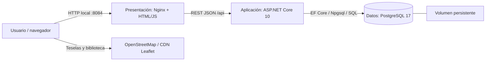
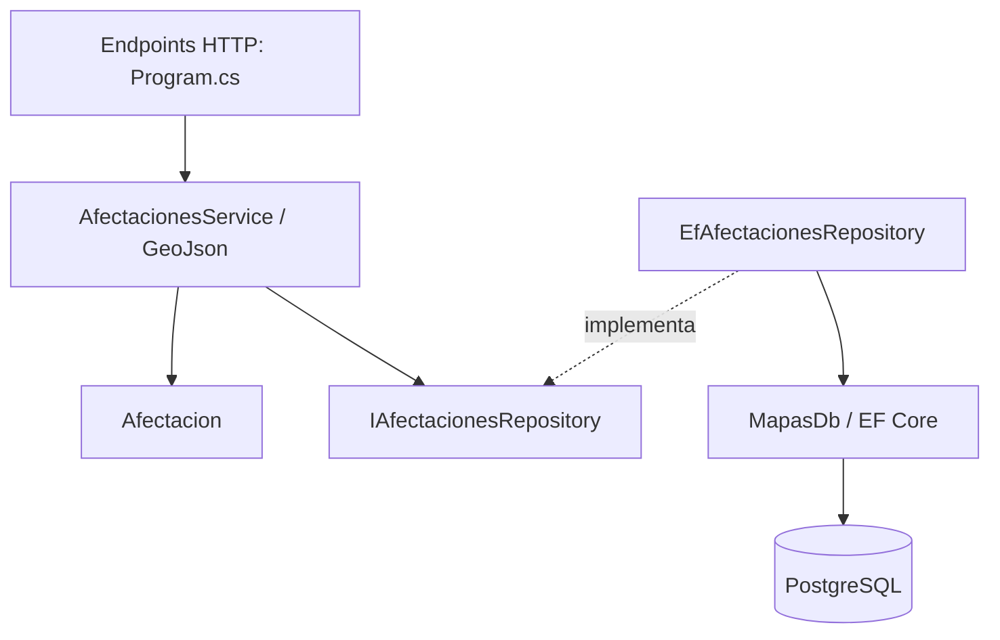
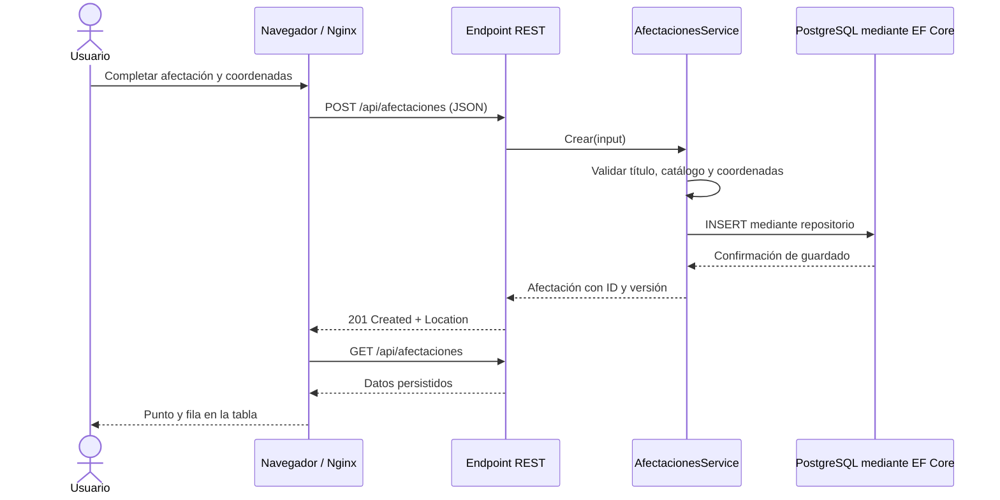

# Arquitectura y decisiones

## Problema y alcance

Un usuario necesita registrar la ubicación de una afectación y consultar su posición junto a otros eventos. El requisito mínimo observable del tablero es ubicar coordenadas en un mapa. Elegimos puntos WGS 84: delimitar áreas necesita geometrías, reglas y datos que no están especificados.

Este taller implementa un módulo geográfico del dominio de desastres. Los documentos del proyecto del semestre y los talleres Java aportan contexto, pero sus requisitos completos de alertas, recursos, reconstrucción y mensajería no se incorporan automáticamente a este enunciado.

## Tres niveles de ejecución

La presentación entrega archivos y reenvía `/api`. La API procesa casos de uso y controla la persistencia. PostgreSQL administra datos y transacciones. No se publican los puertos internos de API ni base de datos. El navegador usa el mismo origen para recursos y API, por lo que no requiere abrir CORS. Nginx vuelve a resolver el nombre de la API mediante el DNS de Docker para recuperarse cuando cambia su dirección interna.

Una **capa** organiza responsabilidades dentro del código. Un **nivel** corresponde a una unidad de ejecución. Hay tres niveles de ejecución aunque dos se comuniquen a través del mismo puerto público local. Los tres contenedores comparten un equipo en la demo; no ofrecen tolerancia a la pérdida de ese equipo.

## Componentes de la API

Las reglas y el contrato de persistencia están separados de EF Core mediante carpetas y espacios de nombres dentro de un proyecto. El repositorio tiene una interfaz porque constituye la frontera con almacenamiento; no se añadió un repositorio genérico que simplemente replique todo DbContext. La separación no está impuesta por referencias entre ensamblados: dividirla en proyectos sería una evolución si el módulo crece.

## Recorrido de registro

El marcador persistido se muestra después del guardado. El círculo discontinuo del formulario es una selección provisional y no se guarda al hacer clic en el mapa.

## Decisiones arquitectónicas

| Decisión | Motivo | Costo o límite |
|---|---|---|
| REST en lugar de gRPC | Consumo directo desde el navegador y demostración con herramientas HTTP | No hay streaming ni contrato protobuf |
| .NET 10 / ASP.NET Core | Implementa el contexto tecnológico del tablero | Requiere SDK o imagen de ejecución correspondiente |
| EF Core + LINQ | Mapeo, consultas parametrizadas, transacciones y concurrencia | Hay que revisar SQL y rendimiento al crecer |
| PostgreSQL separado | Hace explícito el tercer nivel y permite almacenamiento persistente compartido | Servicio adicional que operar |
| Leaflet con mapa OpenStreetMap | Marcadores y navegación sin desarrollar un motor cartográfico | Depende de servicios externos; sin garantía de disponibilidad |
| Puntos GeoJSON | Formato interoperable y mínimo suficiente para el requisito | No representa áreas afectadas |
| Guardado atómico por lote | Un punto inválido no deja una importación parcial | Límite de 500 puntos y 2 MiB |
| Concurrencia optimista con Guid | Detecta cambios desde una versión ya leída | El usuario debe recargar y repetir su edición |
| Inicialización EnsureCreated | Una única versión de esquema en una demo reproducible | No actualiza esquemas existentes; se necesitan migraciones para evolución |

ADO.NET es la interfaz de acceso a bases de datos sobre la cual trabaja Npgsql. EF Core es el ORM; LINQ expresa consultas que EF traduce a SQL. No se mezclan lecturas manuales ADO.NET con el repositorio EF porque no hay una necesidad que justifique dos caminos de acceso.

## Modelo e invariantes

`Afectacion`: ID Guid, título (3–120 caracteres sin espacios exteriores), tipo, severidad, descripción (hasta 2000), latitud, longitud, instante de registro UTC y versión Guid.

- Latitud obligatoria y finita entre -90 y 90. Longitud obligatoria y finita entre -180 y 180. Cero es un valor válido.
- Tipos: INUNDACION, INCENDIO, DESLIZAMIENTO, TERREMOTO, OTRO.
- Severidades: BAJA, MEDIA, ALTA, CRITICA.
- El ID, la versión y la fecha los controla el servidor. La fecha representa registro, no el momento real del desastre.
- La fecha se conserva al editar. La versión cambia en cada edición.
- Edición y eliminación requieren la versión leída. Si alguien ya cambió el registro, se responde 409. EF también comprueba la versión en el UPDATE/DELETE para cerrar la ventana entre leer y escribir.
- El contrato interno usa campos nombrados; solo el adaptador GeoJSON convierte a `[longitud, latitud]`. Leaflet recibe `[latitud, longitud]`.
- La importación valida todas las entidades antes de `SaveChanges`; EF guarda el conjunto en una transacción. La reimportación crea nuevas entidades, no se promete deduplicación.
- Las restricciones de rango geográfico también están en la base de datos. Las reglas de título y catálogos pertenecen al servicio.

## Atributos de calidad y evaluación

| Atributo | Escenario | Respuesta / evidencia |
|---|---|---|
| Integrabilidad | Un sistema envía un GeoJSON Point | Importa propiedades conocidas y respeta el orden del estándar; prueba de ida y vuelta |
| Integridad | Un lote tiene un punto fuera de rango | HTTP 400 con campos; cero puntos de ese lote guardados |
| Integridad concurrente | Dos usuarios editan la misma versión | Una edición gana; la otra recibe 409 |
| Persistencia | Se reinician API y PostgreSQL | El volumen conserva el registro; prueba separada de reinicio |
| Modificabilidad | Cambiar las consultas de almacenamiento | Implementación del repositorio aislada del adaptador HTTP |
| Usabilidad | El usuario no conoce las coordenadas | Un clic las completa; los datos también se gestionan desde la tabla |
| Manejo de fallos | API o base no disponibles | Error visible; no se anuncia guardado exitoso antes de confirmar |

Estos escenarios no equivalen a una evaluación ATAM completa ni a una prueba de carga. No se afirma un objetivo medido de latencia, número de usuarios o alta disponibilidad.

## Fallos y siguientes pasos justificados

Si PostgreSQL falla durante un guardado, la API devuelve un error sin anunciar éxito. Si la API pierde conectividad después del commit, el cliente podría no saber si el registro se guardó: recargar antes de reintentar. Un POST no tiene clave de idempotencia. Este límite y la importación aditiva están documentados.

Para una plataforma operativa serían necesarios: identidad y roles, TLS, gestión de secretos, auditoría, respaldos y prueba de recuperación, migraciones, paginación, observabilidad, proveedor cartográfico adecuado y un mecanismo de idempotencia. Se incorporan cuando el uso los exija; el taller no se presenta como una plataforma lista para emergencias reales.

## Fuentes técnicas consultadas

- Microsoft: [APIs mínimas con ASP.NET Core](https://github.com/dotnet/AspNetCore.Docs/blob/main/aspnetcore/tutorials/min-web-api.md).
- Proveedor oficial: [Npgsql.EntityFrameworkCore.PostgreSQL 10.0.3](https://www.nuget.org/packages/Npgsql.EntityFrameworkCore.PostgreSQL/10.0.3).
- Leaflet: [inicio rápido 1.9](https://leafletjs.com/examples-v1/quick-start/).
- Microsoft: [EF Core](https://github.com/dotnet/efcore/blob/main/README.md).
