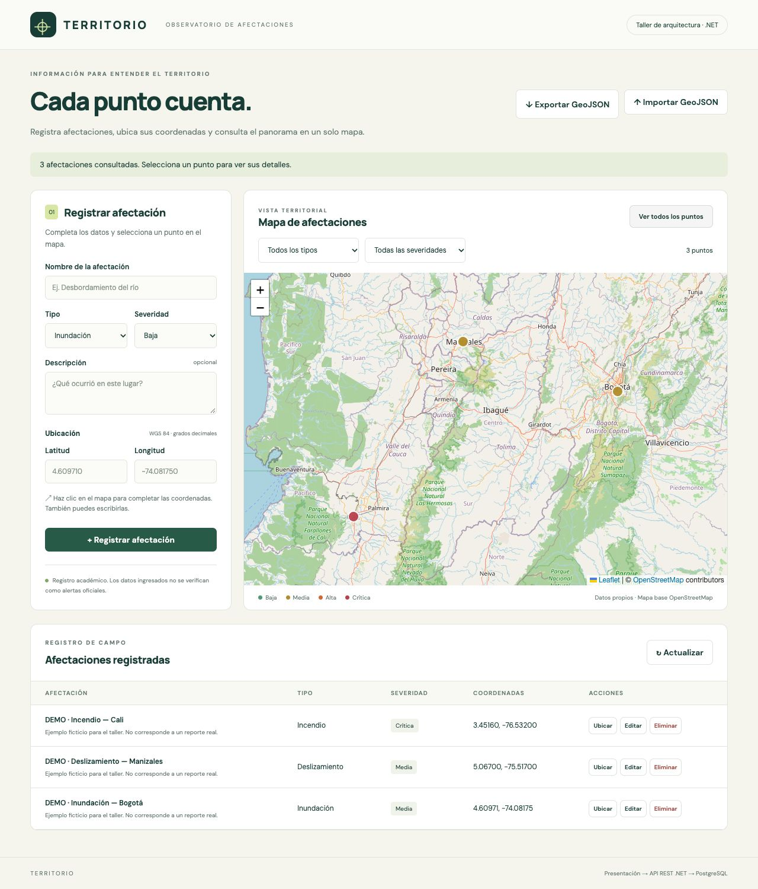

# Verificación de la entrega

Fecha: 3 de noviembre de 2026. Entorno: macOS Apple Silicon, Docker Desktop. Servicios reales: Nginx, ASP.NET Core 10 en Linux ARM64 y PostgreSQL 17. La API usa Npgsql.EntityFrameworkCore.PostgreSQL 10.0.3.

## Resultados

| Comprobación ejecutada | Resultado |
|---|---|
| Compilación Release del proyecto .NET | Sin errores ni advertencias |
| Construcción y publicación mediante Dockerfile | Correctas |
| Sintaxis JavaScript con `node --check` | Correcta |
| `test_01_salud_catalogos` | OK |
| `test_02_crud_filtros_version` | OK |
| `test_03_validacion_limites_y_ausencias` | OK |
| `test_04_geojson_orden_y_atomicidad` | OK |
| `test_05_geojson_malformado` | OK |
| `test_06_actualizacion_concurrente` | OK |
| Reinicio real de API y PostgreSQL, consulta y comparación del registro y versión | OK |
| Navegador: carga del mapa base y consulta inicial vacía | Correctas |
| Navegador: crear una afectación desde el formulario | Guardado confirmado y fila visible |
| Navegador: editar severidad y guardar | Cambio visible en la tabla |
| Navegador: filtrar por incendio y quitar filtro | 1 y 3 puntos respectivamente |
| Visualización de tres ejemplos ficticios | Marcadores y tabla visibles; captura incluida |

La suite HTTP final ejecutó 6 pruebas en 0,224 segundos y terminó en OK. Son seis métodos con varias comprobaciones y casos de límites, no una medición de rendimiento. La prueba de persistencia volvió a pasar tras la corrección de reconexión.

## Problemas detectados y corregidos

1. La precisión de fecha de .NET excedía la conservada por PostgreSQL. Se normalizó la fecha de registro a milisegundos para devolver el mismo valor en creación y consultas posteriores.
2. Nginx resolvía la dirección de la API solo al arrancar. Tras cambios o reinicios de contenedores podía conservar una dirección antigua y responder 502. Se configuró resolución DNS de Docker con actualización cada 5 segundos; se repitieron las pruebas funcionales y el reinicio sin reiniciar el servidor web.
3. La API espera conectividad con PostgreSQL antes de inicializar el esquema. Un error de esquema sigue siendo un error de arranque: no se oculta con reintentos infinitos.

## Datos y reproducción

Los datos creados por las pruebas se eliminaron al terminar. Quedaron tres registros explícitamente marcados DEMO, con descripciones que aclaran que no son reportes reales. Bogotá se creó y editó desde la interfaz; los otros dos se importaron mediante la API. En la ejecución actual Bogotá tiene severidad MEDIA como resultado de la prueba de edición. El archivo de ejemplo conserva ALTA como valor inicial.

Para repetir:

```sh
docker compose up --build -d
python3 scripts/verificar_api.py
python3 scripts/verificar_persistencia.py
```

La prueba de persistencia reinicia solo api y db de este proyecto, conserva volúmenes y limpia su registro temporal. Los otros registros se conservan.

## Límites de lo comprobado

No se realizaron pruebas de carga, auditoría de seguridad, recuperación tras pérdida del volumen, alta disponibilidad, navegación sin conexión, verificación en móviles reales ni integración con fuentes oficiales de desastres. El clic sobre el mapa, la descarga desde el botón Exportar y el selector de archivos Importar están implementados; no se automatizó su interacción en esta revisión. Los contratos de importación y exportación sí se probaron por HTTP con persistencia real.


